# Unira

[Vietnamese version](./README.md)

Unira is a system for detecting and merging duplicate customer records.

A customer may appear multiple times with different names, phone numbers, or addresses. A Steward uploads CSV files; Unira validates the data and identifies records that may belong to the same customer. The Steward reviews evidence and decides whether to merge them. Only after approval does the system create or update a Golden Record. Each session may contain multiple files and has separate results. Once a session is complete, the Steward downloads its clean CSV. Original records remain available for traceability and to undo mistaken merges.

**Workflow:** `Create session → Upload files → Validate and normalize → Match → Steward review → Merge → Verify results → Export CSV`.

## 1. Requirements — INVEST, use cases, and acceptance criteria

There are 15 user stories, 10 use cases, 18 business rules, and 17 acceptance criteria. The [English requirements](./docs/requirements/README.en.md) provide the complete list and test conditions.

### 1.1. Product mind map

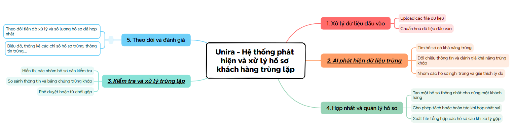

### 1.2. INVEST requirements

Stories are checked against INVEST so each requirement has a clear value and can be tested. The implementation may change while preserving the product goals and business rules.

| INVEST criterion | Application to Unira |
| --- | --- |
| Independent | Each requirement has a distinct outcome, even when it belongs to a larger workflow. |
| Negotiable | UI and implementation choices may change if session scoping and permission rules remain intact. |
| Valuable | Requirements help import, match, verify, or export clean customer data. |
| Estimable | The role, inputs, outputs, and failure cases are clear enough to estimate. |
| Small | User actions and background processing are separated when needed. |
| Testable | Acceptance criteria verify the outcome. |

| Story IDs | Scope |
| --- | --- |
| US14 | Sign-in and Steward/Viewer authorization. |
| US01–US04 | Create sessions, import multiple files, run AI, and track progress. |
| US05–US08 | View evidence, approve/reject proposals, and create Golden Records. |
| US09–US10 | Undo mistaken merges and search by session. |
| US11–US13 | Statistics and tracking of processing results and decisions. |
| US15 | Download the correct completed session's clean CSV. |

Every file, record, match result, review decision, Golden Record, and CSV in a session must share its `session_id`. Steward approval precedes merging; original records are retained for traceability and correction. See the [requirements, rules, and acceptance criteria](./docs/requirements/README.en.md).

### 1.3. Use cases

#### 1.3.1. Actors

| Actor | Responsibility |
| --- | --- |
| **Steward** | Create sessions, upload files, run matching, review results, manage records, and download clean CSV. |
| **Viewer** | View authorized sessions, search records, and view statistics. |

Files exported from a CRM or ERP are still uploaded by a Steward; those systems do not directly interact with Unira.

#### 1.3.2. Use-case overview

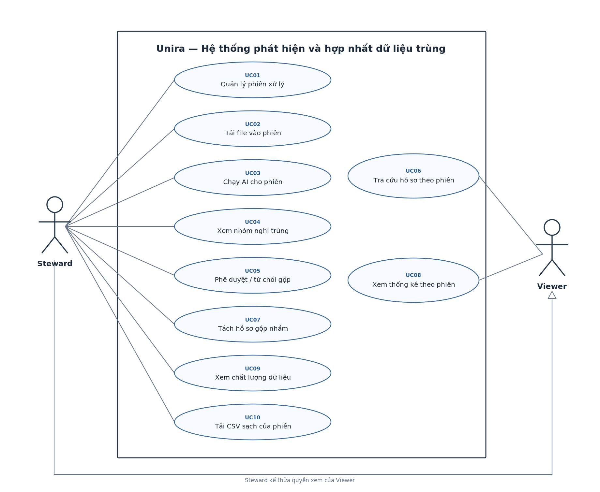

The [English PlantUML source](./docs/uml/usecase-overview.en.puml) uses English labels.

#### 1.3.3. Use-case list

| ID | Use case | Primary actor | Stories |
| --- | --- | --- | --- |
| UC01 | Manage processing sessions | Steward | US01, US04 |
| UC02 | Upload files to a session | Steward | US02, US12 |
| UC03 | Run matching for a session | Steward | US03, US04 |
| UC04 | View likely duplicate groups | Steward | US05 |
| UC05 | Approve or reject a merge | Steward | US06, US07, US08, US13 |
| UC06 | Search Golden Records | Steward, Viewer | US10 |
| UC07 | Undo a mistaken merge | Steward | US09 |
| UC08 | View statistics by session | Steward, Viewer | US11 |
| UC09 | View data quality | Steward | US12 |
| UC10 | Download a session's clean CSV | Steward | US15 |

US14, sign-in and authorization, is a shared precondition. The backend checks authorization for every action, even if its UI button is hidden.

#### 1.3.4. Key use-case specifications

**UC01 — Manage processing sessions**

- **Actor:** Steward.
- **Precondition:** Signed in and allowed to create sessions.
- **Main flow:** (1) Open the session list and choose **Create session** → (2) Enter a name and optional description → (3) The system validates the input, creates a `session_id`, and sets status `DRAFT` → (4) Open the new session's file-upload screen.
- **Alternative:** Reopen an existing session to view its status, input files, and results without changing its data.
- **Exception:** An empty name requires correction; insufficient permission returns `403` without creating a session.
- **Postcondition:** The new session has its own ID, creator, and status; no matching job or CSV exists yet.

**UC02 — Upload files to a session**

- **Actor:** Steward.
- **Precondition:** Authorized for a `DRAFT` or `READY` session whose input list has not been frozen.
- **Main flow:** (1) Select one or more CSV files → (2) Add optional origin labels → (3) Store each file under the correct `session_id` and validate CSV format, columns, and rows → (4) Show valid/error row counts and error details for each file.
- **Alternative:** Before matching, add or remove files and revalidate.
- **Exception:** Report a non-CSV or oversized file individually. After the session starts, reject additional files and keep the frozen list unchanged.
- **Postcondition:** Accepted files belong to one session. Raw records and validation results are retained; nothing has been merged.

**UC05 — Approve or reject a merge**

- **Actor:** Steward.
- **Precondition:** The session is `WAITING_REVIEW`; the group belongs to it and is `PENDING`.
- **Main flow:** (1) Inspect the group, records, and evidence → (2) Choose Golden Record values and confirm approval → (3) The backend checks permissions, locks the group, and rechecks its state → (4) Save the decision and enqueue merging → (5) The worker creates or updates a master, links records within the session, and updates progress.
- **Alternative:** Reject the proposal; save the decision without creating a merge link.
- **Exception:** Return `409` if the group was already resolved or the source data changed. Record merge failures so they can be retried safely.
- **Postcondition:** Each group has one effective decision. Only approved groups are merged; final CSV export waits until the entire session qualifies.

**UC10 — Download a session's clean CSV**

- **Actor:** Steward.
- **Precondition:** The session is `COMPLETED` and its current CSV is `READY`.
- **Main flow:** (1) Open session details and choose **Download clean CSV** → (2) The backend checks permissions, `session_id`, and file status → (3) Issue a time-limited download URL → (4) Download the CSV for that session.
- **Alternative:** Download the current export again without creating a file or job.
- **Exception:** Deny download if no CSV is `READY`, the session is regenerating after a split, or the user lacks permission. A Viewer receives `403`.
- **Postcondition:** The Steward receives the current file without changing session data, status, or matching history.

### 1.4. Roles and permissions

| Role | Allowed | Not allowed |
| --- | --- | --- |
| **Data Steward** | Create sessions, upload CSV, run matching, review results, manage and split records, and download clean CSV. | Edit or delete original files from the merge screen. |
| **Viewer** | View authorized sessions, processing results, and Golden Records within each session. | Upload files, run jobs, review, merge, or split records. |

Steward and Viewer are the only actors. A CRM/ERP name, when present, is an origin label. Workers, Splink, and LangGraph are internal. A **data source** is where a Steward obtained a file. A session is an independent batch of input files, matching, decisions, and export. A job is background work within a session.

## 2. Information architecture and screen hierarchy

Unira has **nine screens (P01–P09)**. A session may contain many files and likely duplicate groups, but has one result set and one current CSV. Modals and detail panels belong to their parent page.

### 2.1. Information architecture

#### 2.1.1. Page hierarchy

```text
P01 Login
└── P02 Overview
    ├── P03 Session list
    │   ├── P04 Create session / import files
    │   └── P05 Session details
    │       ├── P06 Session AI results
    │       │   └── P07 Verify likely duplicate group
    │       └── P08 Customer records (session selected)
    ├── P08 Customer records (select a session before searching)
    └── P09 Statistics
```

P04 is also reachable from P02, and P05 links back to P03. Navigation to P06–P08 always carries the selected session.

#### 2.1.2. Sections within each page

Each section is a content block. Its controls, forms, and feedback are described in the same row.

##### P01 — Login

| Section | Content and behavior |
| --- | --- |
| **Login form** | Email, password, and **Sign in** button; required-field and invalid-credential messages. |
| **Feedback and navigation** | Account-locked and session-expired messages; go to P02 after successful sign-in. |

##### P02 — Overview

| Section | Content and behavior |
| --- | --- |
| **Overall metrics** | Cards for **Total sessions**, **Running**, **Awaiting review**, **Completed**, and **Failed**, scoped by authorization. |
| **Recent sessions** | Table of 5–10 recent sessions with name, file and record counts, status, and time; select a name for P05. |
| **Work to review** | Sessions awaiting Steward verification or requiring error handling; **View session** action. |
| **Quick action** | **Create session** goes to P04 for a Steward; Viewers do not see it. |

##### P03 — Session list

| Section | Content and behavior |
| --- | --- |
| **Header** | Page title, total count, and Steward **Create session** action to P04. |
| **Search and filters** | Search by session name/ID; filter by status, creator, and date range; **Clear filters** action. |
| **Session table** | Columns: **Session ID, Name, File count, Record count, Progress, Status, Created date, CSV**. Selecting a row opens P05. |
| **Pagination and states** | Server-side pages and page size; empty and load-error messages. |

##### P04 — Create session / import files

| Section | Content and behavior |
| --- | --- |
| **Session information** | Required **Name**, optional **Description**, creator; creation generates an ID and `DRAFT` status. |
| **Upload multiple files** | Select/drop multiple **CSV files**; show names, sizes, Steward-entered origin labels, and a remove action before processing. Reject a non-CSV file immediately. |
| **Data validation** | Preview rows and columns; per-file valid/error counts, missing-column and format messages, and error details. |
| **Actions** | **Save session**, **Start AI processing** (enabled only with a valid file), **Cancel/Back**. Starting freezes the file list and opens P05. |

##### P05 — Session details

| Section | Content and behavior |
| --- | --- |
| **Header** | Session ID, name, description, creator, date, and status; back to P03. |
| **Progress** | **Import → Normalize → AI matching → Await review → Merge → Export CSV**, plus errors. |
| **Input files** | All session files with names, origin labels, valid/error counts, and upload time; open error details. Before the run, **Add file** returns to P04 and **Start AI** begins matching. |
| **AI results** | Cards for **Records, Likely duplicate groups, Approved, Rejected, Awaiting review**; open P06. |
| **Golden Records** | Customer count after processing; open P08 for the selected session. |
| **Clean CSV** | Filename, row count, export time, status; **Download clean CSV** is enabled only when the session is `COMPLETED` and the file is `READY`. |
| **Session timeline** | Start time, latest status update, and processing outcome. |

##### P06 — Session AI results

| Section | Content and behavior |
| --- | --- |
| **Session context** | Persistent name/ID, status, group count, and link back to P05. |
| **Filters** | **Pending / Approved / Rejected**, search by name/phone/record ID, and sort by match score. |
| **Likely duplicate groups** | Group ID, member count, confidence, matching signals, conflicts, and status; select a group for P07. |
| **Summary** | Groups requiring review and related record count, without groups from other sessions. |

##### P07 — Verify a likely duplicate group

| Section | Content and behavior |
| --- | --- |
| **Group details** | Group ID, session, record count, AI score, and conflict warnings. |
| **Record comparison** | Side-by-side names, emails, phones, addresses, and source labels; highlight matching and differing values. |
| **AI evidence** | Reasons supporting and opposing a match, not just one probability. |
| **Proposed Golden Record** | Select a **value and source** for each name, email, phone, and address field; preview the result. |
| **Decision** | **Approve merge**, **Reject**, reason field, confirmation dialog, and progress after approval. |

##### P08 — Customer records

| Section | Content and behavior |
| --- | --- |
| **Session selection and search** | **Select a session first**; search by master ID, name, email, or phone without mixing sessions. |
| **Record list** | Master ID, name, contact, source-record count, status, and server-side pagination. |
| **Record details** | Golden Record values, linked original records, and the source of each field. |
| **Split records** | Steward-only **Split** action, mistaken-record selection, reason, confirmation, and notice that CSV must be regenerated. |

##### P09 — Statistics

| Section | Content and behavior |
| --- | --- |
| **Session filter** | Choose **All sessions** or one session; show the metric scope and date range. |
| **Processing metrics** | Charts for imported, valid/error, and merged records, likely duplicate groups, customers after merging, and CSV exports. |
| **Performance** | Per-session step times, candidate-pair count, run duration, RAM, and CPU. |
| **Data quality** | Valid/error rate and resolved duplicate count by session; no model comparison. |

### 2.2. Screen hierarchy

#### 2.2.1. Screen inventory

| ID | Page | Display form | Roles | Related stories |
| --- | --- | --- | --- | --- |
| P01 | Login | Form page | Steward, Viewer | US14 |
| P02 | Overview | Dashboard | Steward, Viewer | US04, US11 |
| P03 | Session list | List page | Steward, Viewer | US01, US04 |
| P04 | Create session / import files | Form and file upload | Steward | US01–US03, US12 |
| P05 | Session details | Details and progress | Steward, Viewer | US04, US11, US15 |
| P06 | Session AI results | List page | Steward | US05, US13 |
| P07 | Verify likely duplicate group | Comparison and approval | Steward | US05–US08, US13 |
| P08 | Customer records | List and detail panel | Steward, Viewer | US09, US10 |
| P09 | Statistics | Charts and reports | Steward, Viewer | US11, US12 |

Viewers see only authorized sessions. Creating sessions, uploading, running matching, reviewing/splitting, and downloading CSV are Steward actions.

#### 2.2.2. Main navigation flows

**Flow A — Create a session and export clean data**

```text
P01 Login → P02 Overview → P03 Session list
  → P04 Create session, upload one or more CSV files, inspect per-file errors
  → Start matching → P05 Track session progress
  → P06 View likely duplicate groups → P07 Verify and approve/reject
  → P05 View results and download the current CSV when session COMPLETED and file READY
```

**Flow B — Search and correct a mistaken merge**

```text
P03 Session list → P05 Session details → P08 Session records
  → Inspect original records and field sources
  → [Steward: split mistaken merge] → Old CSV download disabled
  → System revalidates and creates a new CSV → P05 Download current CSV
```

**Flow C — View data and statistics**

```text
P01 Login → P02 Overview
  ├── P03 Session list → P05 Session details
  ├── P08 Select session → Search customer records
  └── P09 Select all sessions or one session → View statistics
```

Each query flow retains its `session_id`. Switching from A to B must also switch the displayed groups, records, and CSV; cached results from A must not reappear.

### 2.3. UI/UX mockups

The nine images below illustrate P01–P09. They are demo screenshots with Vietnamese interface text and are stored in [docs/ui-ux](./docs/ui-ux/README.en.md).

#### P01 — Login

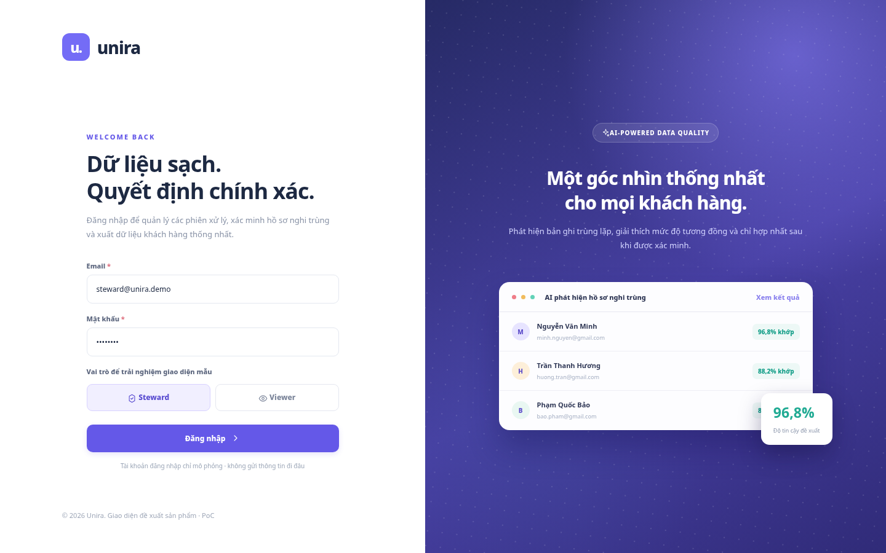

#### P02 — Overview

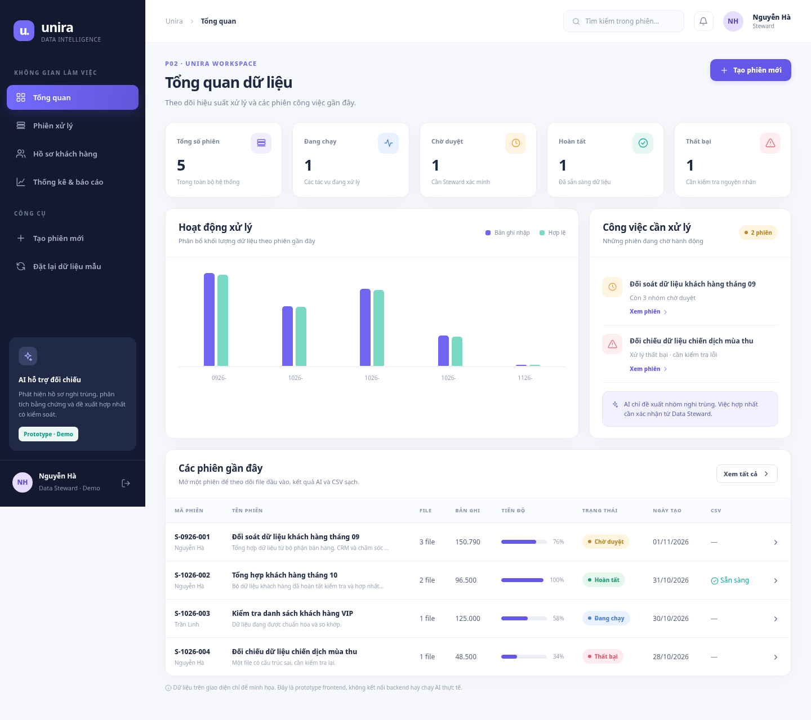

#### P03 — Session list

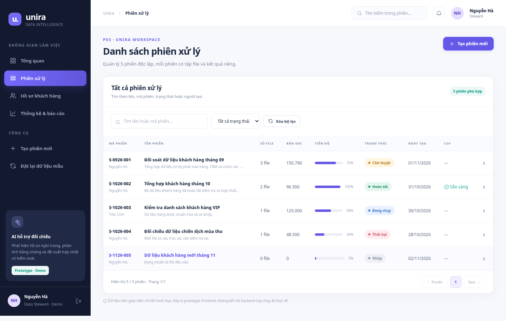

#### P04 — Create session / import CSV

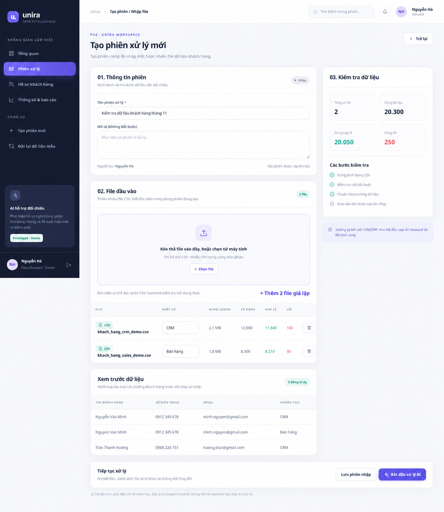

#### P05 — Session details

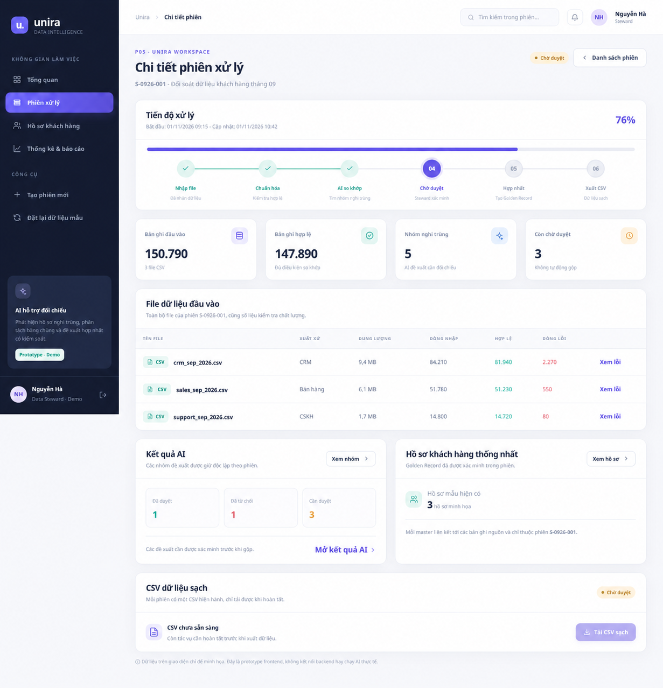

#### P06 — AI results

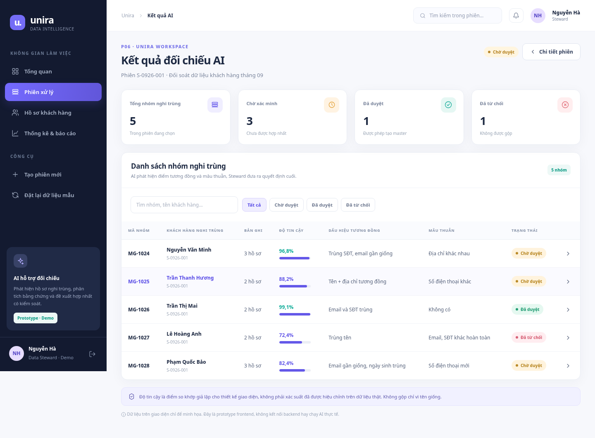

#### P07 — Verify group

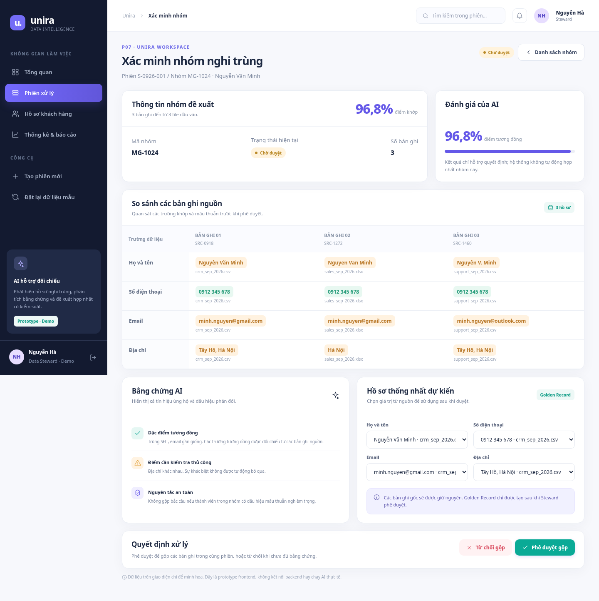

#### P08 — Customer records

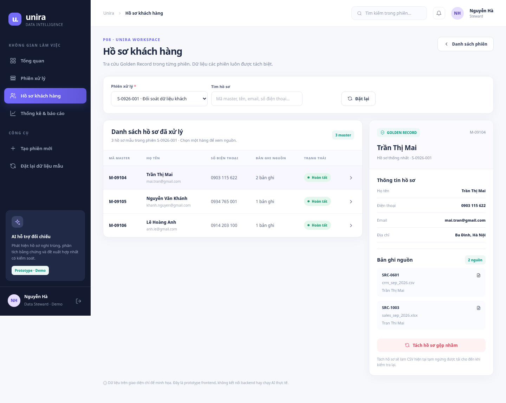

#### P09 — Statistics

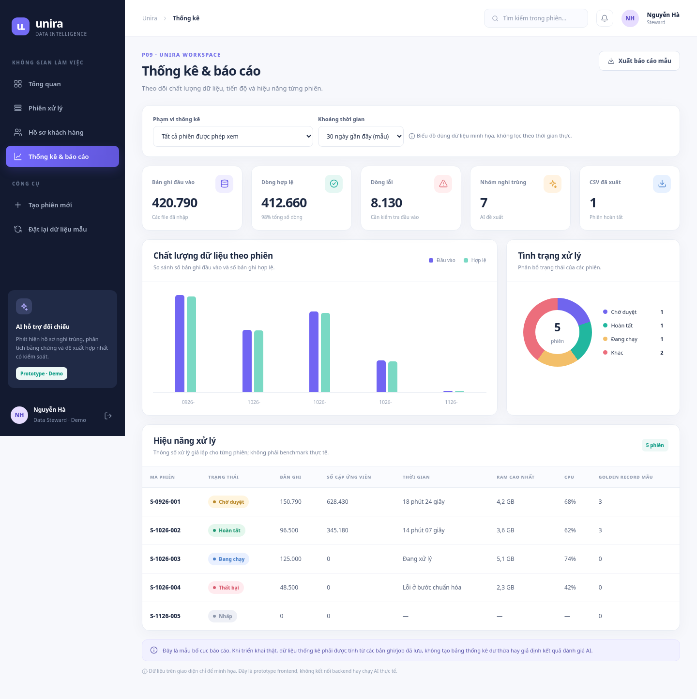

### 2.4. UI states and principles

- **Session states:** `DRAFT`, `READY`, `QUEUED`, `RUNNING`, `WAITING_REVIEW`, `MERGING`, `EXPORTING`, `COMPLETED`, `FAILED`, and `REVALIDATING` after a post-export split.
- **Concurrent sessions:** Status, progress, and notifications always identify the session. Switching sessions must not show stale cached results. Lists have server-side filters and pagination.
- **Conditional actions:** Do not run a session without a valid file, add files after the run begins, review a resolved group again, or download a current CSV before `COMPLETED`.
- **Clarity:** Buttons have action labels; empty, error, and loading states are distinct. Approval shows affected record counts, merge reasons, and mistaken-merge risk.
- **Permissions:** Viewers have read-only access to authorized data; the backend enforces authorization. Large lists use server-side search, filters, and pagination rather than sending millions of rows to the browser.

## 3. System architecture (C4)

### C1 — System context

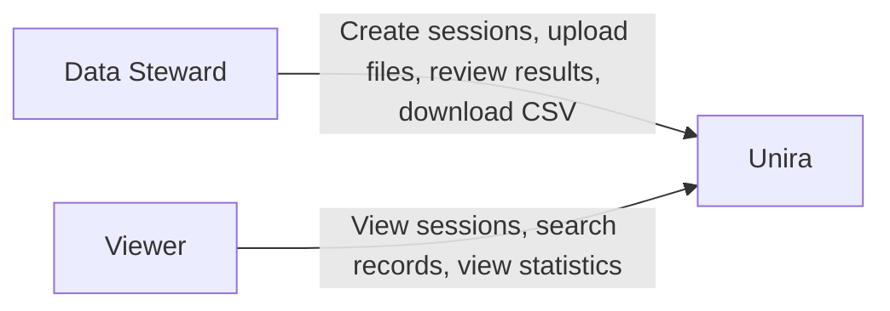

In this PoC, a Steward can create multiple sessions and upload one or more files to each. A file may come from a CRM, ERP, or department, but Unira accepts only Steward uploads and does not connect or write back to those sources. Origin labels provide traceability.

### C2 — Containers

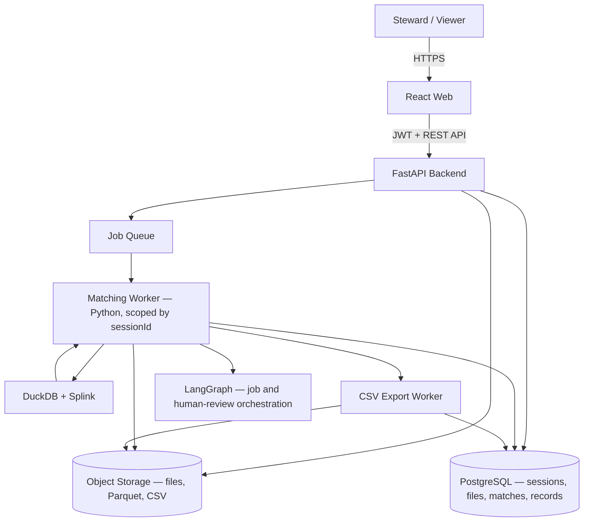

- **React** displays data and collects user actions; large tables use server-side search and pagination.
- **FastAPI** authenticates and authorizes, manages sessions, files, jobs, proposals, and records by `session_id`, and exposes a REST API.
- **Matching Worker** reads a session's frozen files, normalizes data, applies blocking and Splink, checks likely duplicate groups, and stores proposals. It runs separately from the API and limits concurrency.
- **DuckDB and Parquet** support batch processing. The **CSV Export Worker** writes one row per verified customer. **PostgreSQL** stores session state, review decisions, record links, and export metadata.
- **LangGraph** may orchestrate stages and pauses for Steward review. It does not invoke an LLM for every record pair. If the workflow is simple, a queue and job states may suffice.
- **Embedding/LLM** is reserved for difficult cases that need more evidence. Usage and cost must be bounded. An LLM never makes the merge decision automatically.

### C3 — Backend components

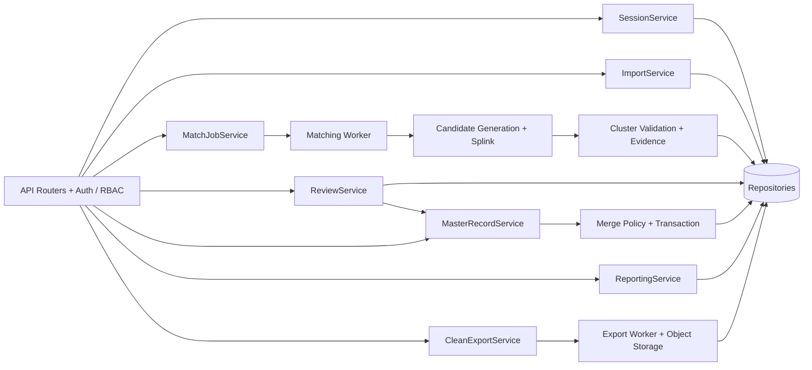

Matching produces proposals only. After Steward approval, `MergeService` rechecks status, locks related groups and links, and updates them in one transaction. Failure rolls back the transaction; retries do not create duplicates.

The [nine-step processing workflow](./docs/architecture/processing-workflow.en.md) covers session creation through CSV regeneration after a split.

The [detailed AI matching design](./docs/architecture/ai-matching-workflow.en.md) explains normalization, blocking, Splink scoring, group review, and validation step by step.

## 4. Database and API contract

The data model and API contract below are proposed designs. This repository does not yet contain migrations or a running backend.

### 4.1. Data model

The [DBML](./docs/schema.en.dbml) lists tables, columns, and relationships. Large data may also be stored in Parquet or object storage, as shown in C2.

| Area | Main tables | Purpose |
| --- | --- | --- |
| Accounts | `users` | Steward/Viewer roles. |
| **Sessions** | **`processing_sessions`** | Independent status, creator, configuration, and progress. |
| Imported files | `import_batches`, `source_records` | **One session to many files**, and each file's rows. |
| Matching | `match_jobs`, `match_candidates`, `match_groups`, `group_members` | Session-scoped jobs, candidate pairs, and likely duplicate groups. |
| Human review | `review_decisions` | Decision, evidence, and reviewer. |
| Golden Records | `master_records`, `master_links` | Session-scoped masters, original-record links, and split support. |
| **Export** | **`clean_exports`** | One current clean CSV per session. |

`processing_sessions.id` defines the session boundary. Imported files, matching jobs, Golden Records, and CSV exports reference it through `session_id`. Files from the same session can be matched; files from different sessions cannot be mixed. `source_records` retains original rows.

`UNIQUE(session_id)` in `clean_exports` allows only one current CSV per session. After a split, the old file cannot be downloaded until the new file is ready. A source record has at most one `ACTIVE` `master_links` entry. The backend must also verify that sources and masters belong to the same session; foreign keys alone are insufficient.

The consolidated ERD has 12 tables and 19 foreign-key relationships. It shows key columns; the [DBML](./docs/schema.en.dbml) has the full model.

[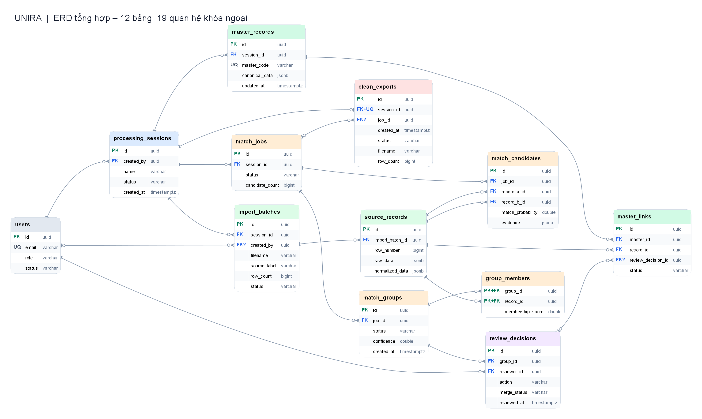](./docs/erd/erd-tong-the.svg)

### 4.2. OpenAPI 3.0 specification

The [English OpenAPI file](./docs/api/openapi.en.yaml) defines endpoints, request and response data, permissions, and error codes. Endpoints have the `/api/v1` prefix.

| Area | Main API paths | Screens |
| --- | --- | --- |
| Authentication | `POST /auth/login`, `GET /me` | P01 |
| **Sessions** | **`GET /sessions`, `POST /sessions`, `GET /sessions/{sessionId}`** | P02–P05 |
| **Session files** | **`POST /sessions/{sessionId}/imports`, `GET /sessions/{sessionId}/imports`, `GET /sessions/{sessionId}/imports/{batchId}`** | P04–P05 |
| **Session AI** | **`POST /sessions/{sessionId}/match-jobs`, `GET /sessions/{sessionId}/match-jobs`**, `GET /match-jobs/{jobId}` | P05 |
| AI proposals | `GET /match-groups?sessionId=...`, `GET /match-groups/{groupId}` | P06–P07 |
| Review | `POST /match-groups/{groupId}/decisions` | P07 |
| Golden Records | `GET /master-records?sessionId=...`, `GET /master-records/{masterId}`, `POST /master-records/{masterId}/undo` | P08 |
| **Session CSV** | **`GET /sessions/{sessionId}/exports`, `GET /sessions/{sessionId}/exports/{exportId}/download`** | P05 |
| Statistics | `GET /dashboard?sessionId=...` | P02/P09 |

`POST /sessions` creates a `DRAFT` session. A Steward may call `POST /sessions/{sessionId}/imports` repeatedly. `POST /sessions/{sessionId}/match-jobs` freezes the input file list and returns `202 Accepted` with a `jobId`. APIs check authorization and that every file, job, record, and CSV belongs to the requested session. Return `409` when a session or group state has changed and an action can no longer proceed.

The output CSV uses UTF-8 with columns `master_id,full_name,phone,email,address,origin_labels,source_record_count`. `origin_labels` contains Steward-entered source labels. Each valid customer, including a nonduplicate, appears exactly once. Only Stewards may download a current `READY` CSV through a time-limited URL. After a split, the system regenerates the CSV before downloads resume.

## 5. Frontend and backend folder structure

### 5.1. Current structure

```text
Unira/
├── README.md, README.en.md
└── docs/
    ├── mindmap.png
    ├── schema.dbml, schema.en.dbml
    ├── requirements/README.md, README.en.md
    ├── architecture/processing-workflow.*, ai-matching-workflow.*
    ├── ui-ux/README.md, README.en.md, P01–P09 images
    ├── uml/usecase-overview.puml, usecase-overview.en.puml, .svg, .png
    ├── erd/README.md, README.en.md, build_erd.py, erd-tong-the.*
    └── api/openapi.yaml, openapi.en.yaml
```

The repository currently contains documentation and diagrams. The frontend and backend structures below are targets for implementation.

### 5.2. Proposed frontend structure

```text
frontend/
└── src/
    ├── app/           # Routing, authentication, layout
    ├── pages/         # P01–P09, session list, session details
    ├── features/      # Sessions, imports, matching, review, masters, exports
    ├── components/    # Tables, evidence comparison, confirmation dialogs
    └── api/           # HTTP client and DTOs
```

Frontend call flow: `Page → Feature → API client → REST API`.

### 5.3. Proposed backend structure

```text
backend/
├── app/
│   ├── api/           # Routers and validation
│   ├── auth/          # JWT and RBAC
│   ├── services/      # Session, import, matching, review, master, export
│   ├── repositories/  # PostgreSQL
│   ├── matching/      # Blocking, Splink, grouping, evidence
│   ├── workflows/     # Session-scoped state machine / LangGraph
│   ├── workers/       # Batch processing, CSV export, retry
│   └── models/        # Database and request/response schemas
├── migrations/
├── tests/             # Unit, API, ML evaluation, performance
└── scripts/           # Data generation and benchmarking

infra/                 # Docker Compose and storage
```

Backend flow: `API router → service/workflow → repository → PostgreSQL or object storage`.

## 6. Class design and processing flows

These diagrams show how C3 components collaborate and how data moves through each stage. They describe a design, not implemented code.

### 6.1. C4 Level 4 — Code collaboration

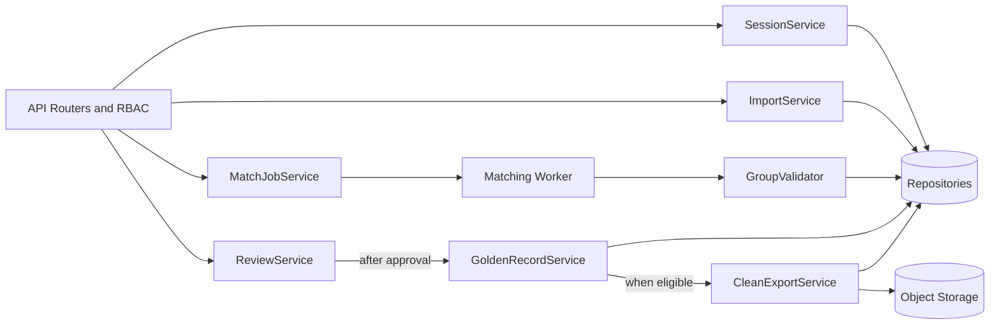

| Component | Responsibility |
| --- | --- |
| `SessionService` | Create and look up sessions; manage state and frozen file lists. |
| `ImportService` | Receive files, validate structure, create batches, and normalize data. |
| `MatchJobService` | Create a job from a session's files, dispatch a worker, and track progress. |
| `CandidateGenerator` | Use blocking to select record pairs for comparison. |
| `ProbabilisticMatcher` | Use Splink to score pairs and retain matching evidence. |
| `GroupValidator` | Group pairs and detect conflicts. |
| `ReviewService` | Display evidence, save Steward decisions, and check group state. |
| `GoldenRecordService` | Create or update a Golden Record and its source links after approval. |
| `SplitRecordService` | Undo incorrect links, revalidate the record, and regenerate CSV. |
| `CleanExportService` | Export CSV when the session qualifies, verify row count, and provide a download URL. |

### 6.2. Core class diagram

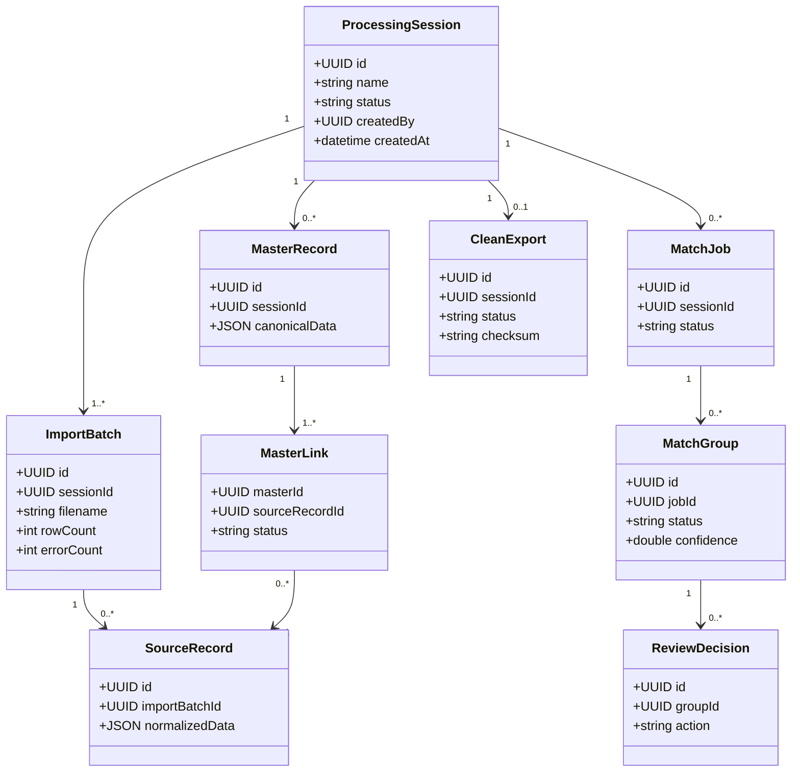

Linked `SourceRecord` and `MasterRecord` instances must share a `session_id`. `ReviewDecision` history may be retained, but only one decision per group is effective at a time.

### 6.3. Sequence diagrams

The sequences cover upload, matching, review, splitting, and session-specific CSV export.

#### Create a session, upload files, and run matching

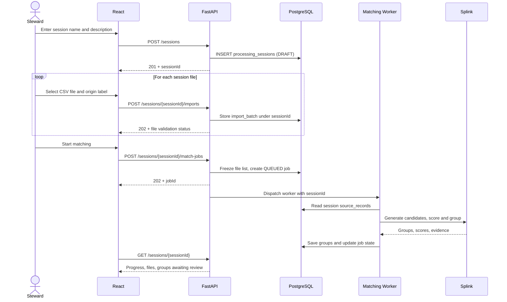

#### Review, merge, and export a session's CSV

```mermaid
sequenceDiagram
    actor S as Steward
    participant UI as React
    participant API as FastAPI
    participant R as ReviewService
    participant M as GoldenRecordService
    participant DB as PostgreSQL
    participant E as CleanExportService
    S->>UI: Open session A and a likely duplicate group
    UI->>API: GET /match-groups/{groupId}
    API->>DB: Verify group belongs to session A
    API-->>UI: Evidence and source data
    S->>UI: Approve or reject
    UI->>API: POST /match-groups/{groupId}/decisions
    API->>R: Lock group and verify PENDING state
    alt Reject
        R->>DB: Store review_decisions(REJECTED)
    else Approve
        R->>DB: Store APPROVED and enqueue merge
        R->>M: Merge only session A sources
        M->>DB: Update masters, links, and decision in one transaction
        M->>DB: Check constraints and COMMIT
    end
    opt All session A groups resolved
        M->>E: Validate and create masters for nonduplicates
        E->>DB: Read only session A masters
        E->>E: Stream CSV; check row count and checksum
        E->>DB: Set clean_exports READY and session A COMPLETED
    end
    S->>UI: Download clean CSV for session A at P05
    UI->>API: GET /sessions/{sessionId}/exports/{exportId}/download
    API-->>UI: URL for session A after authorization check
```

#### Undo a mistaken merge

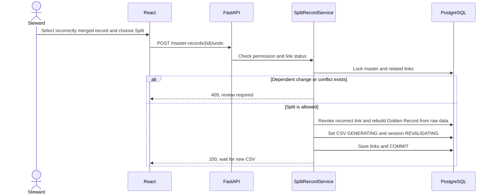

#### Create and download a session-specific CSV

```mermaid
sequenceDiagram
    participant W as Workflow Worker
    participant DB as PostgreSQL
    participant E as CleanExportService
    participant O as Object Storage
    actor S as Steward
    participant API as FastAPI
    W->>DB: Validate groups and merges within sessionId
    alt Unresolved group or failed merge
        DB-->>W: Export conditions not met
        W->>DB: WAITING_REVIEW / FAILED; do not publish CSV
    else All conditions met
        W->>DB: Freeze sessionId master snapshot
        W->>DB: Set session EXPORTING
        W->>E: Generate current CSV idempotently
        E->>O: Stream CSV scoped to sessionId
        E->>E: Validate row count, masterId, and checksum
        E->>DB: Set clean_export READY and session COMPLETED
        S->>API: GET /sessions/{sessionId}/exports
        API-->>S: Session CSV information
        S->>API: GET /sessions/{sessionId}/exports/{exportId}/download
        API-->>S: 302, time-limited URL after authorization
    end
```
