# Unira

Unira helps identify and merge duplicate customer records in CSV files. A Data Steward uploads the files, reviews possible matches, and decides whether to merge them. Each processing session has its own results and clean export file.

## 1. Requirements - INVEST, Use Cases, and Acceptance Criteria

This section describes what Unira needs to do, who uses it, and how to verify the outcomes. A **User Story (US)** describes a user's need; a **Use Case (UC)** describes an interaction with the system; and **Acceptance Criteria (AC)** define how to check the result.

### 1.1. Product Mind Map

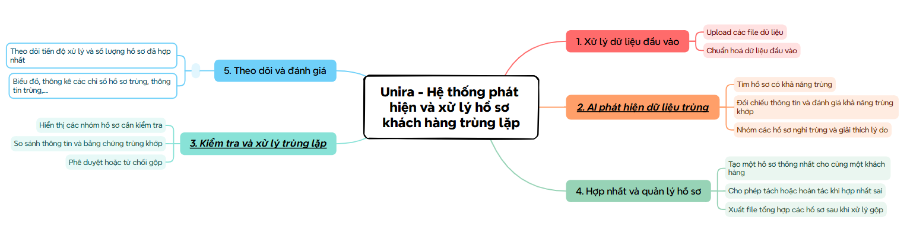

| Feature area | Purpose |
| --- | --- |
| Processing sessions | Keep each batch of work in a separate session with its own files and results. |
| Data import | Upload multiple CSV files, preview their contents, and identify errors in each file. |
| Duplicate detection | Suggest groups of records that may belong to the same customer. |
| Review | Let a Data Steward inspect the reasons for a match and decide whether to merge the records. |
| Customer records | Search the results, view the original data, and correct mistaken merges. |
| Clean exports and statistics | Download the result of each session and track processing progress. |

### 1.2. INVEST Requirements

#### 1.2.1. INVEST Principles

| Principle | Meaning |
| --- | --- |
| **Independent** | Each need has its own outcome and depends on another step only when necessary. |
| **Negotiable** | Presentation and implementation may change while the goal and access rules remain in place. |
| **Valuable** | Each need helps import, check, merge, or export data. |
| **Estimable** | The actor, input, output, and error cases are clear enough to estimate the work. |
| **Small** | Larger tasks are divided into steps that can be completed separately. |
| **Testable** | Each need has an observable result. |

#### 1.2.2. User Stories

| ID | Role | User story |
| --- | --- | --- |
| US01 | Steward | I want to create, name, and manage each processing session. |
| US02 | Steward | I want to add multiple CSV files to a session and see errors for each file. |
| US03 | Steward | I want to preview the data and then run duplicate detection for the selected session. |
| US04 | Steward | I want to track the status and progress of each session. |
| US05 | Steward | I want to see possible duplicate groups and the reasons behind each suggestion in the correct session. |
| US06 | Steward | I want to approve or reject a proposed merge for each group. |
| US07 | Steward | I want to choose the values for the unified customer record before approving a merge. |
| US08 | Steward | I want the system to create the unified customer record after I approve the merge. |
| US09 | Steward | I want to split records that were merged by mistake without losing the original data. |
| US10 | Steward, Viewer | I want to search processed customer records by session. |
| US11 | Steward, Viewer | I want to see overall statistics and the results for each session. |
| US12 | Steward | I want to know how many valid and invalid rows each session has and how processing turned out. |
| US13 | Steward | I want to know which groups were approved or rejected and who made each decision. |
| US14 | Steward, Viewer | I want to sign in and use only the functions allowed for my role. |
| US15 | Steward | I want to download the clean CSV for a completed session without getting a file from another session. |

#### 1.2.3. INVEST Review by Story Group

| Group | Necessary dependency | What can change | Value | How to split and verify the work |
| --- | --- | --- | --- | --- |
| **US01–US04** Sessions and files | Sign in before creating a session | Form layout and progress display | Handle multiple files in one processing batch | Separate session creation, file import, and matching; check errors per file. |
| **US05–US08** Review | Matching results must be available | How records and reasons are compared and displayed | Avoid merging different customers | Separate viewing groups, making decisions, and creating unified records; merge only approved groups. |
| **US09–US10** Records | Processed records must be available | Filters and detail layout | Search records and correct mistakes | Verify that splitting a record preserves the original data. |
| **US11–US13** Monitoring | Session data must be available | Chart presentation | See progress and who made each decision | Verify session-specific statistics and decision history. |
| **US14–US15** Access and exports | Sign-in and a completed session are required | Messages and export filename | Restrict access and deliver the correct result | Verify that Viewers cannot download files and that sessions do not share results. |

#### 1.2.4. Business Rules

| ID | Rule |
| --- | --- |
| BR01 | A Data Steward can create multiple sessions, each with its own progress. |
| BR02 | A session can accept multiple CSV files and report errors for each file. |
| BR03 | A file belongs to one session only; data from different sessions is not mixed. |
| BR04 | Once matching starts, the session's file list cannot be changed. |
| BR05 | The original data is retained along with the file validation results. |
| BR06 | The system compares only records that may be related to reduce processing time. |
| BR07 | A possible match must include a reason; matching names alone is not enough for an automatic merge. |
| BR08 | A Data Steward must approve records before they are merged. |
| BR09 | A group that has already been processed cannot be approved again. |
| BR10 | A unified record contains data from one session only. |
| BR11 | An original record cannot be linked to two currently active unified records. |
| BR12 | The clean export is created only after every group requiring review has been processed. |
| BR13 | Each valid customer appears once in the session's clean export. |
| BR14 | Each session has one current clean export. |
| BR15 | After an incorrect merge is split, the old export is unavailable for download until the new one is ready. |
| BR16 | Every view, edit, and download operation must check access to the requested session. |
| BR17 | Sessions can be processed independently, and progress is saved for each one. |
| BR18 | Approvals and rejections are recorded for later review. |

#### 1.2.5. Acceptance Criteria

| ID | Verification condition |
| --- | --- |
| AC01 | Creating two sessions gives each its own name, status, and detail page. |
| AC02 | A session accepts at least two files and shows valid and invalid row counts for each. |
| AC03 | Files in the wrong format are rejected; data errors identify the location that needs correction. |
| AC04 | The session list shows the correct status, progress, and imported files. |
| AC05 | Possible duplicate groups from session A do not appear in session B; every suggestion includes a reason. |
| AC06 | Only a Data Steward can approve a merge; a group with a decision cannot be approved again. |
| AC07 | Approval creates a unified record; rejection keeps the records separate. |
| AC08 | The unified record provides access to its original data and sources. |
| AC09 | Splitting an incorrect merge preserves the original data and regenerates the result. |
| AC10 | A session is completed only when its groups have been processed and its clean export is ready. |
| AC11 | Session A's clean export does not contain data that belongs only to session B. |
| AC12 | The clean export preserves Vietnamese text and the correct row count after processing. |
| AC13 | Downloading the current export again does not create a new session or export file. |
| AC14 | After records are split, the old export remains unavailable until the new export is complete. |
| AC15 | The overview shows counts of running, awaiting-review, completed, and failed sessions. |
| AC16 | Session statistics show valid rows, invalid rows, and processed groups. |
| AC17 | Performance reporting uses measured time and resource usage rather than estimates. |

### 1.3. Use Cases

#### 1.3.1. Actors

| Actor | Role |
| --- | --- |
| **Data Steward** | Creates sessions, imports files, reviews results, corrects mistaken merges, and downloads clean exports. |
| **Viewer** | Views sessions, customer records, and statistics they are authorized to access. |

#### 1.3.2. Use Case Overview Diagram

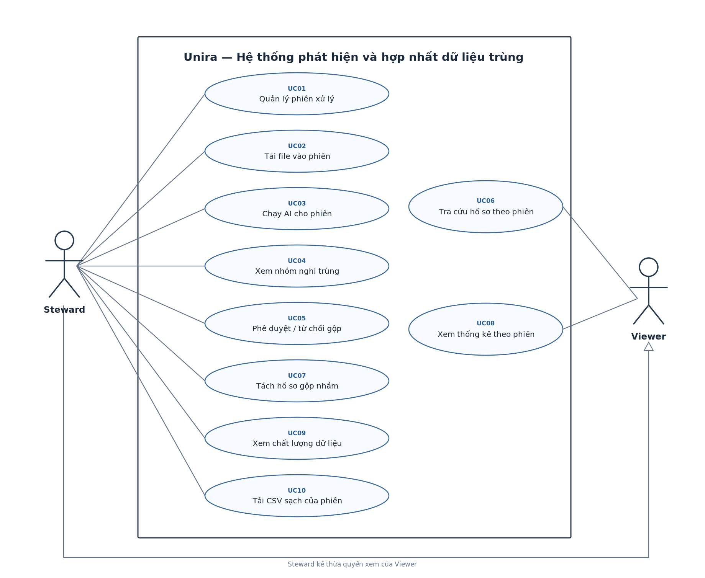

#### 1.3.3. Use Case List

| ID | Use case | Primary actor | Related user stories |
| --- | --- | --- | --- |
| UC01 | Manage processing sessions | Steward | US01, US04 |
| UC02 | Upload files to a session | Steward | US02, US12 |
| UC03 | Run matching for a session | Steward | US03, US04 |
| UC04 | View possible duplicate groups | Steward | US05 |
| UC05 | Approve or reject a merge | Steward | US06, US07, US08, US13 |
| UC06 | Search unified customer records | Steward, Viewer | US10 |
| UC07 | Split an incorrect merge | Steward | US09 |
| UC08 | View session statistics | Steward, Viewer | US11 |
| UC09 | View data quality | Steward | US12 |
| UC10 | Download a session's clean CSV | Steward | US15 |

Sign-in and permission checks are common prerequisites for these actions.

#### 1.3.4. Key Use Case Specifications

**UC01 – Manage processing sessions**

- **Actor:** Data Steward.
- **Precondition:** The Steward is signed in and allowed to create sessions.
- **Main flow:** Open the session list → name a new session → save it → open the file import page.
- **Alternative flow:** Reopen an existing session to check its progress.
- **Postcondition:** The session has its own file list and results; matching has not started yet.

**UC02 – Import files into a session**

- **Actor:** Data Steward.
- **Precondition:** Processing has not started for the session.
- **Main flow:** Select one or more CSV files → review validation results for each file → correct or remove invalid files → start matching when at least one valid file is available.
- **Error case:** Files in the wrong format or missing required data are reported clearly; no files can be added after the session starts processing.
- **Postcondition:** Valid files are attached to the correct session, and the original data is retained.

**UC05 – Approve or reject a merge**

- **Actor:** Data Steward.
- **Precondition:** The session has an unprocessed possible duplicate group.
- **Main flow:** Open the group → compare records and the suggested reasons → choose to merge or keep them separate → confirm the decision.
- **Error case:** If the group already has a decision, the system asks the Steward to reload before continuing.
- **Postcondition:** Only approved groups produce unified records; the decision is saved.

**UC10 – Download a clean export**

- **Actor:** Data Steward.
- **Precondition:** The session and its export are complete.
- **Main flow:** Open the session details → choose the clean export → receive the file for that session.
- **Error case:** The file cannot be downloaded while it is unavailable or being regenerated.
- **Postcondition:** Downloading the file does not change the session data.

### 1.4. Roles and Permissions

#### 1.4.1. Permission Matrix

Legend: **✓** allowed; **—** not allowed; **Authorized sessions only** means the user can view only sessions they have access to.

| Function | Data Steward | Viewer |
| --- | :---: | :---: |
| View the session list, records, and statistics | Authorized sessions only | Authorized sessions only |
| Create sessions and import files | ✓ | — |
| Run matching and view possible duplicate groups | ✓ | — |
| Approve, reject, or split records | ✓ | — |
| Download clean exports | ✓ | — |

#### 1.4.2. Business States

| Object | User-facing states | Meaning |
| --- | --- | --- |
| Processing session | Not started · Running · Awaiting review · Completed · Failed | Shows the current stage of the session. |
| Input file | Validating · Valid · Has errors | Shows whether the file can be used for matching. |
| Possible duplicate group | Awaiting review · Approved · Kept separate | Shows the decision for the group. |
| Clean export | Generating · Ready · Needs regeneration | Shows when the file can be downloaded. |

## 2. Information Architecture, Screen Hierarchy, and UI/UX

Unira has nine screens. Each session has its own files, possible duplicate groups, customer records, and clean export. Dialogs and detail panels belong to the screen in which they appear and are not counted as separate screens.

### 2.1. Information Architecture

#### 2.1.1. Page Hierarchy

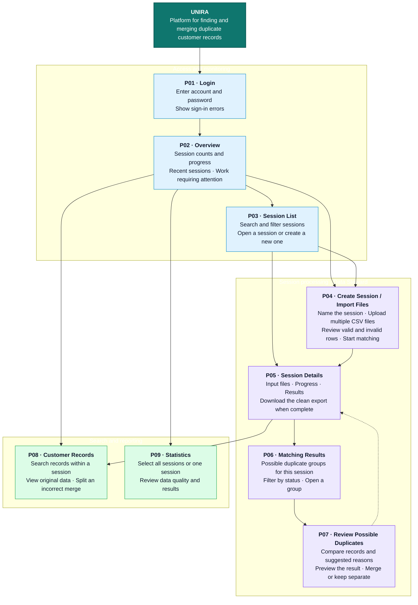

P04 can also be opened directly from P02. When moving from P05 to P06–P08, the system keeps the selected session in context.

#### 2.1.2. Page Content by Section

Each **Section** is a content area on a screen. Buttons and messages are described alongside the area they support.

##### P01 – Login

| Section | Content and actions |
| --- | --- |
| Sign-in | Enter an account and password, then select **Sign in**. |
| Messages | Show incorrect credentials or an unauthorized account; on success, go to P02. |

##### P02 – Overview

| Section | Content and actions |
| --- | --- |
| Overall status | Total sessions and counts of running, awaiting-review, completed, and failed sessions. |
| Recent sessions | Open a session that needs further work. |
| Work to do | Highlight sessions awaiting review or requiring error correction. |
| Create session | A Data Steward can open P04; a Viewer cannot perform this action. |

##### P03 – Session List

| Section | Content and actions |
| --- | --- |
| Search and filters | Search by session name; filter by status and time. |
| Session list | Show name, file count, progress, and status; select a session to open P05. |
| Create new | A Data Steward can open P04. |

##### P04 – Create Session / Import Files

| Section | Content and actions |
| --- | --- |
| Session details | Give the session a name and a short description. |
| Input files | Add multiple CSV files; show the name and source of each file. |
| File validation | Show valid and invalid row counts and the reasons for errors in each file. |
| Start | Allow matching only when at least one valid file is available, then open P05. |

##### P05 – Session Details

| Section | Content and actions |
| --- | --- |
| Session information | Name, creator, date and time, and status. |
| Progress | Import, matching, review, merging, and export stages. |
| Files and results | Input file list, number of possible duplicate groups, and processed records. |
| Clean export | A Data Steward can download the file once the session is complete and the file is ready. |

##### P06 – Matching Results

| Section | Content and actions |
| --- | --- |
| Current session | Always show the session name to prevent confusion between results. |
| Filters | Filter groups awaiting review, approved, or kept separate. |
| Group list | Show record counts, similarity, and suggested reasons; select a group to open P07. |

##### P07 – Review Possible Duplicates

| Section | Content and actions |
| --- | --- |
| Record comparison | Place records side by side and highlight similarities and differences. |
| Suggested reasons | Show supporting signals and any conflicting information. |
| Preview | Show the values that would be kept after a merge. |
| Decision | Choose **Merge** or **Keep separate**, add a reason if needed, and confirm. |

##### P08 – Customer Records

| Section | Content and actions |
| --- | --- |
| Session selection and search | Select the correct session and search by customer contact details. |
| Record list | View processed records in that session. |
| Details | View unified data alongside the original records. |
| Correct an incorrect merge | A Data Steward can split a record and wait for the clean export to be regenerated. |

##### P09 – Statistics

| Section | Content and actions |
| --- | --- |
| Scope | View all authorized sessions or select one session. |
| Processing results | File counts, valid and invalid rows, possible duplicate groups, and records after merging. |
| Progress | See completed sessions and sessions that still need attention. |

### 2.2. Screen Hierarchy

#### 2.2.1. Screen Inventory

| ID | Screen | Users | Related needs |
| --- | --- | --- | --- |
| P01 | Login | Both roles | US14 |
| P02 | Overview | Both roles | US04, US11 |
| P03 | Session list | Both roles | US01, US04 |
| P04 | Create session / Import files | Data Steward | US01–US03, US12 |
| P05 | Session details | Both roles | US04, US11, US15 |
| P06 | Matching results | Data Steward | US05, US13 |
| P07 | Review possible duplicates | Data Steward | US05–US08, US13 |
| P08 | Customer records | Both roles; only a Steward can edit | US09, US10 |
| P09 | Statistics | Both roles | US11, US12 |

#### 2.2.2. Navigation Flow

**Create a session and download its clean export**

```text
P01 Login → P02 Overview → P03 Session list → P04 Create session / Import files
→ P05 Session details → P06 Matching results → P07 Review possible duplicates
→ P05 Session details → Download the clean export
```

**Search records and correct an incorrect merge**

```text
P03 Session list → P05 Session details → P08 Customer records
→ Split the incorrect merge → Regenerate the clean export → P05 Session details
```

**View statistics**

```text
P02 Overview → P09 Statistics → Select all sessions or one session
```

### 2.3. UI/UX Screens

#### Overview

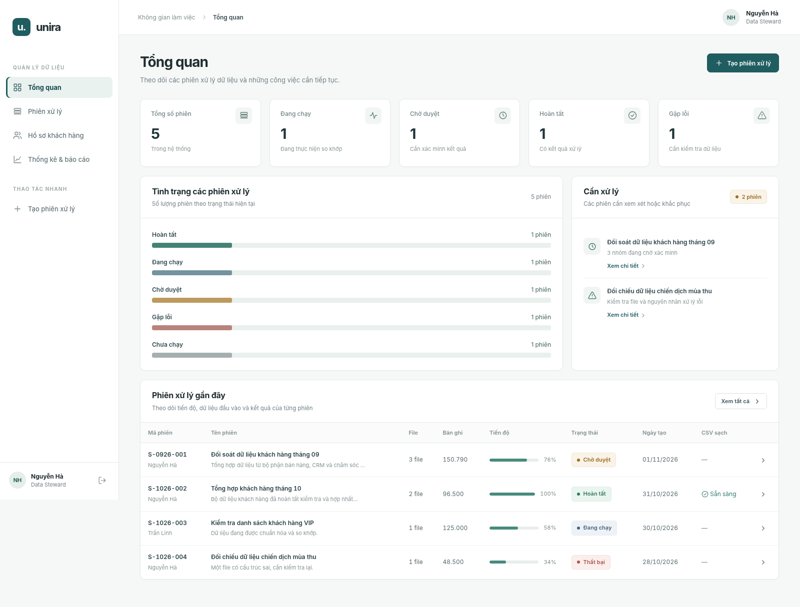

#### Session list

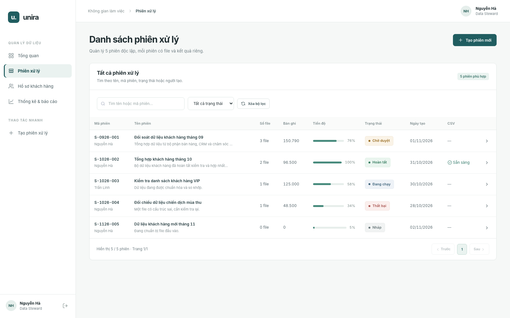

#### Create session and import files

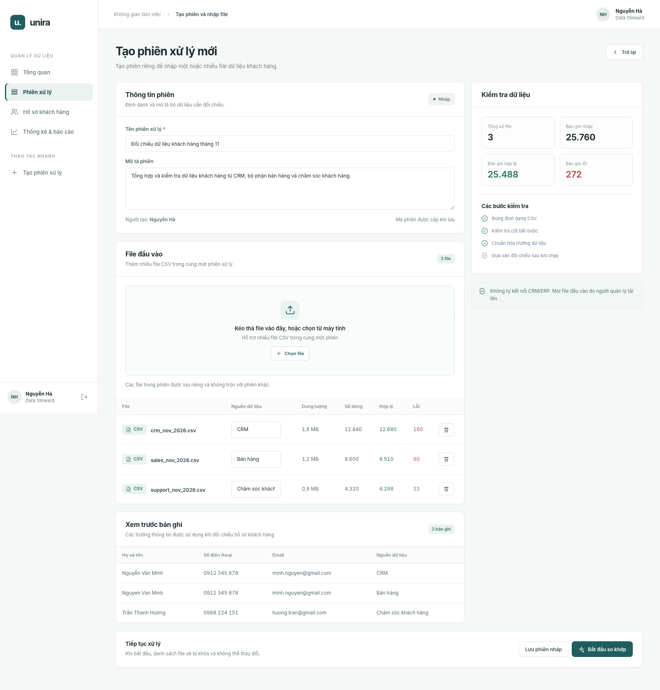

#### Session details

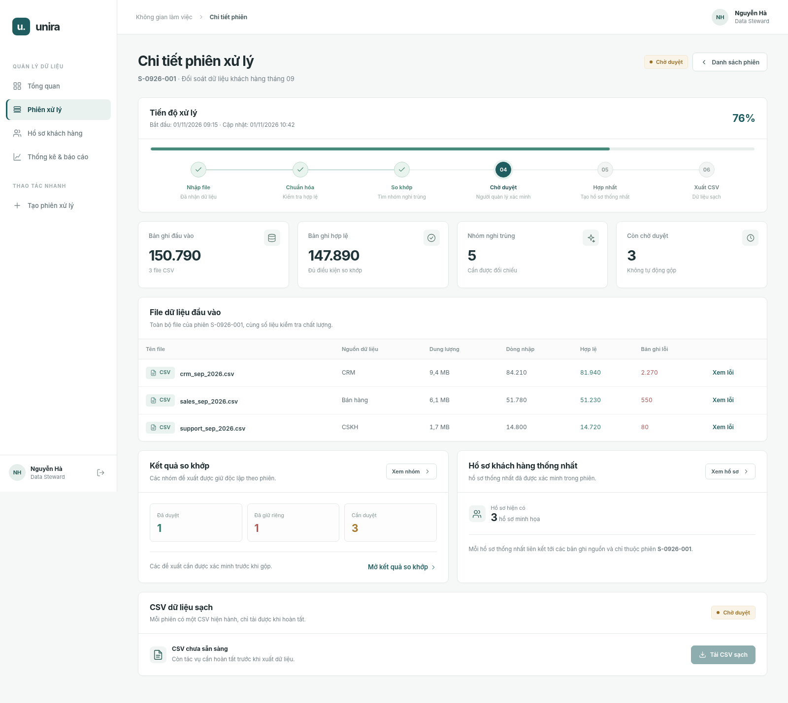

#### Matching results

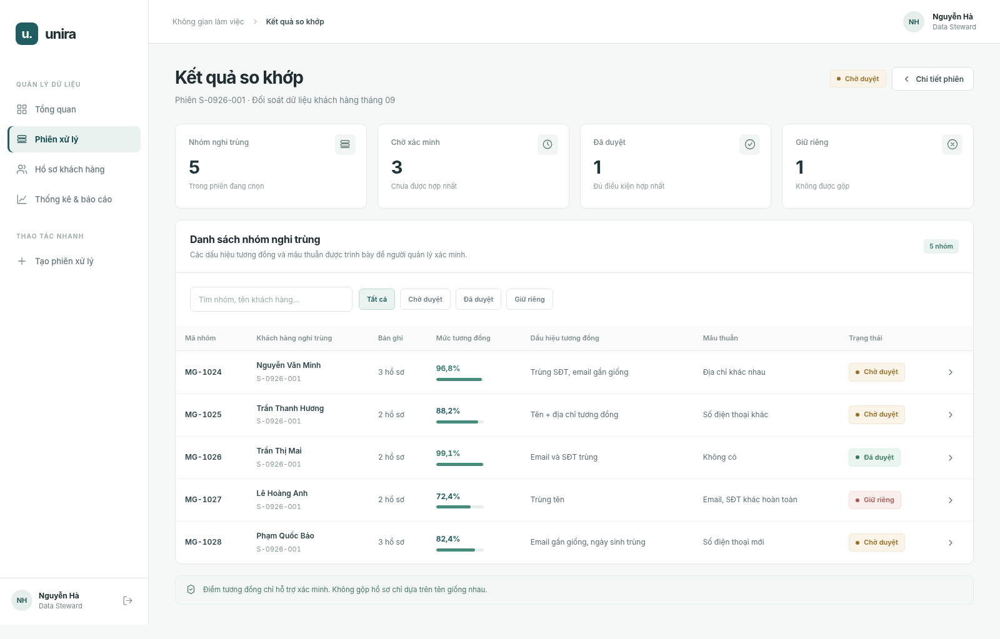

#### Review possible duplicates

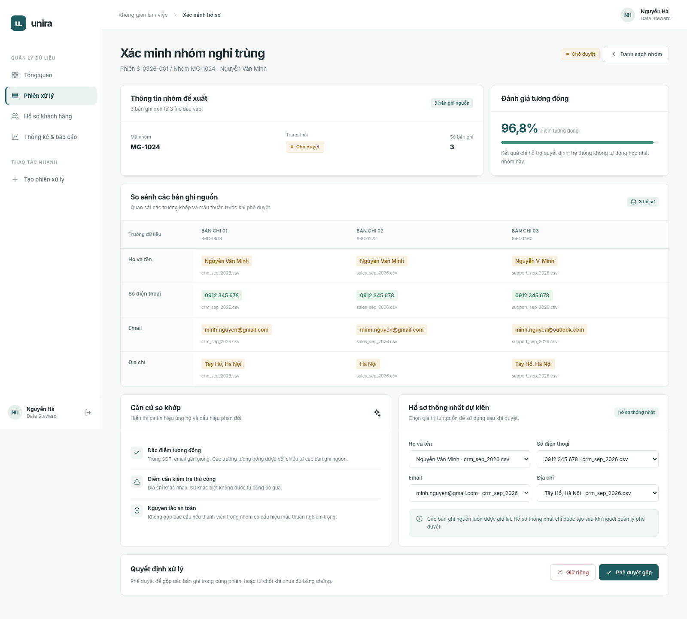

#### Customer records

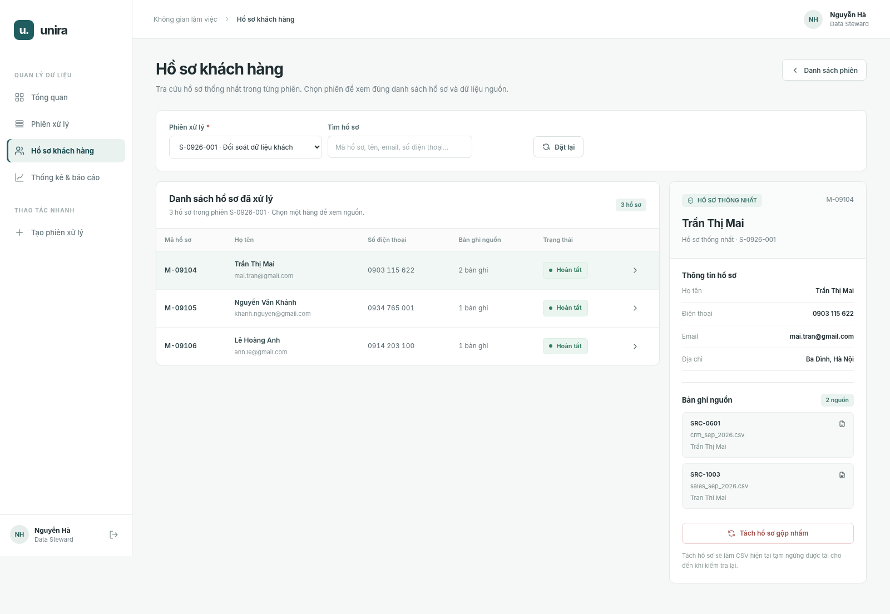

#### Statistics

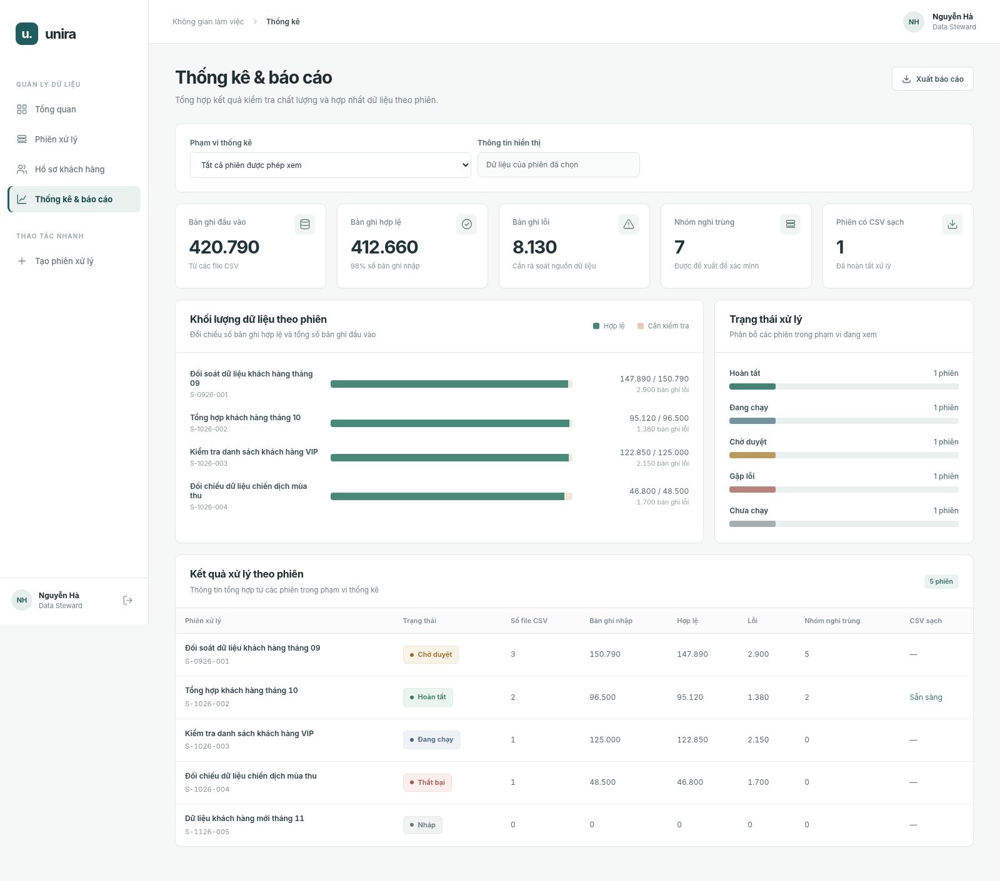

## 3. C4 Architecture

This section presents Unira's proposed architecture at three levels: **C1** shows the users and the system, **C2** shows the main parts of the system, and **C3** looks inside the application API. Implementation technologies have not yet been selected.

Detailed documentation: [C4 Architecture](./docs/architecture/c4/README.en.md).

### C1 — System Context

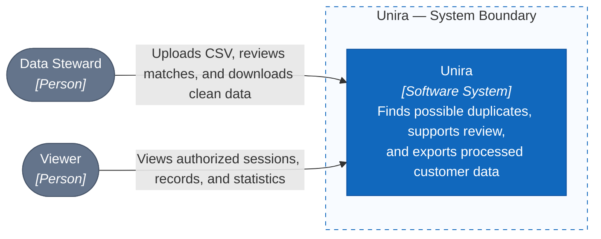

[Details: C1 — System Context](./docs/architecture/c4/01-system-context.en.md).

Users upload CSV files themselves. Files may be exported from a CRM or ERP system; Unira does not connect directly to those systems.

### C2 — Container

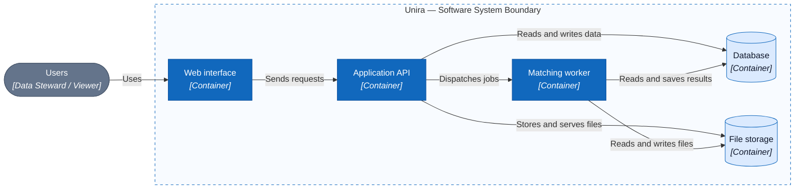

[Details: C2 — Container](./docs/architecture/c4/02-container.en.md).

### C3 — Component

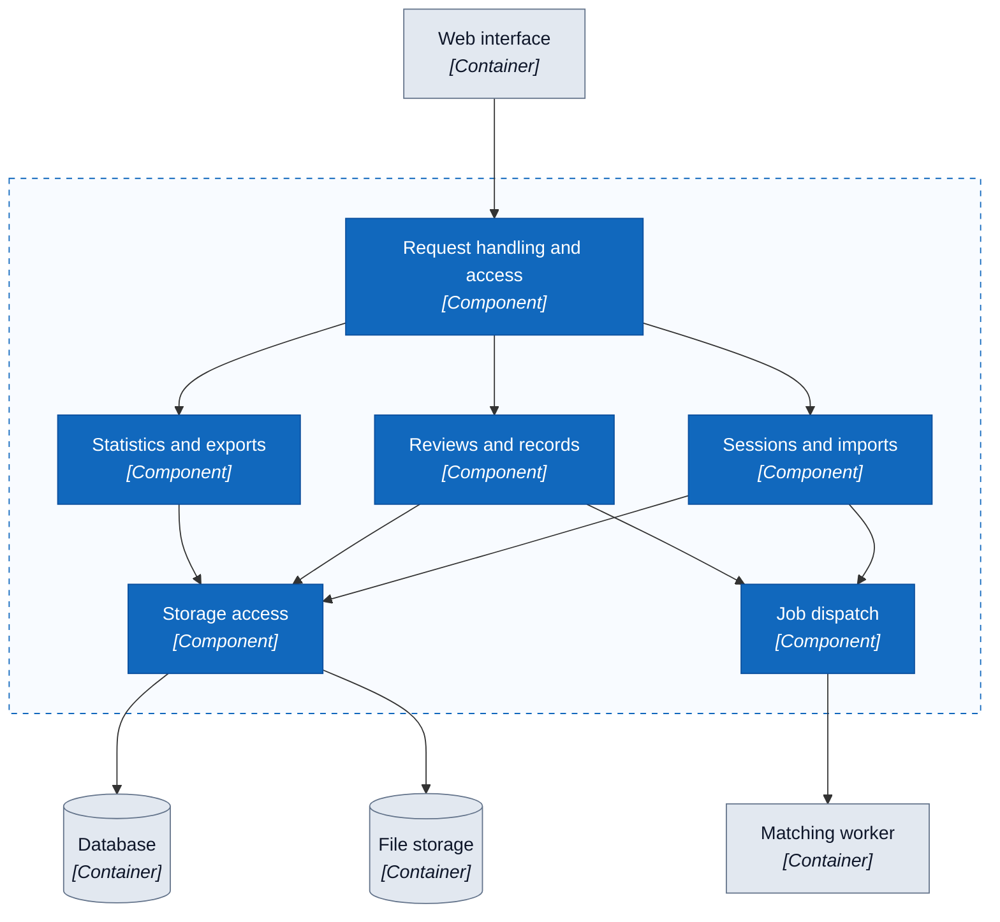

[Details: C3 — Component](./docs/architecture/c4/03-component.en.md).

The dashed box encloses the proposed API components. Arrows show which parts interact. Matching and CSV generation are handled by the matching worker shown in C2.

### Design status

| Unit | Current status |
| --- | --- |
| Web interface | Screens and navigation are designed. |
| Application API | The OpenAPI contract is written; the backend is not running yet. |
| Matching worker | The workflow is documented; performance has not been measured. |
| Database and file storage | The data model and file storage roles are designed; they are not connected to an application. |

## 4. Database Diagrams and OpenAPI 3.0 Contract

This section describes the data Unira needs to store and the operations the web interface will call. The diagrams and API contract are proposed designs; the working application has not been built yet.

### 4.1 Database diagrams

The ERD shows tables, their main attributes, and relationships. See the [DBML](./docs/schema.dbml) for all columns and keys.

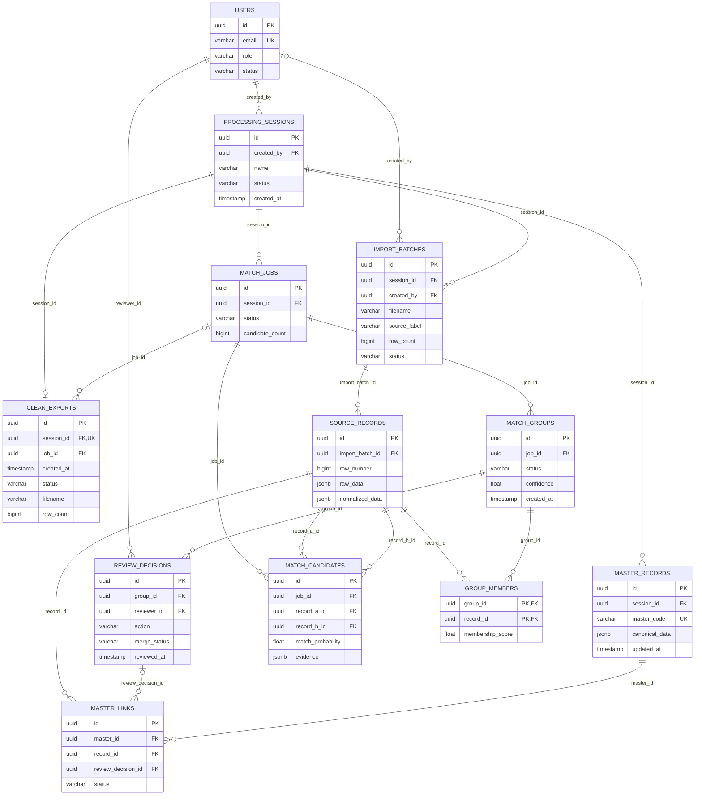

| Data group | Purpose |
| --- | --- |
| Accounts | Store users and their permissions. |
| Processing sessions | Track each session's name, creator, and progress. |
| Files and original records | Keep uploaded files, original data, and import errors. |
| Matching results | Store possible duplicate groups and the reasons for each suggestion. |
| Review decisions | Record who approved or rejected a merge and when. |
| Unified records | Store merged results and their links to original records. |
| Clean exports | Store the current export for each session. |

A session can contain multiple files. Each file, possible duplicate group, unified record, and clean export belongs to exactly one session. Original data is not deleted when records are merged.

### 4.2 API documentation — OpenAPI 3.0

The API contract describes interactions between the web interface and the processing layer, including request data, responses, access rules, and error cases. It uses OpenAPI 3.0.3 and currently describes 20 proposed operations.

- [View the API documentation in English](./docs/api/openapi.en.yaml)
- [View the API documentation in Vietnamese](./docs/api/openapi.yaml)

| Operation group | Supported actions |
| --- | --- |
| Sign-in | Authenticate users and retrieve their permissions. |
| Processing sessions | Create and search sessions and view their progress. |
| Input files | Upload files and view status and counts of valid and invalid rows. |
| Matching | Start processing and view possible duplicate groups. |
| Review decisions | Merge records or keep them separate. |
| Customer records | Search records and split incorrect merges. |
| Clean exports and statistics | Download the result for the correct session and view summary figures. |

Sign-in is public; all other operations require authentication and appropriate permissions. Session-related operations must check access to the requested session. This is a proposed contract, not a running API.
