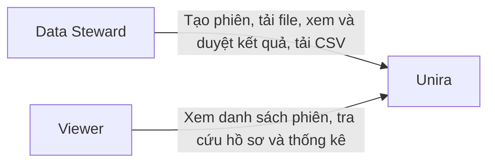
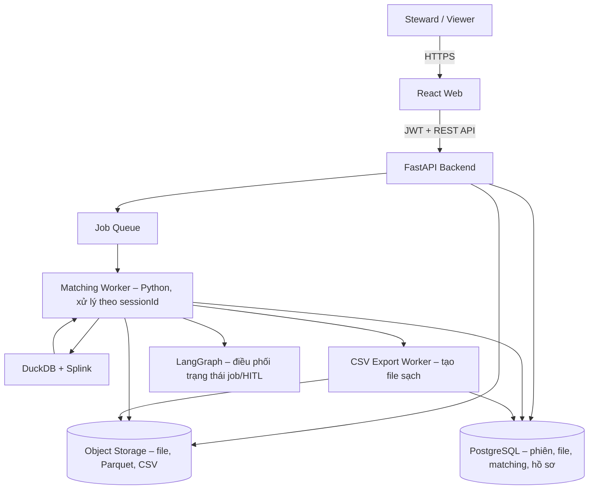
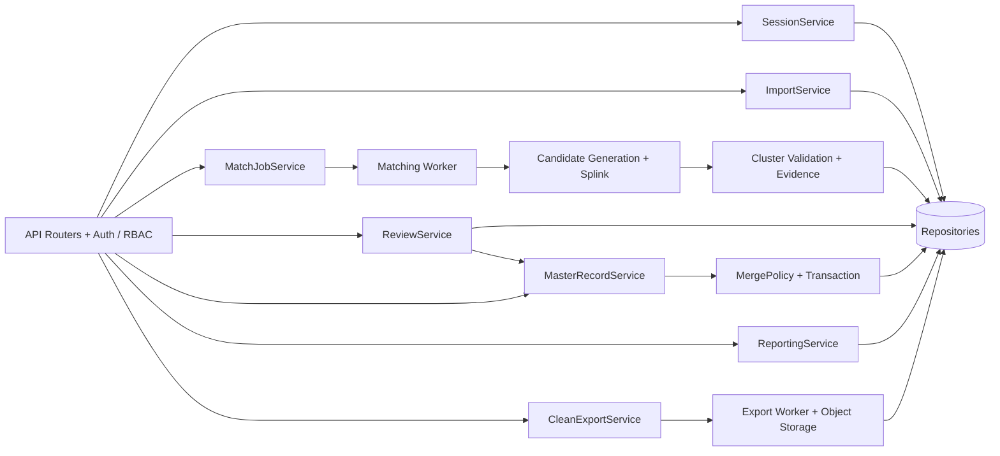
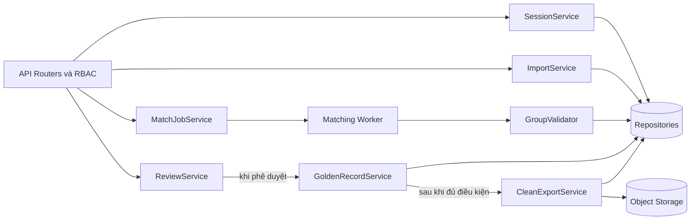
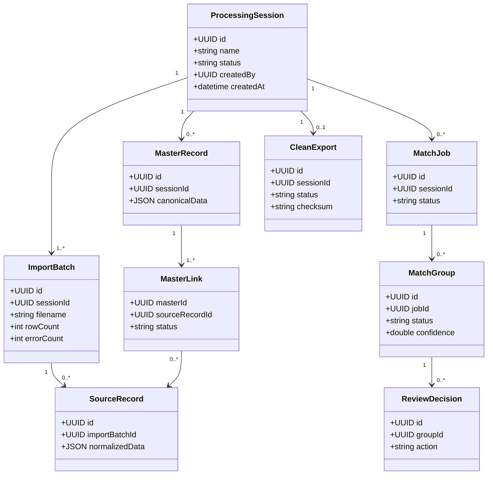
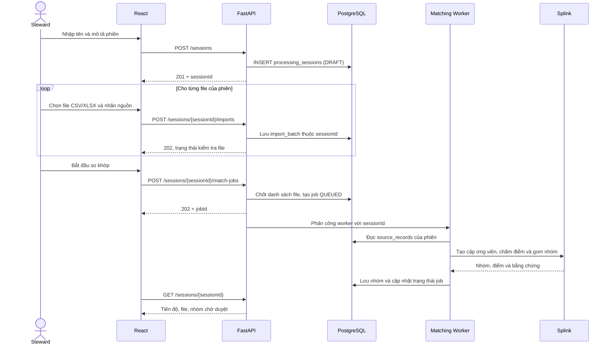
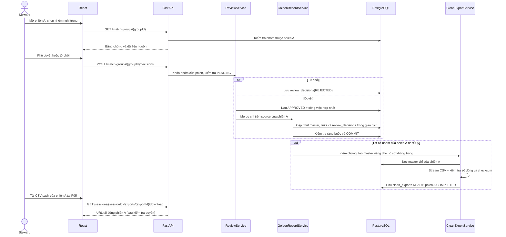
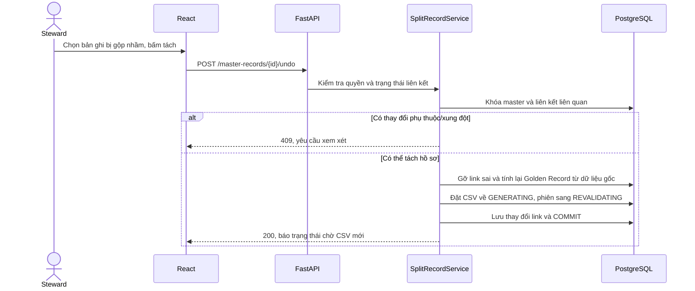
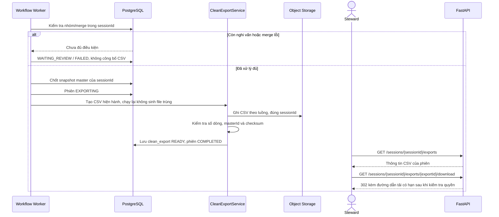

# Unira

Unira là đề xuất xây dựng hệ thống phát hiện và hợp nhất hồ sơ khách hàng trùng lặp ở quy mô lớn.

Một khách hàng có thể xuất hiện nhiều lần trong dữ liệu, với tên, số điện thoại hoặc địa chỉ được ghi khác nhau. Unira nhận file CSV/XLSX do Steward tải lên, kiểm tra dữ liệu và tìm những hồ sơ có khả năng trùng nhau. Steward xem bằng chứng và quyết định có gộp hay không; sau khi được duyệt, hệ thống mới tạo hoặc cập nhật hồ sơ thống nhất (Golden Record). Mỗi phiên có thể chứa nhiều file và có kết quả xử lý riêng. Khi phiên hoàn tất, Steward tải CSV dữ liệu sạch của phiên đó. Bản ghi gốc vẫn được giữ để đối chiếu hoặc tách hồ sơ nếu gộp nhầm.

**Luồng xử lý:** `Tạo phiên → Tải file lên → Kiểm tra và chuẩn hóa → So khớp → Steward duyệt → Hợp nhất → Kiểm tra kết quả → Xuất CSV`.

---

## 1. Yêu cầu – INVEST, use case và tiêu chí chấp nhận

Tài liệu gồm 15 câu chuyện người dùng, 10 use case, 18 quy tắc nghiệp vụ và 17 tiêu chí chấp nhận. [Bản chi tiết](./docs/requirements/README.md) ghi rõ từng yêu cầu và cách kiểm tra.

### 1.1. Sơ đồ ý tưởng sản phẩm


### 1.2. Yêu cầu theo INVEST

Các câu chuyện người dùng được rà theo INVEST để mỗi yêu cầu có giá trị rõ ràng và có thể kiểm thử. Có thể thay đổi cách triển khai mà vẫn giữ nguyên mục tiêu và quy tắc nghiệp vụ.

| Tiêu chí INVEST | Áp dụng cho Unira |
| --- | --- |
| Independent | Mỗi yêu cầu có kết quả riêng, dù có thể nằm trong cùng quy trình. |
| Negotiable | Có thể điều chỉnh giao diện và cách triển khai, miễn là vẫn đúng quy tắc về phiên và quyền. |
| Valuable | Yêu cầu giúp nhập, so khớp, xác minh hoặc xuất dữ liệu khách hàng sạch. |
| Estimable | Nêu rõ vai trò, đầu vào, đầu ra và lỗi để có thể ước lượng công việc. |
| Small | Tách thao tác của người dùng khỏi công việc chạy nền khi cần. |
| Testable | Có tiêu chí chấp nhận để kiểm tra kết quả. |

| Mã yêu cầu | Phạm vi |
| --- | --- |
| US14 | Đăng nhập và phân quyền Steward/Viewer. |
| US01–US04 | Tạo phiên, nhập nhiều file, chạy AI và theo dõi tiến độ. |
| US05–US08 | Xem bằng chứng, duyệt/từ chối và tạo Golden Record. |
| US09–US10 | Tách hồ sơ gộp sai và tra cứu theo phiên. |
| US11–US13 | Thống kê và theo dõi kết quả, quyết định xử lý. |
| US15 | Tải CSV sạch của đúng phiên đã hoàn tất. |

Mọi file, bản ghi, kết quả so khớp, quyết định duyệt, hồ sơ thống nhất và CSV của một phiên phải gắn với cùng `session_id`. Steward duyệt trước khi hệ thống gộp hồ sơ; bản ghi gốc được giữ để truy vết và xử lý khi gộp sai. Chi tiết nằm trong [danh sách yêu cầu, quy tắc và tiêu chí chấp nhận](./docs/requirements/README.md).

### 1.3. Các ca sử dụng (Use case)

#### 1.3.1. Tác nhân

| Tác nhân | Vai trò trong hệ thống |
| --- | --- |
| **Steward** | Tạo phiên, tải file, chạy so khớp, duyệt kết quả, quản lý hồ sơ và tải CSV sạch. |
| **Viewer** | Xem các phiên được cấp quyền, tra cứu hồ sơ và xem thống kê. |

File được xuất từ CRM hoặc ERP vẫn do Steward tải lên; các hệ thống đó không tương tác trực tiếp với Unira.

#### 1.3.2. Sơ đồ Use Case tổng quan


#### 1.3.3. Danh sách Use Case

| Mã | Ca sử dụng | Tác nhân chính | User story liên quan |
| --- | --- | --- | --- |
| UC01 | Quản lý phiên xử lý | Steward | US01, US04 |
| UC02 | Tải file vào phiên | Steward | US02, US12 |
| UC03 | Chạy so khớp cho phiên | Steward | US03, US04 |
| UC04 | Xem nhóm nghi trùng | Steward | US05 |
| UC05 | Duyệt hoặc từ chối gộp | Steward | US06, US07, US08, US13 |
| UC06 | Tra cứu hồ sơ thống nhất | Steward, Viewer | US10 |
| UC07 | Tách hồ sơ gộp nhầm | Steward | US09 |
| UC08 | Xem thống kê theo phiên | Steward, Viewer | US11 |
| UC09 | Xem chất lượng dữ liệu | Steward | US12 |
| UC10 | Tải CSV sạch của phiên | Steward | US15 |

US14 về đăng nhập và phân quyền là điều kiện chung của các ca sử dụng. Backend kiểm tra quyền ở từng thao tác, kể cả khi giao diện đã ẩn nút.

#### 1.3.4. Đặc tả các Use Case trọng tâm

**UC01 – Quản lý phiên xử lý**

- **Tác nhân:** Steward.
- **Tiền điều kiện:** Steward đã đăng nhập và có quyền tạo phiên.
- **Luồng chính:** (1) Steward mở danh sách phiên và chọn **Tạo phiên mới** → (2) Nhập tên, có thể thêm mô tả → (3) Hệ thống kiểm tra dữ liệu và tạo `session_id`, trạng thái `DRAFT` → (4) Mở màn hình thêm file cho phiên vừa tạo.
- **Luồng thay thế:** Steward mở lại một phiên có sẵn để xem trạng thái, file đầu vào và kết quả; dữ liệu phiên không thay đổi.
- **Ngoại lệ:** Tên trống thì yêu cầu nhập lại; không đủ quyền thì trả `403` và không tạo phiên.
- **Hậu điều kiện:** Phiên mới được lưu với mã, người tạo và trạng thái riêng; chưa có job so khớp hoặc CSV.

**UC02 – Tải file vào phiên**

- **Tác nhân:** Steward.
- **Tiền điều kiện:** Steward có quyền với phiên; phiên còn `DRAFT` hoặc `READY` và chưa chốt file đầu vào.
- **Luồng chính:** (1) Steward mở phiên và chọn một hoặc nhiều file CSV/XLSX → (2) Thêm nhãn xuất xứ nếu cần → (3) Hệ thống lưu từng file dưới đúng `session_id`, kiểm tra cột và dòng → (4) Hiển thị số dòng hợp lệ, số dòng lỗi và chi tiết lỗi theo từng file.
- **Luồng thay thế:** Trước khi chạy so khớp, Steward có thể thêm file hoặc loại file đã chọn rồi kiểm tra lại.
- **Ngoại lệ:** File sai định dạng hoặc vượt hạn mức thì báo lỗi cho file đó; phiên đã bắt đầu chạy thì không nhận thêm file và không thay đổi danh sách đã chốt.
- **Hậu điều kiện:** Các file được nhận thuộc đúng một phiên. Bản ghi gốc và kết quả kiểm tra được giữ để xử lý tiếp; hệ thống chưa gộp hồ sơ.

**UC05 – Duyệt hoặc từ chối gộp**

- **Tác nhân:** Steward.
- **Tiền điều kiện:** Phiên ở `WAITING_REVIEW`; nhóm thuộc phiên và còn `PENDING`.
- **Luồng chính:** (1) Steward mở nhóm và xem hồ sơ cùng bằng chứng so khớp → (2) Chọn giá trị cho Golden Record rồi xác nhận duyệt → (3) Backend kiểm tra quyền, khóa nhóm và kiểm tra lại trạng thái → (4) Lưu quyết định và giao việc hợp nhất → (5) Worker tạo hoặc cập nhật master, liên kết bản ghi nguồn trong cùng phiên và cập nhật tiến độ.
- **Luồng thay thế:** Steward từ chối đề xuất; hệ thống lưu quyết định nhưng không tạo liên kết gộp.
- **Ngoại lệ:** Nhóm đã được xử lý hoặc dữ liệu nguồn thay đổi thì trả `409` và yêu cầu xem lại. Nếu việc hợp nhất lỗi, hệ thống ghi trạng thái lỗi để có thể chạy lại an toàn.
- **Hậu điều kiện:** Mỗi nhóm có một quyết định đang có hiệu lực. Chỉ nhóm được duyệt mới được hợp nhất; CSV cuối chỉ được xuất khi toàn bộ phiên đủ điều kiện.

**UC10 – Tải CSV sạch của phiên**

- **Tác nhân:** Steward.
- **Tiền điều kiện:** Phiên đã `COMPLETED` và CSV hiện hành ở trạng thái `READY`.
- **Luồng chính:** (1) Steward mở chi tiết phiên và chọn **Tải CSV sạch** → (2) Backend kiểm tra quyền, `session_id` và trạng thái file → (3) Cấp đường dẫn tải có thời hạn → (4) Steward tải CSV của đúng phiên.
- **Luồng thay thế:** Tải lại cùng bản xuất hiện hành; hệ thống không tạo file hoặc job mới.
- **Ngoại lệ:** Chưa có CSV `READY`, phiên đang tạo lại file sau khi tách hồ sơ hoặc người dùng không đủ quyền thì từ chối tải. Viewer nhận `403`.
- **Hậu điều kiện:** Steward nhận file hiện hành; dữ liệu, trạng thái phiên và lịch sử so khớp không thay đổi.

### 1.4. Vai trò và phân quyền

| Vai trò | Được làm | Không được làm |
| --- | --- | --- |
| **Data Steward** (người quản lý dữ liệu) | Tạo phiên, tải file CSV/XLSX, chạy so khớp, duyệt kết quả, quản lý hồ sơ, tách hồ sơ gộp sai và tải CSV sạch. | Không sửa hoặc xóa file gốc trên màn hình hợp nhất. |
| **Viewer** (người xem) | Xem các phiên được cấp quyền, kết quả xử lý và Golden Record trong từng phiên. | Không tải file lên, chạy job, duyệt, hợp nhất hoặc tách hồ sơ. |

Sơ đồ chỉ có hai vai trò: Steward và Viewer. Steward tải file lên; CRM/ERP, nếu được ghi trên file, chỉ là thông tin xuất xứ. Worker, Splink và LangGraph là các thành phần bên trong hệ thống.

“Nguồn dữ liệu” cho biết file được lấy từ đâu, chẳng hạn do Steward xuất từ CRM. Mỗi phiên xử lý là một đợt công việc độc lập, gồm các file đầu vào, lần chạy so khớp, quyết định duyệt và CSV kết quả. Job là công việc chạy nền trong phiên đó.

## 2. Kiến trúc thông tin và phân cấp màn hình

Unira có **9 màn hình (P01–P09)**. Một phiên có thể chứa nhiều file và nhóm nghi trùng, nhưng chỉ có một bộ kết quả và một CSV hiện hành của riêng phiên đó. Modal và panel chi tiết thuộc trang đang mở, không tính là trang riêng.

### 2.1. Kiến trúc thông tin (Information Architecture)

#### 2.1.1. Cây phân cấp Page

```text
P01 Đăng nhập
└── P02 Tổng quan
    ├── P03 Danh sách phiên
    │   ├── P04 Tạo phiên / nhập file
    │   └── P05 Chi tiết phiên
    │       ├── P06 Kết quả AI của phiên
    │       │   └── P07 Xác minh nhóm nghi trùng
    │       └── P08 Hồ sơ khách hàng (đã chọn phiên)
    ├── P08 Hồ sơ khách hàng (chọn phiên trước khi tra cứu)
    └── P09 Thống kê
```

P04 cũng có thể mở từ P02; P05 có đường quay về P03. Các đường dẫn đến P06–P08 luôn mang theo phiên đang chọn.

#### 2.1.2. Nội dung từng Page theo Section

Mỗi Section là một khối nội dung của trang. Nút, biểu mẫu và phản hồi được mô tả ngay trong khối liên quan.

##### P01 – Đăng nhập

| Section | Mô tả nội dung và chức năng |
| --- | --- |
| **Form đăng nhập** | Ô email, mật khẩu, nút **Đăng nhập**; nhãn lỗi trường bắt buộc và sai thông tin. |
| **Phản hồi & điều hướng** | Thông báo tài khoản bị khóa/hết phiên; chuyển đến P02 khi đăng nhập thành công. |

##### P02 – Tổng quan

| Section | Mô tả nội dung và chức năng |
| --- | --- |
| **Chỉ số chung** | Thẻ **Tổng số phiên**, **Đang chạy**, **Chờ duyệt**, **Hoàn tất**, **Thất bại**; cho xem tổng quan theo quyền. |
| **Các phiên gần đây** | Bảng 5–10 phiên mới: tên, số file, số bản ghi, trạng thái, thời gian; nhấn tên → P05. |
| **Công việc cần xử lý** | Danh sách phiên đang chờ Steward xác minh hoặc phiên lỗi; nút **Xem phiên**. |
| **Thao tác nhanh** | Nút **Tạo phiên mới** dành cho Steward → P04; Viewer không có nút này. |

##### P03 – Danh sách phiên

| Section | Mô tả nội dung và chức năng |
| --- | --- |
| **Thanh tiêu đề** | Tên trang, tổng số phiên; nút **Tạo phiên mới** → P04 (Steward). |
| **Tìm kiếm & bộ lọc** | Tìm theo tên/mã phiên; lọc trạng thái, người tạo, khoảng thời gian; nút **Xóa bộ lọc**. |
| **Bảng phiên** | Cột **Mã phiên, Tên phiên, Số file, Số bản ghi, Tiến độ, Trạng thái, Ngày tạo, File CSV**. Nhấn hàng → P05. |
| **Phân trang & trạng thái** | Phân trang phía server, số phiên mỗi trang; thông báo khi không có phiên hoặc tải lỗi. |

##### P04 – Tạo phiên / Nhập file

| Section | Mô tả nội dung và chức năng |
| --- | --- |
| **Thông tin phiên** | Ô **Tên phiên** (bắt buộc), **Mô tả** (tùy chọn), người tạo; khi tạo sinh mã phiên và trạng thái `DRAFT`. |
| **Tải nhiều file** | Khu chọn/kéo-thả **nhiều CSV/XLSX**, bảng tên file, dung lượng, định dạng, nhãn xuất xứ do Steward nhập, nút loại bỏ **trước khi chạy**. |
| **Kiểm tra dữ liệu** | Xem trước vài dòng và cột; số dòng hợp lệ/lỗi của **mỗi file**, thông báo lỗi cột bắt buộc/định dạng; link xem chi tiết lỗi. |
| **Hành động** | **Lưu phiên**, **Bắt đầu xử lý AI** (chỉ mở khi có file hợp lệ), **Hủy/quay lại**. Sau khi bắt đầu khóa danh sách file và chuyển P05. |

##### P05 – Chi tiết phiên

| Section | Mô tả nội dung và chức năng |
| --- | --- |
| **Tiêu đề phiên** | Mã phiên, tên, mô tả, người tạo, ngày tạo, trạng thái; nút quay lại P03. |
| **Tiến độ xử lý** | Thanh tiến độ và các bước **Nhập file → Chuẩn hóa → AI so khớp → Chờ duyệt → Hợp nhất → Xuất CSV**; thông báo lỗi nếu có. |
| **File đầu vào** | Bảng toàn bộ file của phiên: tên, nhãn nguồn, số dòng hợp lệ/lỗi, thời gian upload; mở chi tiết lỗi. Nếu phiên chưa chạy, có nút **Thêm file** quay lại P04 và **Bắt đầu AI**. |
| **Kết quả AI** | Các thẻ **Số bản ghi**, **Số nhóm nghi trùng**, **Đã duyệt**, **Đã từ chối**, **Chờ duyệt**; nút **Xem nhóm nghi trùng** → P06. |
| **Hồ sơ thống nhất** | Số khách hàng sau xử lý, nút **Xem hồ sơ** → P08 với phiên đã chọn. |
| **CSV dữ liệu sạch** | Tên file, số dòng, thời điểm xuất, trạng thái; nút **Tải CSV sạch** chỉ bật khi phiên `COMPLETED` và file `READY`. |
| **Tiến độ phiên** | Thời điểm bắt đầu, lần cập nhật trạng thái gần nhất và kết quả xử lý trong phiên. |

##### P06 – Kết quả AI của phiên

| Section | Mô tả nội dung và chức năng |
| --- | --- |
| **Ngữ cảnh phiên** | Tên/mã phiên cố định ở đầu trang, trạng thái, tổng số nhóm; link trở về P05. |
| **Bộ lọc** | Lọc **Chờ duyệt / Đã duyệt / Đã từ chối**, tìm kiếm theo tên/số điện thoại/mã hồ sơ, sắp xếp mức độ khớp. |
| **Danh sách nhóm nghi trùng** | Bảng mã nhóm, số bản ghi trong nhóm, độ tin cậy, dấu hiệu trùng, mâu thuẫn, trạng thái; chọn nhóm → P07. |
| **Thống kê nhanh** | Số nhóm cần xem lại và tổng số bản ghi liên quan; không hiển thị nhóm từ phiên khác. |

##### P07 – Xác minh nhóm nghi trùng

| Section | Mô tả nội dung và chức năng |
| --- | --- |
| **Thông tin nhóm** | Mã nhóm, phiên xử lý, số bản ghi, điểm AI và cảnh báo mâu thuẫn. |
| **So sánh hồ sơ** | Bảng đặt các hồ sơ cạnh nhau: tên, email, số điện thoại, địa chỉ, nhãn file gốc; đánh dấu giá trị giống/khác. |
| **Bằng chứng AI** | Các lý do đề xuất trùng và những dấu hiệu phản đối, không chỉ hiển thị một con số xác suất. |
| **Hồ sơ dự kiến sau gộp** | Mẫu chọn **giá trị và nguồn** cho từng trường tên, email, số điện thoại, địa chỉ; xem trước Golden Record. |
| **Quyết định** | Nút **Phê duyệt gộp**, **Từ chối**, ô lý do và hộp xác nhận; hiển thị tiến độ hợp nhất sau khi duyệt. |

##### P08 – Hồ sơ khách hàng

| Section | Mô tả nội dung và chức năng |
| --- | --- |
| **Chọn phiên & tìm kiếm** | **Bắt buộc chọn phiên**, tìm theo mã master, tên, email hoặc điện thoại; không trộn hồ sơ giữa các phiên. |
| **Danh sách hồ sơ** | Bảng mã master, tên, liên hệ, số bản ghi nguồn, trạng thái; phân trang phía server. |
| **Chi tiết hồ sơ** | Thông tin thống nhất, các bản ghi gốc liên kết và nguồn của từng trường. |
| **Tách hồ sơ** | Nút **Tách hồ sơ** (chỉ Steward), chọn bản ghi gộp nhầm, nhập lý do, xác nhận và thông báo CSV cần tạo lại. |

##### P09 – Thống kê

| Section | Mô tả nội dung và chức năng |
| --- | --- |
| **Bộ lọc phiên** | Chọn **Tất cả phiên** hoặc một phiên; hiển thị phạm vi số liệu và khoảng thời gian. |
| **Thống kê xử lý** | Biểu đồ số bản ghi nhập, bản ghi hợp lệ/lỗi, nhóm nghi trùng, khách hàng sau gộp, CSV đã xuất. |
| **Hiệu năng** | Bảng thời gian từng bước, số cặp được so khớp, thời gian chạy, tài nguyên RAM/CPU của từng phiên. |
| **Chất lượng dữ liệu** | Tỷ lệ dòng nhập hợp lệ/lỗi và số hồ sơ trùng đã xử lý theo phiên; không hiển thị so sánh mô hình. |

### 2.2. Phân rã kiến trúc thông tin và phân cấp màn hình (Screen Hierarchy)

#### 2.2.1. Danh mục màn hình (Screen Inventory)

| Mã | Màn hình / Page | Hình thức hiển thị | Vai trò | US liên quan |
| --- | --- | --- | --- | --- |
| P01 | Đăng nhập | Trang biểu mẫu | Steward, Viewer | US14 |
| P02 | Tổng quan | Trang tổng quan | Steward, Viewer | US04, US11 |
| P03 | Danh sách phiên | Trang danh sách | Steward, Viewer | US01, US04 |
| P04 | Tạo phiên / Nhập file | Trang biểu mẫu và tải file | Steward | US01–US03, US12 |
| P05 | Chi tiết phiên | Trang chi tiết và tiến độ | Steward, Viewer | US04, US11, US15 |
| P06 | Kết quả AI của phiên | Trang danh sách | Steward | US05, US13 |
| P07 | Xác minh nhóm nghi trùng | Trang so sánh và phê duyệt | Steward | US05–US08, US13 |
| P08 | Hồ sơ khách hàng | Trang danh sách và panel chi tiết | Steward, Viewer | US09, US10 |
| P09 | Thống kê | Trang biểu đồ và báo cáo | Steward, Viewer | US11, US12 |

Viewer chỉ được xem nội dung thuộc phiên mình có quyền truy cập. Các thao tác tạo phiên, tải file, chạy so khớp, duyệt/tách hồ sơ và tải CSV chỉ dành cho Steward.

#### 2.2.2. Luồng điều hướng chính (Navigation Flow)

**Luồng A – Tạo phiên và xuất dữ liệu sạch**

```text
P01 Đăng nhập → P02 Tổng quan → P03 Danh sách phiên
  → P04 Tạo phiên, tải một hoặc nhiều file CSV/XLSX, xem lỗi từng file
  → Bắt đầu so khớp → P05 Theo dõi tiến độ phiên
  → P06 Xem nhóm nghi trùng → P07 Xác minh và duyệt/từ chối
  → P05 Xem kết quả, tải CSV hiện hành khi phiên COMPLETED và file READY
```

**Luồng B – Tra cứu và sửa hồ sơ gộp nhầm**

```text
P03 Danh sách phiên → P05 Chi tiết phiên → P08 Hồ sơ của phiên
  → Xem bản ghi gốc và nguồn của từng trường
  → [Steward: tách hồ sơ gộp nhầm] → CSV cũ ngừng tải
  → Hệ thống kiểm tra lại và tạo CSV mới → P05 Tải CSV hiện hành
```

**Luồng C – Xem dữ liệu và thống kê**

```text
P01 Đăng nhập → P02 Tổng quan
  ├── P03 Danh sách phiên → P05 Chi tiết phiên
  ├── P08 Chọn phiên → Tra cứu hồ sơ khách hàng
  └── P09 Chọn tất cả phiên hoặc một phiên → Xem thống kê
```

Mỗi luồng tra cứu phải giữ đúng `session_id`. Chuyển từ phiên A sang phiên B thì danh sách nhóm, hồ sơ và CSV phải đổi theo phiên B; dữ liệu cũ không được hiển thị lại do bộ nhớ đệm.

### 2.3. Thiết kế giao diện (UI/UX)

Đặt ảnh thiết kế vào [docs/ui-ux](./docs/ui-ux/README.md) và chèn dưới đúng màn hình bên dưới. Mỗi ảnh nên cho thấy bố cục chính; nếu có nhiều trạng thái của cùng màn hình, thêm ảnh ngay dưới ảnh đầu tiên và ghi rõ trạng thái.

#### P01 – Đăng nhập

*Chưa có ảnh thiết kế P01. Chèn ảnh tại đây khi có bản thiết kế.*

#### P02 – Tổng quan

*Chưa có ảnh thiết kế P02. Chèn ảnh tại đây khi có bản thiết kế.*

#### P03 – Danh sách phiên

*Chưa có ảnh thiết kế P03. Chèn ảnh tại đây khi có bản thiết kế.*

#### P04 – Tạo phiên / Nhập file

*Chưa có ảnh thiết kế P04. Chèn ảnh tại đây khi có bản thiết kế.*

#### P05 – Chi tiết phiên

*Chưa có ảnh thiết kế P05. Chèn ảnh tại đây khi có bản thiết kế.*

#### P06 – Kết quả AI của phiên

*Chưa có ảnh thiết kế P06. Chèn ảnh tại đây khi có bản thiết kế.*

#### P07 – Xác minh nhóm nghi trùng

*Chưa có ảnh thiết kế P07. Chèn ảnh tại đây khi có bản thiết kế.*

#### P08 – Hồ sơ khách hàng

*Chưa có ảnh thiết kế P08. Chèn ảnh tại đây khi có bản thiết kế.*

#### P09 – Thống kê

*Chưa có ảnh thiết kế P09. Chèn ảnh tại đây khi có bản thiết kế.*

Khi có ảnh, thay dòng “Chưa có ảnh thiết kế” bằng cú pháp như: ``.

### 2.4. Trạng thái giao diện và nguyên tắc UI/UX

- **Phiên xử lý:** `DRAFT` (chưa chạy), `READY` (file hợp lệ), `QUEUED`, `RUNNING`, `WAITING_REVIEW`, `MERGING`, `EXPORTING`, `COMPLETED`, `FAILED`, `REVALIDATING` (khi tách hồ sơ sau xuất).
- **Nhiều phiên đồng thời:** Thanh trạng thái và thông báo luôn gắn mã/tên phiên; mở phiên A rồi B không được hiển thị lại kết quả A do cache cũ. Danh sách có lọc, phân trang server-side.
- **Hành động có điều kiện:** Không chạy phiên không có file hợp lệ; không upload thêm sau khi đã chạy; không duyệt lại nhóm đã kết thúc; không tải CSV hiện hành khi phiên chưa `COMPLETED`.
- **Độ rõ ràng:** Mỗi nút có nhãn hành động, dữ liệu rỗng/lỗi/đang tải được hiển thị riêng. Đặc biệt khi phê duyệt phải nêu số bản ghi chịu ảnh hưởng, lý do gộp và nguy cơ nhầm.
- **Quyền:** Viewer chỉ đọc các nội dung được cấp; backend kiểm tra quyền chứ không chỉ ẩn nút giao diện. Các trang đọc dữ liệu lớn dùng tìm kiếm, bộ lọc và phân trang, không gửi hàng triệu dòng xuống trình duyệt.

## 3. Kiến trúc hệ thống (C4)

### C1 – Bối cảnh hệ thống



Trong phạm vi PoC, Steward có thể tạo nhiều phiên và tải một hoặc nhiều file vào mỗi phiên. File có thể được xuất từ CRM, ERP hoặc một phòng ban, nhưng Unira chỉ nhận file do Steward tải lên; hệ thống không kết nối hay ghi ngược vào các nguồn đó. Nhãn nguồn giúp truy ra file được lấy từ đâu.

### C2 – Các thành phần triển khai



- **React:** hiển thị dữ liệu và nhận thao tác của người dùng. Các bảng lớn được tìm kiếm và phân trang từ server.
- **FastAPI:** xác thực, kiểm tra quyền, quản lý phiên, file, job, đề xuất và hồ sơ theo `session_id`; cung cấp REST API cho giao diện.
- **Matching Worker:** đọc các file đã chốt của phiên, chuẩn hóa dữ liệu, chạy blocking và Splink, kiểm tra nhóm nghi trùng rồi lưu đề xuất. Worker chạy riêng với API và giới hạn số job cùng lúc.
- **DuckDB và Parquet:** xử lý dữ liệu theo lô. **CSV Export Worker:** tạo một dòng cho mỗi khách hàng đã xác minh. **PostgreSQL:** lưu trạng thái phiên, quyết định duyệt, liên kết hồ sơ và thông tin về file xuất.
- **LangGraph:** có thể dùng để điều phối các bước xử lý và điểm chờ Steward duyệt. Không gọi LLM cho từng cặp bản ghi. Nếu quy trình đủ đơn giản, hàng đợi và trạng thái job có thể đảm nhiệm việc này.
- **Embedding/LLM:** chỉ dành cho trường hợp khó cần xem thêm bằng chứng; phải giới hạn số lần dùng và đo chi phí. LLM không tự quyết định gộp hồ sơ.

### C3 – Các thành phần backend



So khớp chỉ tạo đề xuất. Khi Steward duyệt, `MergeService` kiểm tra trạng thái, khóa các hồ sơ và liên kết liên quan rồi cập nhật trong một giao dịch. Nếu có lỗi, giao dịch được hủy; chạy lại không tạo bản ghi trùng.

Xem [quy trình xử lý chín bước](./docs/architecture/processing-workflow.md), từ tạo phiên đến xuất lại CSV sau khi tách hồ sơ.

## 4. Cơ sở dữ liệu và hợp đồng API

Sơ đồ dữ liệu và đặc tả API dưới đây là thiết kế dự kiến; repository hiện chưa có migration hay backend chạy thực tế.

### 4.1. Sơ đồ dữ liệu

[DBML](./docs/schema.dbml) ghi các bảng, cột và quan hệ. Dữ liệu lớn có thể được lưu thêm ở Parquet hoặc object storage như trong sơ đồ C2.

| Nhóm | Bảng chính | Mục đích |
| --- | --- | --- |
| Tài khoản | `users` | Vai trò Steward/Viewer |
| **Quản lý phiên** | **`processing_sessions`** | Phiên riêng, trạng thái, người tạo, cấu hình và tiến độ |
| File đã nhập | `import_batches`, `source_records` | **Một phiên – nhiều file**; từng file và từng dòng dữ liệu |
| Matching | `match_jobs`, `match_candidates`, `match_groups`, `group_members` | Job xử lý **thuộc phiên**, cặp so khớp và nhóm nghi trùng |
| HITL | `review_decisions` | Quyết định, bằng chứng, người phê duyệt |
| Golden Record | `master_records`, `master_links` | Hồ sơ chuẩn **theo phiên**, liên kết bản ghi gốc và hỗ trợ tách gộp sai |
| **Xuất dữ liệu** | **`clean_exports`** | **Một file CSV sạch hiện hành cho mỗi phiên** |

`processing_sessions.id` xác định phạm vi của một phiên. Bảng file nhập, job so khớp, hồ sơ thống nhất và CSV đều tham chiếu đến phiên qua `session_id`. Các file trong cùng phiên được so khớp với nhau; dữ liệu từ hai phiên khác nhau không bị trộn. `source_records` giữ nguyên dòng gốc.

Ràng buộc `UNIQUE(session_id)` trong `clean_exports` bảo đảm mỗi phiên chỉ có một CSV hiện hành. Sau khi tách hồ sơ, file cũ ngừng được tải cho đến khi tạo xong file mới. Mỗi bản ghi nguồn có tối đa một liên kết `master_links` ở trạng thái `ACTIVE`. Khi gộp hồ sơ, backend còn phải kiểm tra bản ghi nguồn và master thuộc cùng phiên; chỉ kiểm tra khóa ngoại là chưa đủ.

ERD tổng hợp dưới đây có đủ 12 bảng và 19 quan hệ khóa ngoại. Sơ đồ chỉ hiển thị các cột chính; danh sách đầy đủ nằm trong [DBML](./docs/schema.dbml).

[](./docs/erd/erd-tong-the.svg)


### 4.2. Đặc tả API OpenAPI 3.0

[File OpenAPI 3.0](./docs/api/openapi.yaml) mô tả các endpoint, dữ liệu gửi và nhận, quyền truy cập và mã lỗi. Các endpoint dùng tiền tố `/api/v1`.

| Nhóm | API chính | Màn hình |
| --- | --- | --- |
| Đăng nhập | `POST /auth/login`, `GET /me` | P01 |
| **Phiên xử lý** | **`GET /sessions`, `POST /sessions`, `GET /sessions/{sessionId}`** | P02–P05 |
| **File trong phiên** | **`POST /sessions/{sessionId}/imports`, `GET /sessions/{sessionId}/imports`, `GET /sessions/{sessionId}/imports/{batchId}`** | P04–P05 |
| **Chạy AI cho phiên** | **`POST /sessions/{sessionId}/match-jobs`, `GET /sessions/{sessionId}/match-jobs`**, `GET /match-jobs/{jobId}` | P05 |
| Đề xuất AI | `GET /match-groups?sessionId=...`, `GET /match-groups/{groupId}` | P06–P07 |
| Phê duyệt | `POST /match-groups/{groupId}/decisions` | P07 |
| Golden Record | `GET /master-records?sessionId=...`, `GET /master-records/{masterId}`, `POST /master-records/{masterId}/undo` | P08 |
| **CSV theo phiên** | **`GET /sessions/{sessionId}/exports`, `GET /sessions/{sessionId}/exports/{exportId}/download`** | P05 |
| Thống kê | `GET /dashboard?sessionId=...` | P02/P09 |

`POST /sessions` tạo phiên ở trạng thái `DRAFT`. Steward có thể gọi `POST /sessions/{sessionId}/imports` nhiều lần để thêm file. Khi gọi `POST /sessions/{sessionId}/match-jobs`, hệ thống chốt danh sách file đầu vào và trả `202 Accepted` kèm `jobId`. Các API phải kiểm tra quyền và bảo đảm file, job, hồ sơ, CSV thuộc phiên được yêu cầu. Trả `409` nếu trạng thái phiên hoặc nhóm đã thay đổi và không thể thực hiện thao tác.

CSV đầu ra dùng UTF-8 với các cột `master_id,full_name,phone,email,address,origin_labels,source_record_count`. `origin_labels` là nhãn nguồn do Steward nhập. Mỗi khách hàng hợp lệ trong phiên xuất đúng một dòng, kể cả khách hàng không trùng. Chỉ Steward được tải CSV hiện hành ở trạng thái `READY` qua đường dẫn có thời hạn. Nếu tách hồ sơ, hệ thống tạo lại CSV trước khi cho tải tiếp.

## 5. Cấu trúc thư mục frontend và backend

### 5.1. Cấu trúc hiện tại

```text
Unira/
├── README.md
└── docs/
    ├── mindmap.png
    ├── schema.dbml
    ├── requirements/README.md
    ├── architecture/processing-workflow.md
    ├── uml/usecase-overview.puml, .svg, .png
    ├── erd/README.md, build_erd.py, erd-tong-the.*
    └── api/openapi.yaml
```

Kho mã hiện mới có tài liệu và sơ đồ. Phần frontend và backend bên dưới là cấu trúc dự kiến khi bắt đầu triển khai.

### 5.2. Cấu trúc frontend dự kiến

```text
frontend/
└── src/
    ├── app/           # Routing, auth, layout
    ├── pages/         # P01–P09, SessionsList, SessionDetail
    ├── features/      # sessions, imports, matching, review, master, export
    ├── components/    # Table, EvidenceCompare, ConfirmDialog
    └── api/           # HTTP client và DTO
```

Luồng gọi từ giao diện: `Page → Feature → API client → REST API`.

### 5.3. Cấu trúc backend dự kiến

```text
backend/
├── app/
│   ├── api/           # Router và validation
│   ├── auth/          # JWT và RBAC
│   ├── services/      # Session, Import, MatchJob, Review, MasterRecord, CleanExport
│   ├── repositories/  # PostgreSQL
│   ├── matching/      # Blocking, Splink, nhóm và bằng chứng
│   ├── workflows/     # State machine / LangGraph theo sessionId
│   ├── workers/       # Batch, export CSV và retry
│   └── models/        # DB và request/response schema
├── migrations/
├── tests/             # Unit, API, ML eval, performance
└── scripts/           # Sinh dữ liệu và benchmark

infra/                 # Docker Compose và storage
```

Luồng xử lý ở backend: `API router → service/workflow → repository → PostgreSQL hoặc object storage`.

## 6. Thiết kế lớp và luồng xử lý

Các sơ đồ sau cho thấy các thành phần C3 phối hợp thế nào và dữ liệu đi qua từng bước ra sao. Đây vẫn là thiết kế, chưa phải mã đã triển khai.

### 6.1. C4 Level 4 – Cách các thành phần mã phối hợp



| Thành phần | Trách nhiệm |
| --- | --- |
| `SessionService` | Tạo và tra cứu phiên, quản lý trạng thái và danh sách file đã chốt. |
| `ImportService` | Nhận file, kiểm tra cấu trúc, tạo batch và chuẩn hóa dữ liệu. |
| `MatchJobService` | Tạo job từ các file trong phiên, giao việc cho worker và theo dõi tiến độ. |
| `CandidateGenerator` | Dùng blocking để chọn những cặp bản ghi cần so sánh. |
| `ProbabilisticMatcher` | Dùng Splink chấm điểm và lưu bằng chứng so khớp. |
| `GroupValidator` | Gom các cặp thành nhóm và tìm dấu hiệu mâu thuẫn. |
| `ReviewService` | Hiển thị bằng chứng, lưu quyết định của Steward và kiểm tra trạng thái nhóm. |
| `GoldenRecordService` | Tạo hoặc cập nhật hồ sơ thống nhất và liên kết tới bản ghi gốc sau khi được duyệt. |
| `SplitRecordService` | Gỡ các liên kết gộp sai, kiểm tra lại hồ sơ và tạo lại CSV. |
| `CleanExportService` | Khi phiên đủ điều kiện, xuất CSV, kiểm tra số dòng và cung cấp đường dẫn tải. |

### 6.2. Sơ đồ lớp cốt lõi



`SourceRecord` và `MasterRecord` liên kết với nhau phải thuộc cùng `session_id`. Hệ thống có thể giữ lịch sử `ReviewDecision`, nhưng tại một thời điểm, mỗi nhóm chỉ có một quyết định có hiệu lực.

### 6.3. Sơ đồ tuần tự

Các sơ đồ tuần tự đi từ lúc tải file đến so khớp, duyệt hoặc tách hồ sơ và xuất CSV.

#### Tạo phiên, tải file và chạy so khớp



#### Duyệt hợp nhất và xuất CSV của phiên



#### Tách bản ghi gộp nhầm



#### Tạo và tải CSV riêng theo phiên



