# Unira

Unira giúp tìm và hợp nhất hồ sơ khách hàng bị trùng trong các file CSV. Người quản lý dữ liệu tải file lên, xem những trường hợp có thể trùng và quyết định có gộp hay không. Mỗi phiên xử lý có kết quả và file dữ liệu sạch riêng.

## 1. Requirements - INVEST, Use Cases, and Acceptance Criteria

Phần này nêu những việc Unira cần làm, ai sử dụng và cách xác nhận kết quả. **User Story (US)** là nhu cầu của người dùng; **Use Case (UC)** là một thao tác trong hệ thống; **Acceptance Criteria (AC)** là điều kiện để kiểm tra thao tác đó.

### 1.1. Product Mind Map

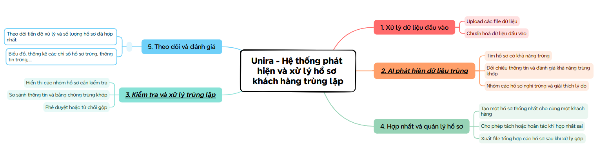

| Nhóm chức năng | Mục đích |
| --- | --- |
| Phiên xử lý | Tách mỗi đợt công việc thành một phiên có file và kết quả riêng. |
| Nhập dữ liệu | Tải nhiều file CSV, xem trước dữ liệu và biết file nào có lỗi. |
| Tìm hồ sơ trùng | Đề xuất các nhóm hồ sơ có thể thuộc cùng một khách hàng. |
| Xác minh | Cho người quản lý xem lý do và quyết định gộp hay giữ riêng. |
| Hồ sơ khách hàng | Tra cứu kết quả, xem dữ liệu gốc và sửa trường hợp gộp nhầm. |
| File sạch và thống kê | Tải kết quả của từng phiên và theo dõi tiến độ xử lý. |

### 1.2. INVEST Requirements

#### 1.2.1. INVEST Principles

| Tiêu chí | Ý nghĩa trong Unira |
| --- | --- |
| **Independent – Độc lập** | Mỗi nhu cầu có một kết quả riêng; chỉ phụ thuộc bước khác khi cần. |
| **Negotiable – Có thể điều chỉnh** | Cách trình bày và triển khai có thể thay đổi, nhưng mục tiêu và quyền truy cập được giữ. |
| **Valuable – Có giá trị** | Mỗi nhu cầu giúp nhập, kiểm tra, hợp nhất hoặc xuất dữ liệu. |
| **Estimable – Có thể ước lượng** | Người làm, đầu vào, đầu ra và tình huống lỗi được nêu rõ. |
| **Small – Đủ nhỏ** | Việc lớn được tách thành những bước có thể hoàn thành riêng. |
| **Testable – Có thể kiểm tra** | Mỗi nhu cầu có kết quả quan sát được. |

#### 1.2.2. User Stories

| ID | Vai trò | User story |
| --- | --- | --- |
| US01 | Steward | Tôi muốn tạo, đặt tên và quản lý từng phiên xử lý. |
| US02 | Steward | Tôi muốn đưa nhiều file CSV vào một phiên và xem lỗi của từng file. |
| US03 | Steward | Tôi muốn xem trước dữ liệu rồi chạy kiểm tra trùng cho phiên đã chọn. |
| US04 | Steward | Tôi muốn theo dõi trạng thái và tiến độ của từng phiên. |
| US05 | Steward | Tôi muốn xem các nhóm nghi trùng cùng lý do gợi ý trong đúng phiên. |
| US06 | Steward | Tôi muốn duyệt hoặc từ chối đề xuất gộp của từng nhóm. |
| US07 | Steward | Tôi muốn chọn thông tin cho hồ sơ thống nhất trước khi duyệt. |
| US08 | Steward | Tôi muốn hệ thống tự tạo hồ sơ thống nhất sau khi tôi duyệt. |
| US09 | Steward | Tôi muốn tách hồ sơ gộp sai mà vẫn giữ được dữ liệu gốc. |
| US10 | Steward, Viewer | Tôi muốn tra cứu hồ sơ đã xử lý theo từng phiên. |
| US11 | Steward, Viewer | Tôi muốn xem thống kê chung và kết quả của từng phiên. |
| US12 | Steward | Tôi muốn biết mỗi phiên có bao nhiêu bản ghi hợp lệ, bản ghi lỗi và kết quả xử lý ra sao. |
| US13 | Steward | Tôi muốn biết nhóm nào đã được duyệt hoặc từ chối, và ai đã quyết định. |
| US14 | Steward, Viewer | Tôi muốn đăng nhập và chỉ dùng được các chức năng phù hợp với vai trò của mình. |
| US15 | Steward | Tôi muốn tải CSV sạch của phiên đã hoàn tất mà không lấy nhầm file của phiên khác. |

#### 1.2.3. INVEST Review by Story Group

| Nhóm | Phụ thuộc cần thiết | Phần có thể điều chỉnh | Giá trị | Cách chia nhỏ và kiểm tra |
| --- | --- | --- | --- | --- |
| **US01–US04** Phiên và file | Đăng nhập trước khi tạo phiên | Bố cục biểu mẫu, cách hiển thị tiến độ | Gom nhiều file trong một đợt xử lý | Tách tạo phiên, nhập file và chạy so khớp; kiểm tra lỗi từng file. |
| **US05–US08** Xác minh | Cần có kết quả so khớp | Cách so sánh và trình bày lý do | Tránh gộp sai khách hàng | Tách xem nhóm, quyết định và tạo hồ sơ; chỉ nhóm đã duyệt mới được gộp. |
| **US09–US10** Hồ sơ | Cần hồ sơ đã xử lý | Bộ lọc và bố cục chi tiết | Tra cứu và sửa sai | Kiểm tra tách hồ sơ mà vẫn giữ dữ liệu gốc. |
| **US11–US13** Theo dõi | Cần dữ liệu của phiên | Cách vẽ biểu đồ | Biết tiến độ và ai đã quyết định | Kiểm tra thống kê đúng phiên và lịch sử quyết định. |
| **US14–US15** Quyền và xuất file | Cần đăng nhập và phiên hoàn tất | Cách thông báo, tên file | Truy cập an toàn, nhận đúng kết quả | Kiểm tra người xem không tải file và hai phiên không dùng chung kết quả. |

#### 1.2.4. Business Rules

| Mã | Quy tắc |
| --- | --- |
| BR01 | Một người quản lý có thể tạo nhiều phiên; mỗi phiên có tiến độ riêng. |
| BR02 | Một phiên có thể nhận nhiều file CSV và báo lỗi cho từng file. |
| BR03 | File chỉ thuộc một phiên; dữ liệu giữa các phiên không bị trộn. |
| BR04 | Sau khi bắt đầu so khớp, danh sách file của phiên không còn thay đổi. |
| BR05 | Dữ liệu gốc được giữ lại cùng kết quả kiểm tra file. |
| BR06 | Hệ thống chỉ so sánh những hồ sơ có khả năng liên quan để xử lý nhanh hơn. |
| BR07 | Gợi ý trùng phải có lý do; trùng tên một mình không đủ để tự gộp. |
| BR08 | Người quản lý dữ liệu phải duyệt trước khi hồ sơ được gộp. |
| BR09 | Một nhóm đã xử lý không được duyệt lần nữa. |
| BR10 | Hồ sơ thống nhất chỉ gồm dữ liệu trong cùng một phiên. |
| BR11 | Một hồ sơ gốc không được gộp vào hai hồ sơ thống nhất đang có hiệu lực. |
| BR12 | Chỉ tạo file sạch khi mọi nhóm cần xem xét đã được xử lý. |
| BR13 | Mỗi khách hàng hợp lệ xuất hiện một lần trong file sạch của phiên. |
| BR14 | Mỗi phiên có một file sạch hiện hành. |
| BR15 | Sau khi tách một hồ sơ gộp nhầm, file cũ ngừng tải cho đến khi file mới sẵn sàng. |
| BR16 | Mọi thao tác xem, sửa và tải file đều phải kiểm tra quyền với đúng phiên. |
| BR17 | Các phiên có thể xử lý độc lập; tiến độ của từng phiên được lưu lại. |
| BR18 | Quyết định duyệt hoặc từ chối được ghi lại để có thể kiểm tra về sau. |

#### 1.2.5. Acceptance Criteria

| Mã | Điều kiện kiểm tra |
| --- | --- |
| AC01 | Tạo hai phiên thì mỗi phiên có tên, trạng thái và trang chi tiết riêng. |
| AC02 | Một phiên nhận ít nhất hai file và hiển thị số dòng hợp lệ, số dòng lỗi của từng file. |
| AC03 | File không đúng định dạng bị từ chối; lỗi dữ liệu nêu rõ vị trí để sửa. |
| AC04 | Danh sách phiên hiển thị đúng trạng thái, tiến độ và các file đã nhập. |
| AC05 | Nhóm nghi trùng của phiên A không xuất hiện trong phiên B; mỗi gợi ý có lý do. |
| AC06 | Chỉ người quản lý được duyệt; nhóm đã có quyết định không được duyệt lại. |
| AC07 | Duyệt thì tạo hồ sơ thống nhất; từ chối thì các hồ sơ được giữ riêng. |
| AC08 | Từ hồ sơ thống nhất có thể xem lại dữ liệu gốc và nguồn của nó. |
| AC09 | Tách hồ sơ gộp nhầm không làm mất dữ liệu gốc và tạo lại kết quả. |
| AC10 | Phiên chỉ hoàn tất khi các nhóm đã được xử lý và file sạch đã sẵn sàng. |
| AC11 | File sạch của phiên A không chứa dữ liệu chỉ có ở phiên B. |
| AC12 | File sạch giữ đúng tiếng Việt và số dòng sau xử lý. |
| AC13 | Tải lại file hiện hành không tạo thêm phiên hoặc file mới. |
| AC14 | Sau khi tách hồ sơ, file cũ không tải được cho đến khi file mới hoàn tất. |
| AC15 | Tổng quan hiển thị số phiên đang chạy, chờ duyệt, hoàn tất và gặp lỗi. |
| AC16 | Thống kê theo phiên hiển thị số dòng hợp lệ, dòng lỗi và nhóm đã xử lý. |
| AC17 | Khi đo hiệu năng, công bố thời gian và tài nguyên thực tế thay vì ước đoán. |

### 1.3. Use Cases

#### 1.3.1. Actors

| Tác nhân | Vai trò |
| --- | --- |
| **Data Steward** (người quản lý dữ liệu) | Tạo phiên, nhập file, duyệt kết quả, sửa gộp nhầm và tải file sạch. |
| **Viewer** (người xem) | Xem những phiên, hồ sơ và thống kê được cấp quyền. |

#### 1.3.2. Use Case Overview Diagram

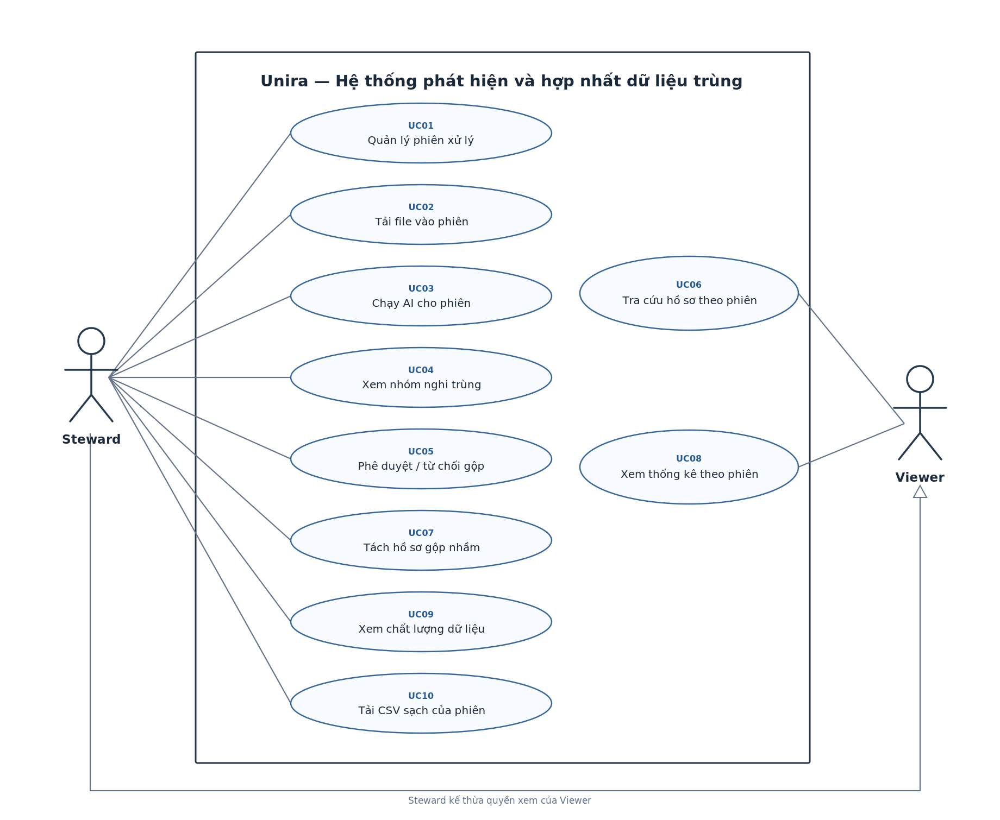

#### 1.3.3. Use Case List

| Mã | Ca sử dụng | Tác nhân chính | User story liên quan |
| --- | --- | --- | --- |
| UC01 | Quản lý phiên xử lý | Steward | US01, US04 |
| UC02 | Tải file vào phiên | Steward | US02, US12 |
| UC03 | Chạy so khớp cho phiên | Steward | US03, US04 |
| UC04 | Xem nhóm nghi trùng | Steward | US05 |
| UC05 | Duyệt hoặc từ chối gộp | Steward | US06, US07, US08, US13 |
| UC06 | Tra cứu hồ sơ thống nhất | Steward, Viewer | US10 |
| UC07 | Tách hồ sơ gộp nhầm | Steward | US09 |
| UC08 | Xem thống kê theo phiên | Steward, Viewer | US11 |
| UC09 | Xem chất lượng dữ liệu | Steward | US12 |
| UC10 | Tải CSV sạch của phiên | Steward | US15 |

Đăng nhập và kiểm tra quyền là điều kiện chung trước khi thực hiện các thao tác trên.

#### 1.3.4. Key Use Case Specifications

**UC01 – Quản lý phiên xử lý**

- **Người thực hiện:** Data Steward.
- **Điều kiện bắt đầu:** Đã đăng nhập và có quyền tạo phiên.
- **Luồng chính:** Mở danh sách phiên → đặt tên phiên mới → lưu → mở trang nhập file.
- **Trường hợp khác:** Có thể mở lại phiên đã tạo để xem tiến độ.
- **Kết quả:** Phiên có danh sách file và kết quả riêng, ban đầu chưa chạy so khớp.

**UC02 – Nhập file vào phiên**

- **Người thực hiện:** Data Steward.
- **Điều kiện bắt đầu:** Phiên chưa bắt đầu xử lý.
- **Luồng chính:** Chọn một hoặc nhiều file CSV → xem kết quả kiểm tra từng file → sửa hoặc loại file lỗi → bắt đầu so khớp khi có file hợp lệ.
- **Trường hợp lỗi:** File sai định dạng hoặc thiếu dữ liệu cần thiết được báo rõ; phiên đã chạy không nhận thêm file.
- **Kết quả:** File hợp lệ được gắn với đúng phiên, dữ liệu gốc được giữ lại.

**UC05 – Duyệt hoặc từ chối gộp**

- **Người thực hiện:** Data Steward.
- **Điều kiện bắt đầu:** Phiên có nhóm nghi trùng chưa được xử lý.
- **Luồng chính:** Mở nhóm → so sánh hồ sơ và lý do gợi ý → chọn gộp hoặc giữ riêng → xác nhận.
- **Trường hợp lỗi:** Nếu nhóm đã có quyết định, hệ thống yêu cầu tải lại trước khi tiếp tục.
- **Kết quả:** Chỉ nhóm được duyệt mới tạo hồ sơ thống nhất; quyết định được lưu lại.

**UC10 – Tải file sạch**

- **Người thực hiện:** Data Steward.
- **Điều kiện bắt đầu:** Phiên và file kết quả đã hoàn tất.
- **Luồng chính:** Mở chi tiết phiên → chọn tải file sạch → nhận đúng file của phiên đó.
- **Trường hợp lỗi:** File chưa sẵn sàng hoặc đang được tạo lại thì chưa thể tải.
- **Kết quả:** Dữ liệu phiên không thay đổi khi tải file.

### 1.4. Roles and Permissions

#### 1.4.1. Permission Matrix

Ký hiệu: **✓** được phép; **—** không được phép; **Theo quyền** chỉ xem phiên được cấp.

| Chức năng | Data Steward | Viewer |
| --- | :---: | :---: |
| Xem danh sách phiên, hồ sơ và thống kê | Theo quyền | Theo quyền |
| Tạo phiên và nhập file | ✓ | — |
| Chạy so khớp và xem nhóm nghi trùng | ✓ | — |
| Duyệt, từ chối hoặc tách hồ sơ | ✓ | — |
| Tải file sạch | ✓ | — |

#### 1.4.2. Business States

| Đối tượng | Các trạng thái dễ hiểu | Ý nghĩa |
| --- | --- | --- |
| Phiên xử lý | Chưa chạy · Đang chạy · Chờ duyệt · Hoàn tất · Gặp lỗi | Cho biết phiên đang ở bước nào. |
| File đầu vào | Đang kiểm tra · Hợp lệ · Có lỗi | Cho biết file có thể được dùng để so khớp không. |
| Nhóm nghi trùng | Chờ duyệt · Đã duyệt · Giữ riêng | Cho biết quyết định với nhóm. |
| File sạch | Đang tạo · Sẵn sàng · Cần tạo lại | Cho biết khi nào được tải. |

## 2. Information Architecture, Screen Hierarchy, and UI/UX

Unira có 9 màn hình. Mỗi phiên có các file, nhóm nghi trùng, hồ sơ và file sạch riêng. Hộp thoại hoặc bảng chi tiết nằm trong màn hình đang mở, không tính thành màn hình mới.

### 2.1. Information Architecture

#### 2.1.1. Page Hierarchy

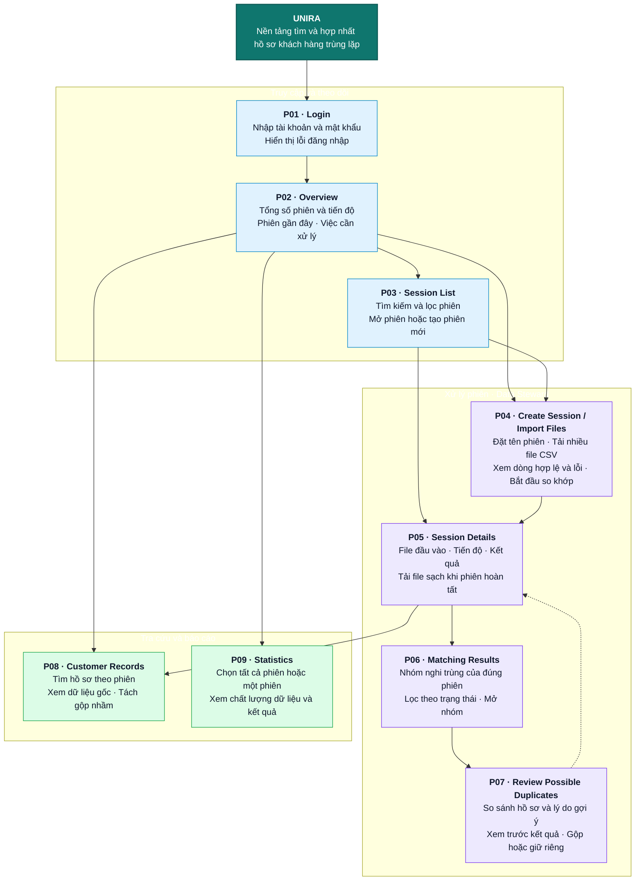

P04 có thể mở trực tiếp từ P02. Khi đi từ P05 đến P06–P08, hệ thống giữ đúng phiên đang chọn.

#### 2.1.2. Page Content by Section

Mỗi **Section** là một khối nội dung trên màn hình. Các nút và thông báo được mô tả cùng khối mà chúng phục vụ.

##### P01 – Login

| Section | Nội dung và thao tác |
| --- | --- |
| Đăng nhập | Nhập tài khoản và mật khẩu, chọn **Đăng nhập**. |
| Thông báo | Báo thông tin sai hoặc tài khoản không được phép; đăng nhập thành công chuyển đến P02. |

##### P02 – Overview

| Section | Nội dung và thao tác |
| --- | --- |
| Tình hình chung | Tổng số phiên, phiên đang chạy, chờ duyệt, hoàn tất và gặp lỗi. |
| Phiên gần đây | Mở nhanh phiên cần tiếp tục xử lý. |
| Việc cần làm | Nhắc các phiên đang chờ duyệt hoặc cần sửa lỗi. |
| Tạo phiên | Người quản lý dữ liệu mở P04; người xem không có thao tác này. |

##### P03 – Session List

| Section | Nội dung và thao tác |
| --- | --- |
| Tìm và lọc | Tìm theo tên phiên, lọc theo trạng thái và thời gian. |
| Danh sách | Xem tên, số file, tiến độ và trạng thái; chọn một phiên để mở P05. |
| Tạo mới | Người quản lý dữ liệu có thể mở P04. |

##### P04 – Create Session / Import Files

| Section | Nội dung và thao tác |
| --- | --- |
| Thông tin phiên | Đặt tên và mô tả ngắn cho phiên. |
| File đầu vào | Thêm nhiều file CSV, xem tên và nguồn của từng file. |
| Kiểm tra file | Xem số dòng hợp lệ, dòng lỗi và lý do lỗi của mỗi file. |
| Bắt đầu | Chỉ cho chạy so khớp khi có file hợp lệ; sau đó mở P05. |

##### P05 – Session Details

| Section | Nội dung và thao tác |
| --- | --- |
| Thông tin phiên | Tên, người tạo, thời gian và trạng thái. |
| Tiến độ | Các bước nhập file, so khớp, chờ duyệt, hợp nhất và xuất file. |
| File và kết quả | Danh sách file đầu vào, số nhóm nghi trùng và hồ sơ sau xử lý. |
| File sạch | Người quản lý tải file khi phiên đã hoàn tất và file sẵn sàng. |

##### P06 – Matching Results

| Section | Nội dung và thao tác |
| --- | --- |
| Phiên đang xem | Luôn hiển thị tên phiên để tránh nhầm kết quả. |
| Bộ lọc | Lọc nhóm chờ duyệt, đã duyệt hoặc giữ riêng. |
| Danh sách nhóm | Xem số hồ sơ, mức độ giống và lý do gợi ý; chọn nhóm để mở P07. |

##### P07 – Review Possible Duplicates

| Section | Nội dung và thao tác |
| --- | --- |
| So sánh hồ sơ | Đặt các hồ sơ cạnh nhau và đánh dấu điểm giống, khác. |
| Lý do gợi ý | Hiển thị dấu hiệu ủng hộ và dấu hiệu còn mâu thuẫn. |
| Kết quả dự kiến | Xem thông tin sẽ được giữ nếu gộp. |
| Quyết định | Chọn **Gộp** hoặc **Giữ riêng**, ghi lý do nếu cần rồi xác nhận. |

##### P08 – Customer Records

| Section | Nội dung và thao tác |
| --- | --- |
| Chọn phiên và tìm kiếm | Chọn đúng phiên, tìm khách hàng theo thông tin liên hệ. |
| Danh sách hồ sơ | Xem hồ sơ đã xử lý trong phiên. |
| Chi tiết | Xem thông tin thống nhất cùng các hồ sơ gốc. |
| Sửa gộp nhầm | Người quản lý dữ liệu tách hồ sơ và chờ tạo lại file sạch. |

##### P09 – Statistics

| Section | Nội dung và thao tác |
| --- | --- |
| Chọn phạm vi | Xem tất cả phiên được phép hoặc chọn một phiên. |
| Kết quả xử lý | Số file, dòng hợp lệ/lỗi, nhóm nghi trùng và hồ sơ sau gộp. |
| Tiến độ | Xem các phiên đã hoàn tất và phiên còn cần xử lý. |

### 2.2. Screen Hierarchy

#### 2.2.1. Screen Inventory

| Mã | Màn hình | Người dùng | Nhu cầu liên quan |
| --- | --- | --- | --- |
| P01 | Login | Cả hai vai trò | US14 |
| P02 | Overview | Cả hai vai trò | US04, US11 |
| P03 | Session list | Cả hai vai trò | US01, US04 |
| P04 | Create session / Import files | Data Steward | US01–US03, US12 |
| P05 | Session details | Cả hai vai trò | US04, US11, US15 |
| P06 | Matching results | Data Steward | US05, US13 |
| P07 | Review possible duplicates | Data Steward | US05–US08, US13 |
| P08 | Customer records | Cả hai vai trò; chỉ Steward được sửa | US09, US10 |
| P09 | Statistics | Cả hai vai trò | US11, US12 |

#### 2.2.2. Navigation Flow

**Tạo phiên và tải file sạch**

```text
P01 Login → P02 Overview → P03 Session list → P04 Create session / Import files
→ P05 Session details → P06 Matching results → P07 Review possible duplicates
→ P05 Session details → Tải file sạch
```

**Tra cứu và sửa gộp nhầm**

```text
P03 Session list → P05 Session details → P08 Customer records
→ Tách hồ sơ gộp nhầm → Tạo lại file sạch → P05 Session details
```

**Xem thống kê**

```text
P02 Overview → P09 Statistics → Chọn tất cả phiên hoặc một phiên
```

### 2.3. UI/UX Screens

#### Overview

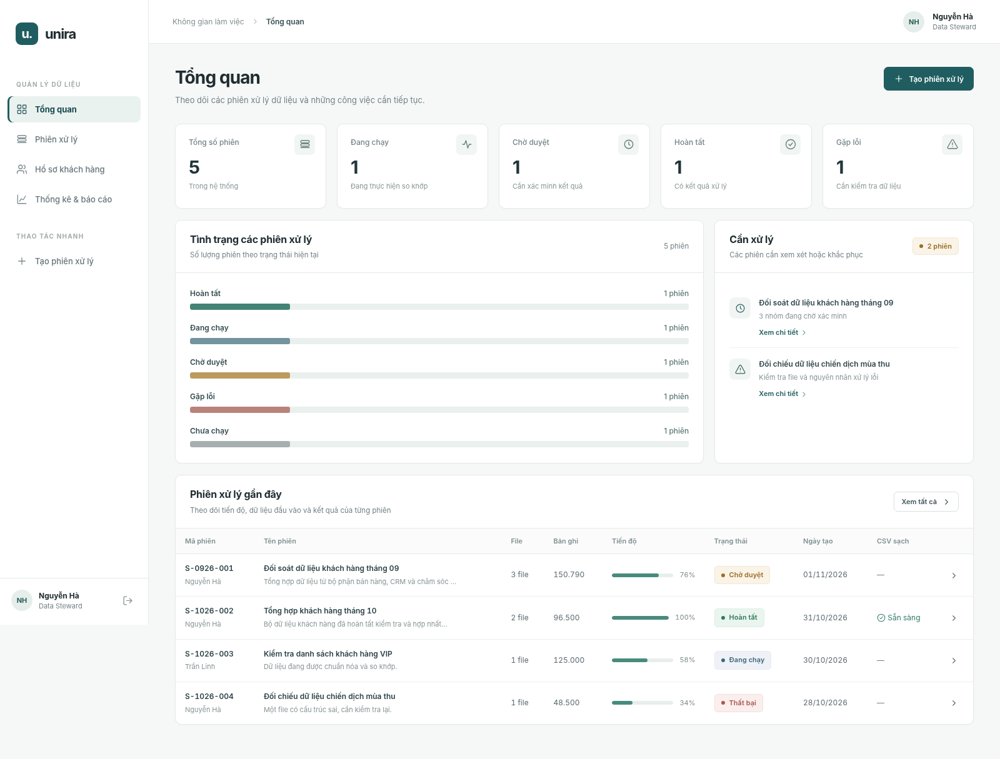

#### Session list

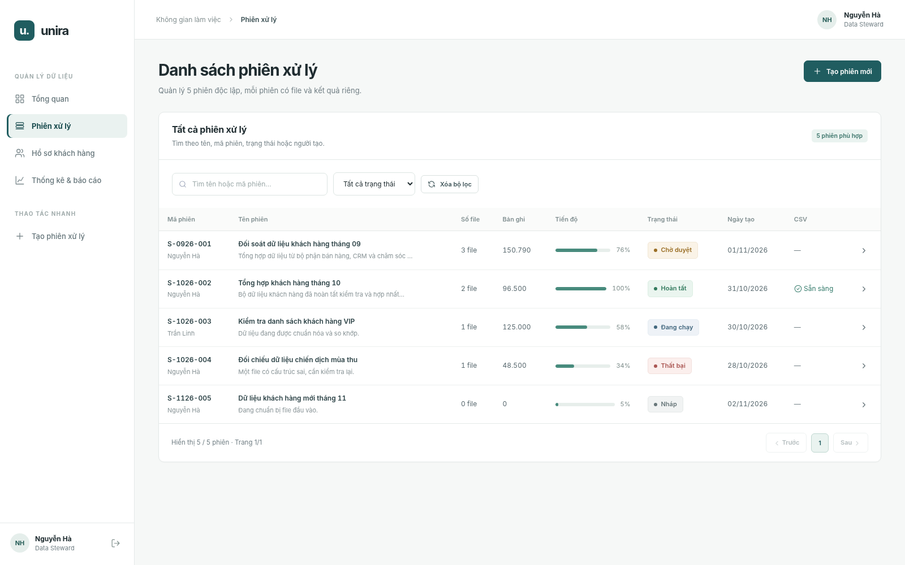

#### Create session and import files

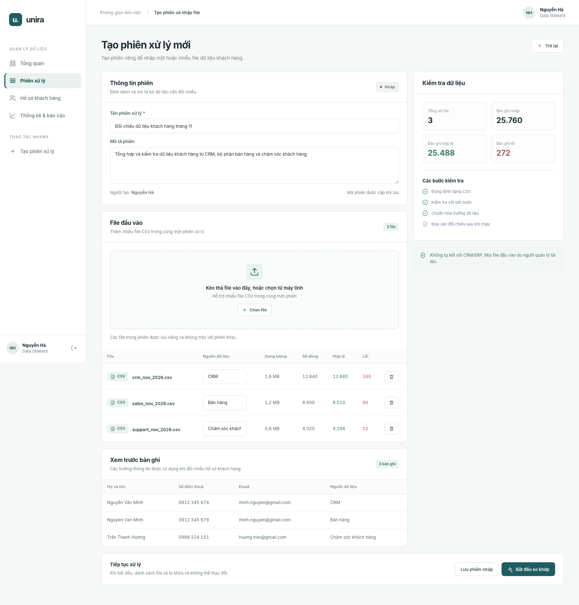

#### Session details

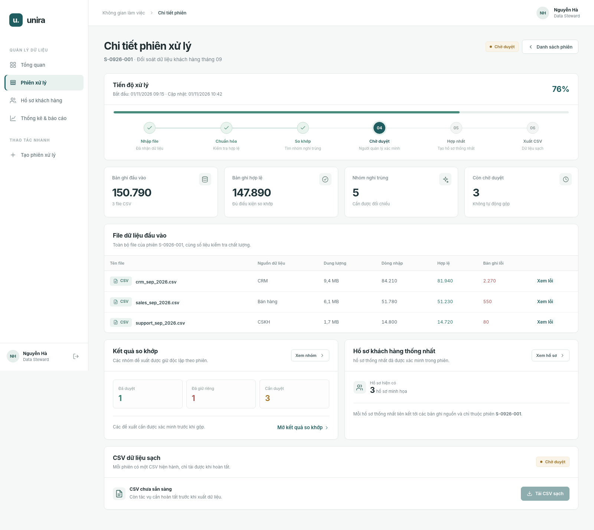

#### Matching results

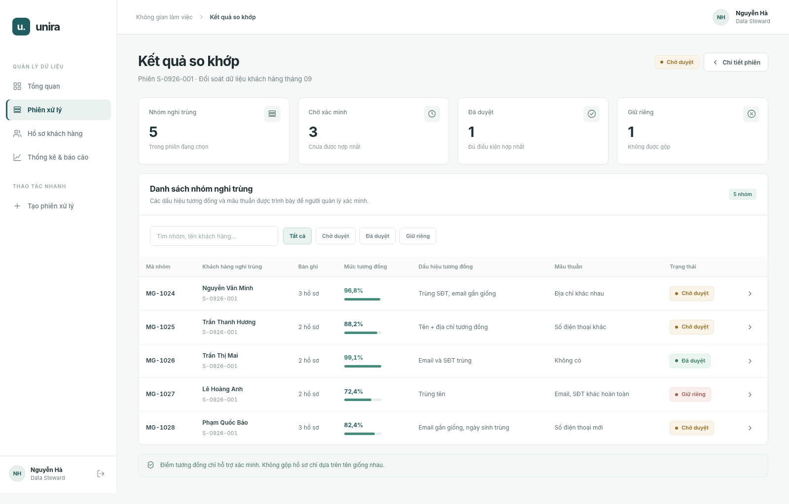

#### Review possible duplicates

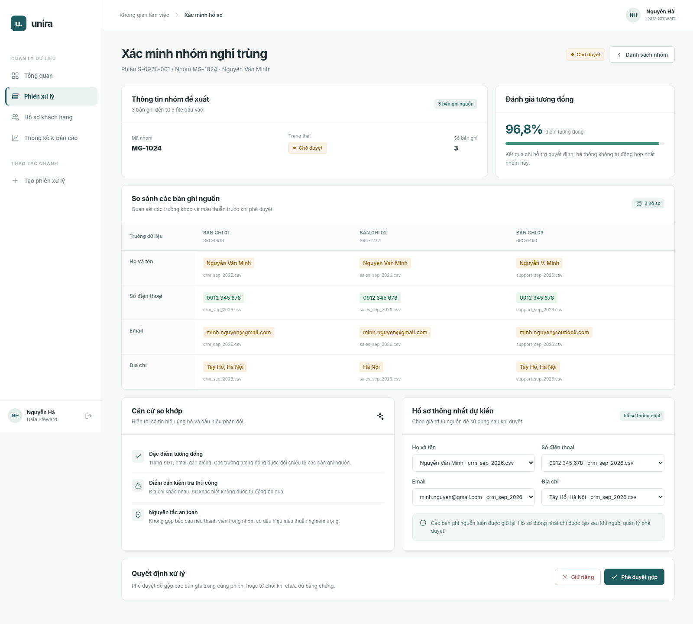

#### Customer records

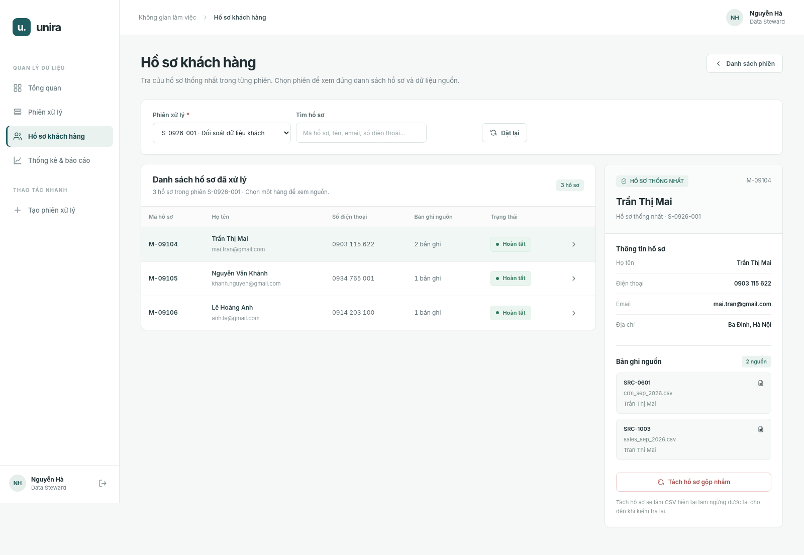

#### Statistics

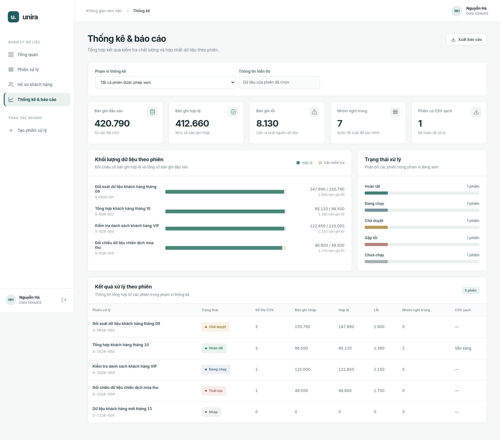

## 3. Kiến trúc C4

Phần này trình bày kiến trúc dự kiến của Unira ở ba mức: **C1** mô tả người dùng và hệ thống, **C2** mô tả các phần chính của hệ thống, **C3** đi sâu vào API ứng dụng. Công nghệ triển khai cụ thể chưa được lựa chọn.

Tài liệu chi tiết: [Kiến trúc C4](./docs/architecture/c4/README.md).

### C1 — System Context (Bối cảnh hệ thống)

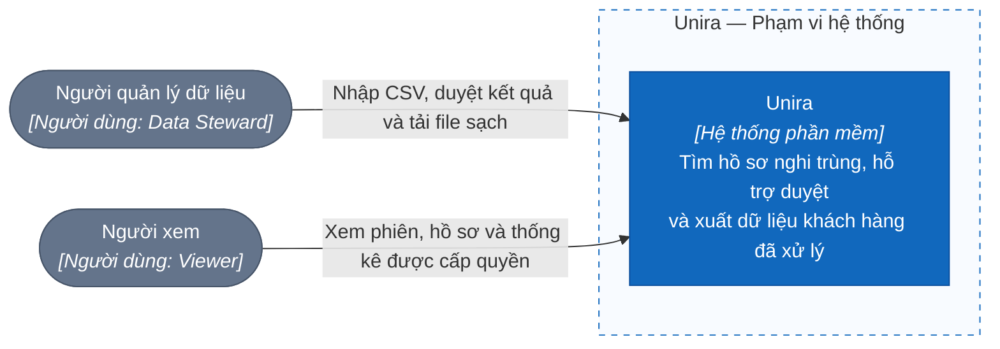

[Xem chi tiết: C1 — System Context](./docs/architecture/c4/01-system-context.md).

File CSV được người dùng tải lên. File có thể xuất từ CRM hoặc ERP; Unira không kết nối trực tiếp với các hệ thống đó.

### C2 — Container (Các phần của hệ thống)

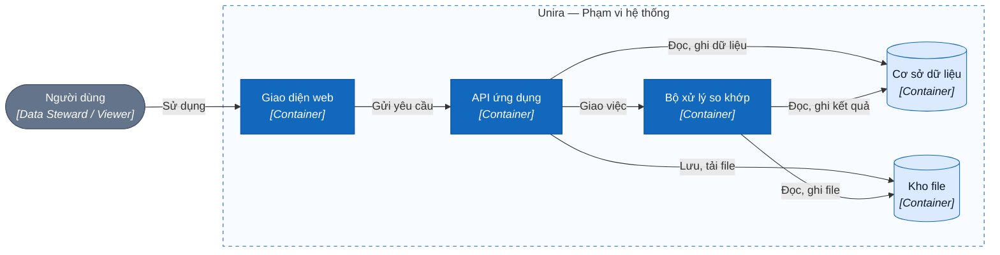

[Xem chi tiết: C2 — Container](./docs/architecture/c4/02-container.md).

### C3 — Component (Các thành phần của API)

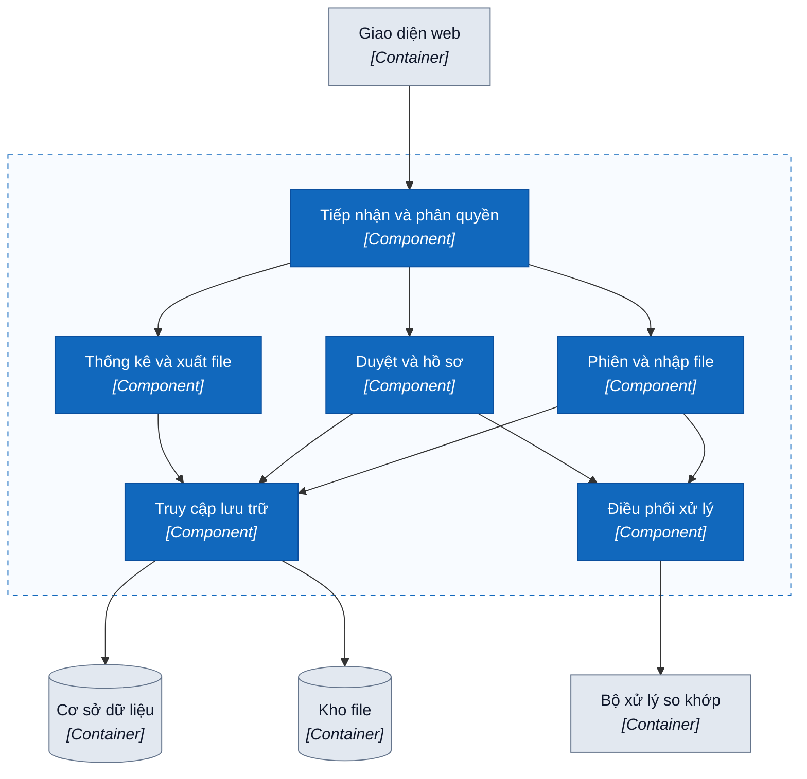

[Xem chi tiết: C3 — Component](./docs/architecture/c4/03-component.md).

Khung nét đứt bao quanh các thành phần dự kiến của API. Mũi tên thể hiện các phần có trao đổi với nhau. Việc tìm trùng và tạo CSV được giao cho bộ xử lý so khớp ở C2.

### Trạng thái thiết kế

| Phần | Tình trạng hiện tại |
| --- | --- |
| Giao diện web | Đã thiết kế màn hình và luồng điều hướng. |
| API ứng dụng | Đã viết hợp đồng OpenAPI; chưa có backend chạy thực tế. |
| Bộ xử lý so khớp | Quy trình đã được mô tả; chưa đo hiệu năng. |
| Cơ sở dữ liệu và kho file | Đã thiết kế dữ liệu và cách lưu file; chưa kết nối vào ứng dụng. |

## 4. Database Diagrams and OpenAPI 3.0 Contract

Phần này mô tả dữ liệu cần lưu và các thao tác mà giao diện sẽ gọi. Sơ đồ và hợp đồng API là thiết kế dự kiến; ứng dụng chạy thực tế chưa được xây dựng.

### 4.1 Database diagrams

Sơ đồ thể hiện các bảng, thuộc tính chính và quan hệ. Xem đầy đủ các cột và khóa trong [DBML](./docs/schema.dbml).

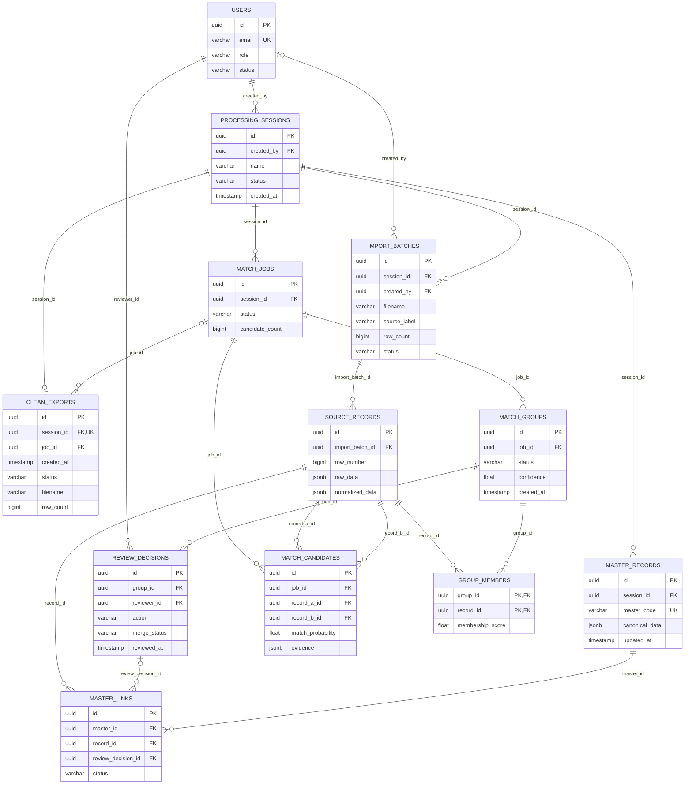

| Nhóm dữ liệu | Mục đích |
| --- | --- |
| Tài khoản | Lưu người dùng và quyền. |
| Phiên xử lý | Theo dõi tên, người tạo và tiến độ từng phiên. |
| File và hồ sơ gốc | Giữ file đã tải lên, dữ liệu gốc và lỗi nhập. |
| Kết quả so khớp | Lưu các nhóm nghi trùng và lý do gợi ý. |
| Quyết định duyệt | Ghi ai đã duyệt hoặc từ chối, vào lúc nào. |
| Hồ sơ thống nhất | Lưu kết quả gộp và liên hệ với hồ sơ gốc. |
| File sạch | Lưu bản kết quả hiện hành của từng phiên. |

Một phiên có thể có nhiều file. Mỗi file, nhóm nghi trùng, hồ sơ thống nhất và file sạch chỉ thuộc đúng một phiên. Dữ liệu gốc không bị xóa khi hợp nhất.

### 4.2 Tài liệu API — OpenAPI 3.0

Hợp đồng API mô tả các thao tác giữa giao diện và phần xử lý, bao gồm dữ liệu cần gửi, kết quả trả về, quyền truy cập và trường hợp lỗi. Tài liệu dùng OpenAPI 3.0.3 và hiện mô tả 20 thao tác dự kiến.

- [Xem tài liệu API tiếng Việt](./docs/api/openapi.yaml)
- [Xem tài liệu API tiếng Anh](./docs/api/openapi.en.yaml)

| Nhóm thao tác | Việc được hỗ trợ |
| --- | --- |
| Đăng nhập | Xác thực người dùng và xem quyền của mình. |
| Phiên xử lý | Tạo, tìm và xem tiến độ phiên. |
| File đầu vào | Tải file lên và xem trạng thái, số dòng hợp lệ và số dòng lỗi. |
| So khớp | Bắt đầu xử lý và xem nhóm nghi trùng. |
| Duyệt kết quả | Gộp hoặc giữ riêng các hồ sơ. |
| Hồ sơ khách hàng | Tra cứu và tách trường hợp gộp nhầm. |
| File sạch và thống kê | Tải kết quả của đúng phiên và xem số liệu tổng hợp. |

Đăng nhập là thao tác công khai; các thao tác còn lại yêu cầu xác thực và kiểm tra quyền phù hợp. Những thao tác liên quan đến phiên phải kiểm tra đúng phiên được yêu cầu. Đây là hợp đồng dự kiến, chưa phải API đang chạy.

## 5. Cấu trúc thư mục frontend và backend

### 5.1 Hiện trạng kho mã

Kho hiện chỉ có **tài liệu thiết kế**: `docs/api/` chứa hợp đồng OpenAPI dự kiến, `docs/architecture/c4/` chứa C1–C3, `docs/requirements/` và `docs/ui-ux/` chứa yêu cầu và màn hình, `docs/schema*.dbml` chứa mô hình dữ liệu. Chưa có frontend, API, worker hoặc migration chạy được.

### 5.2 Cấu trúc mã nguồn đề xuất

Đây là **cấu trúc mục tiêu**, không phải các thư mục đã tồn tại. Có thể chọn tên theo công nghệ khi triển khai nhưng vẫn giữ ranh giới trách nhiệm.

```text
Unira/
├── frontend/
│   ├── app/                    # Điều hướng, trạng thái xác thực, cấu hình API
│   ├── features/
│   │   ├── sessions/           # Danh sách, tạo phiên, trạng thái
│   │   ├── imports/            # Tải CSV và hiển thị lỗi dữ liệu
│   │   ├── matching/           # Job, nhóm nghi trùng, bằng chứng
│   │   ├── review/             # Duyệt hoặc từ chối nhóm
│   │   ├── records/            # Hồ sơ thống nhất, nguồn gốc, tách gộp
│   │   └── dashboard/          # Số liệu tổng quan và theo phiên
│   ├── shared/                 # UI, định dạng và kiểm tra dùng chung
│   └── services/               # API client theo docs/api/openapi.yaml
├── backend/
│   ├── api/                    # HTTP, ánh xạ request/response, xác thực
│   ├── application/            # Use case, phân quyền, điều phối job
│   ├── domain/                 # Quy tắc phiên, nhóm, quyết định, hồ sơ, CSV
│   ├── ports/                  # Interface kho dữ liệu, lưu file, hàng đợi
│   └── infrastructure/         # Adapter cơ sở dữ liệu, file, hàng đợi
├── worker/
│   ├── import_validation/      # Đọc CSV, kiểm tra dòng, chuẩn hóa
│   ├── matching/               # Blocking, tính điểm, bằng chứng, nhóm
│   ├── merging/                # Gộp đã duyệt và nguồn gốc dữ liệu
│   └── exporting/              # Tạo CSV UTF-8 và checksum
├── database/migrations/        # Lược đồ và ràng buộc toàn vẹn
├── tests/
│   ├── contract/              # API và giới hạn theo vai trò
│   ├── application/           # Bất biến của phiên, duyệt, xuất CSV
│   └── integration/           # Cơ sở dữ liệu, lưu file, luồng worker
├── docs/                       # Tài liệu thiết kế và API hiện có
├── README.md
└── VREADME.md
```

| Ranh giới | Quy tắc phụ thuộc |
| --- | --- |
| Frontend | Các màn hình gọi API client chung; backend vẫn phải kiểm tra quyền. |
| API | Chuyển HTTP thành use case, kiểm tra xác thực và quyền với từng phiên. |
| Application và domain | Phụ thuộc vào interface và quy tắc nghiệp vụ, không phụ thuộc framework web hay cơ sở dữ liệu. |
| Infrastructure và worker | Triển khai interface và job nền; dữ liệu luôn được truy xuất theo đúng phiên. |

Các mô-đun `worker/` tương ứng worker độc lập trong [C2](./docs/architecture/c4/02-container.en.md). Các mô-đun `backend/` làm rõ thành phần API trong [C3](./docs/architecture/c4/03-component.en.md). Truy vấn dữ liệu theo phiên phải nhận `sessionId`; chỉ có ID của nhóm hay hồ sơ không đủ để cấp quyền.

## 6. Thiết kế chi tiết lớp và trình tự xử lý

Các sơ đồ dưới đây là thiết kế dự kiến từ [C3](./docs/architecture/c4/03-component.en.md), [mô hình dữ liệu](./docs/schema.dbml) và [hợp đồng OpenAPI](./docs/api/openapi.yaml). Tên lớp chỉ mô tả trách nhiệm; chưa có lớp nào được triển khai.

### 6.1 C4 cấp 4 — các lớp phối hợp

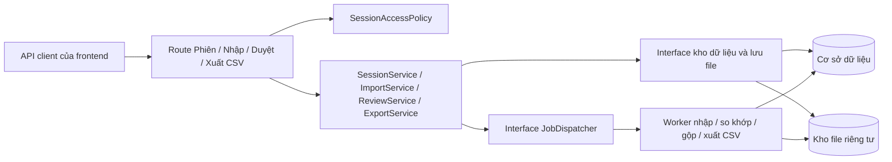

Route kiểm tra danh tính và quyền, rồi gọi service. Service kiểm tra chuyển trạng thái; worker làm tác vụ dài. Nhóm, bản ghi nguồn, hồ sơ thống nhất và file xuất đều phải được xác định thuộc phiên được yêu cầu.

### 6.2 Quan hệ các lớp cốt lõi

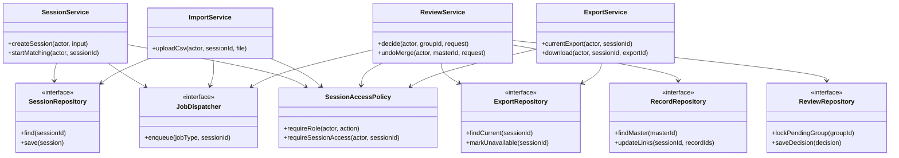

Các interface trên là cổng dự kiến. Khi triển khai phải bảo đảm ràng buộc trong DBML: mỗi bản ghi nguồn có tối đa một liên kết master còn hiệu lực, mỗi phiên có một file xuất hiện hành. Worker giữ dòng dữ liệu gốc và ghi phiên bản mô hình/cấu hình của từng job so khớp.

### 6.3 Trình tự — nhập file và so khớp

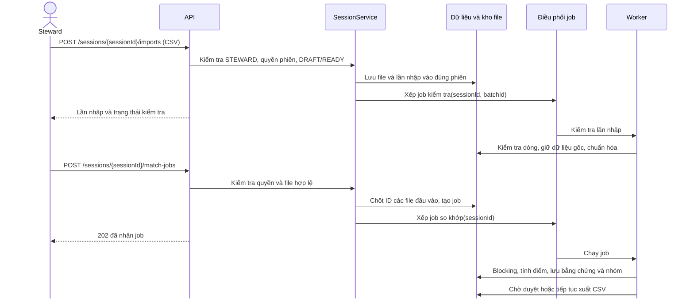

Snapshot đầu vào ngăn thay đổi file trong khi job đang chạy. Cặp ứng viên và nhóm chỉ được chứa bản ghi của chính phiên đó.

### 6.4 Trình tự — duyệt và gộp

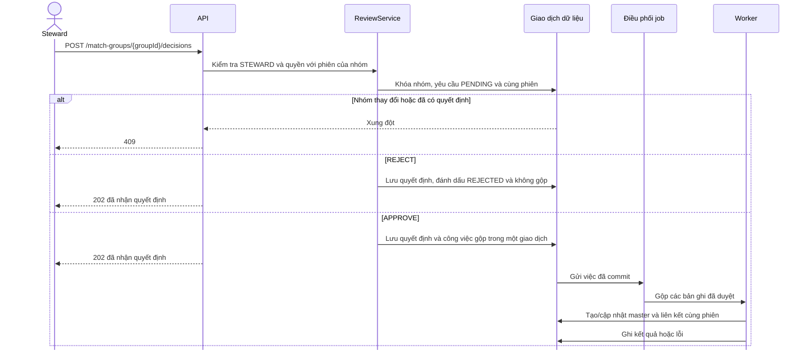

Chỉ `STEWARD` được duyệt. Quyết định đồng thời gây `409`; duyệt tạo công việc gộp, từ chối không tạo liên kết gộp. Nhóm và lịch sử quyết định được giữ để truy vết.

### 6.5 Trình tự — tách, tạo lại và tải CSV

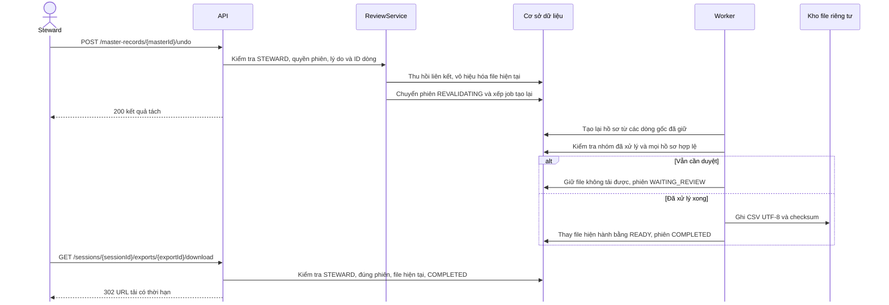

Trước khi file thay thế đạt `READY`, không được tải file cũ. Nếu còn nhóm cần xem xét, phiên chờ quyết định trước khi xuất lại. Tải lại file hiện hành không tạo job mới. CSV có một dòng cho mỗi khách hàng hợp lệ trong phiên, kể cả hồ sơ không trùng.
