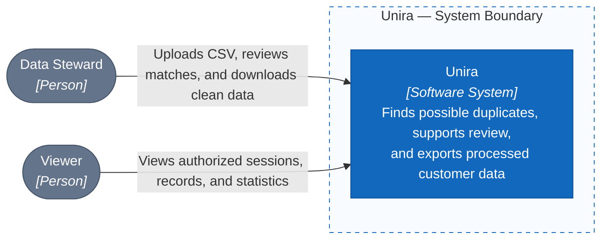

# C1 — System Context

> Proposed architecture; the complete application has not been built yet.

## Scope and users

| Person | Main responsibilities |
| --- | --- |
| Data Steward | Creates sessions, uploads files, reviews possible duplicates, corrects merges, and downloads results. |
| Viewer | Views authorized sessions, records, and statistics. |

Unira processes CSV files uploaded by users. Files may be exported from a CRM or ERP system; Unira does not connect to or write back to those systems directly.

## User flow

1. The Data Steward creates a session and uploads one or more CSV files.
2. The system finds possible duplicate records and presents the results for review.
3. The Data Steward decides whether to merge or keep records separate; the system prepares records and clean files for each session.
4. Authorized users can search records and view statistics. The Data Steward can download the clean file once the session is complete.

Each session keeps its own data and results. Viewers cannot review groups or download clean files.

[C4](README.en.md) · [C2 — Container](02-container.en.md)
