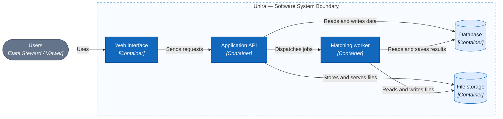

# C2 — Container

> Proposed architecture; the complete application has not been built yet.

## Container responsibilities

| Container | Proposed responsibility |
| --- | --- |
| Web interface | Displays screens, receives user actions, and sends requests to the API. |
| Application API | Checks access and manages sessions, uploads, and review decisions. |
| Matching worker | Processes data, finds possible duplicates, performs approved merges, and creates clean files. |
| Database | Stores sessions, records, matching results, and decision history. |
| File storage | Stores input files and output CSV files. |

In the C4 model, a **container** is an application or data store with a distinct responsibility; it does not require Docker.

## Main processing flow

1. The Data Steward uploads CSV files through the web interface; the API checks access and stores the session data.
2. When matching starts, the API dispatches a job for the session. The worker reads the necessary data and saves the results.
3. The Data Steward reviews each possible duplicate group. Merging happens only after approval.
4. Once the groups needing review have been handled, the system creates a clean file. The API serves the session's current file to an authorized user.

The API and worker both use the database and file storage. Specific technologies and connection protocols have not been chosen.

## Related documents

- [API contract](../../api/openapi.en.yaml)
- [DBML data model](../../schema.en.dbml)

[C4](README.en.md) · [C1 — System Context](01-system-context.en.md) · [C3 — Component](03-component.en.md)
