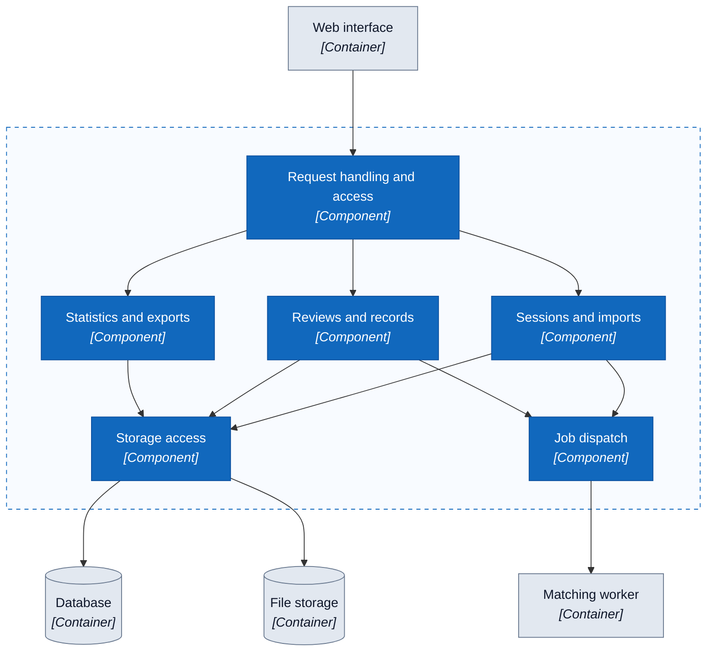

# C3 — Component

> Proposed architecture; the complete application has not been built yet.

The dashed box marks the application API boundary. Arrows show which components interact; their responsibilities are described below.

## Component responsibilities

| Component | Proposed responsibility |
| --- | --- |
| Request handling and access | Receives requests and checks input and user permissions. |
| Sessions and imports | Creates sessions, checks files, and manages input data. |
| Reviews and records | Saves decisions, searches records, and handles requests to correct merges. |
| Statistics and exports | Provides statistics and clean files for the requested session. |
| Storage access | Reads and writes data and files for API components. |
| Job dispatch | Sends matching, merging, and CSV rebuilding jobs to the worker. |

## How the components work together

- Requests pass through input and access checks before reaching the relevant feature.
- Features read or write data through storage access.
- Sessions request matching; reviews request processing after a decision or a merge correction. Job dispatch sends work to the separate worker.
- After an incorrect merge is split, the old clean file cannot be downloaded until the replacement is ready.

The diagram describes a proposed design. Job dispatch, storage technologies, and code structure will be determined during implementation.

[C4](README.en.md) · [C2 — Container](02-container.en.md)
