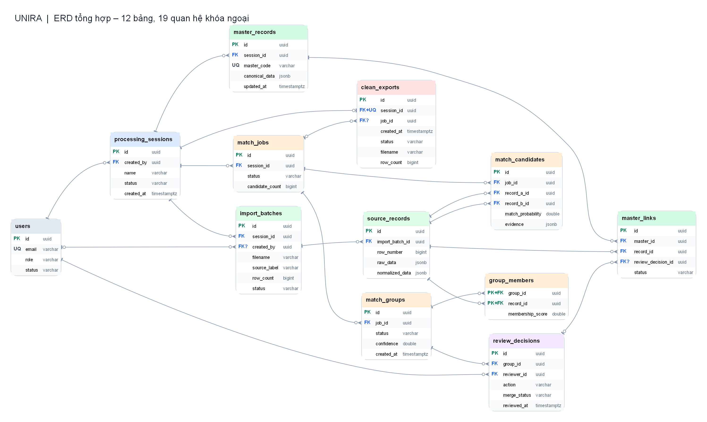

# Consolidated ERD — Unira (12 tables, 19 relationships)

[Vietnamese version](./README.md)

The diagram below combines Unira's 12 tables and 19 foreign-key relationships. Each table shows its main columns, keys, and relationship cardinalities. See the [DBML](../schema.en.dbml) for every column.

[Zoomable SVG](./erd-tong-the.svg) · [PNG](./erd-tong-the.png) · [Mermaid](./erd-tong-the.en.mmd) · [Graphviz DOT](./erd-tong-the.dot)

The tables cover accounts and processing sessions (`users`, `processing_sessions`), imported files and source records (`import_batches`, `source_records`), matching results, review decisions, Golden Records, and clean CSV exports.

The implementation must enforce these constraints:

- A session may contain many files, and each file may contain many rows. Match and merge only records from the same session.
- `source_records` retains original data after merging. Each source record has at most one `master_links` row with status `ACTIVE`.
- `review_decisions` records the reviewer, decision, time, and selected fields. If two people review a group concurrently, the backend must lock the group and recheck its state before saving.
- When a mistaken merge is undone, the system revokes the incorrect link and creates or updates the Master Record from the original data. It does not keep additional snapshot versions.
- Each session has at most one `clean_exports` row (`session_id UNIQUE`). After a split, the old CSV cannot be downloaded until the replacement is ready.
- `(import_batch_id, row_number)` in `source_records` and `(job_id, record_a_id, record_b_id)` in `match_candidates` must each be unique. Individual columns may repeat.

**PK**: primary key; **FK**: foreign key; **FK?**: nullable foreign key; **UQ**: unique; **PK+FK**: part of a composite primary key and also a foreign key; **FK+UQ**: unique foreign key. The `processing_sessions → clean_exports` relationship is **1 → 0..1**. The `source_records → master_links` relationship remains **1 → 0..N** because revoked links may be retained, although only one link may be `ACTIVE`.

When creating a group or master link, the backend must check that all involved records belong to the same session. Individual foreign keys alone do not guarantee this.
