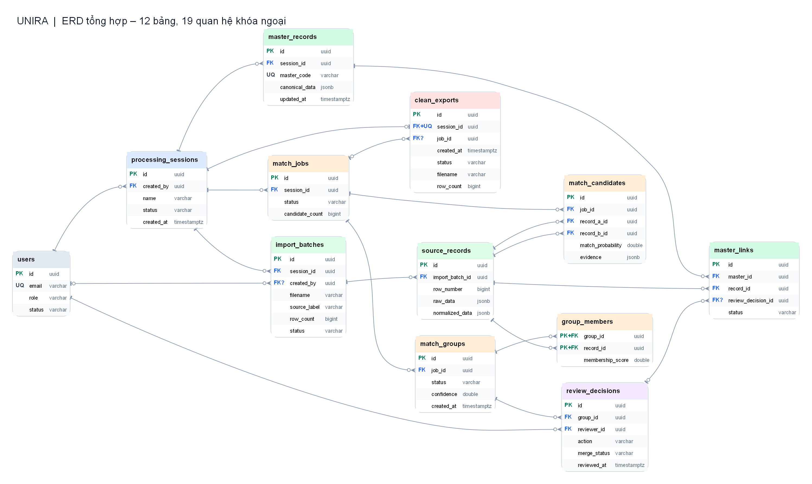

# ERD tổng hợp – Unira (12 bảng, 19 quan hệ)

Sơ đồ dưới đây gom 12 bảng và 19 quan hệ khóa ngoại của Unira. Mỗi bảng hiển thị các cột chính, khóa và số lượng bản ghi có thể liên kết. Xem [DBML](../schema.dbml) để tra đủ các cột.

[SVG phóng to](./erd-tong-the.svg) · [PNG](./erd-tong-the.png) · [Mermaid](./erd-tong-the.mmd) · [Graphviz DOT](./erd-tong-the.dot)

Các bảng đi từ tài khoản và phiên xử lý (`users`, `processing_sessions`), qua file và bản ghi nguồn (`import_batches`, `source_records`), đến kết quả so khớp, quyết định duyệt, hồ sơ thống nhất và CSV sạch.

Khi triển khai, cần giữ các ràng buộc sau:

- Một phiên có thể chứa nhiều file, mỗi file có nhiều dòng. Chỉ so khớp và gộp các bản ghi trong cùng phiên.
- `source_records` giữ dữ liệu gốc ngay cả sau khi gộp. Mỗi bản ghi nguồn có tối đa một `master_links` ở trạng thái `ACTIVE`.
- `review_decisions` ghi người duyệt, quyết định, thời điểm và các trường được chọn. Nếu hai người cùng duyệt một nhóm, backend phải khóa và kiểm tra lại trạng thái trước khi lưu.
- Khi tách hồ sơ gộp sai, hệ thống hủy liên kết không đúng rồi tạo hoặc cập nhật Master Record từ dữ liệu gốc; không lưu thêm các phiên bản snapshot.
- Mỗi phiên có tối đa một dòng `clean_exports` (`session_id UNIQUE`). Sau khi tách hồ sơ, CSV cũ ngừng được tải cho đến khi tạo xong CSV mới.
- Cặp `(import_batch_id, row_number)` trong `source_records` và bộ ba `(job_id, record_a_id, record_b_id)` trong `match_candidates` phải duy nhất. Từng cột riêng lẻ có thể lặp.

**PK**: khóa chính; **FK**: khóa ngoại; **FK?**: khóa ngoại cho phép `NULL`; **UQ**: duy nhất; **PK+FK**: thành phần khóa chính ghép đồng thời là khóa ngoại; **FK+UQ**: khóa ngoại duy nhất. Quan hệ `processing_sessions → clean_exports` là **1 → 0..1**. Quan hệ `source_records → master_links` vẫn là **1 → 0..N** vì có thể lưu nhiều liên kết đã `REVOKED`, nhưng chỉ tối đa một liên kết `ACTIVE`.

Khi tạo nhóm hoặc liên kết master, backend phải kiểm tra các bản ghi thuộc cùng phiên. Chỉ dựa vào khóa ngoại đơn lẻ là chưa đủ.

