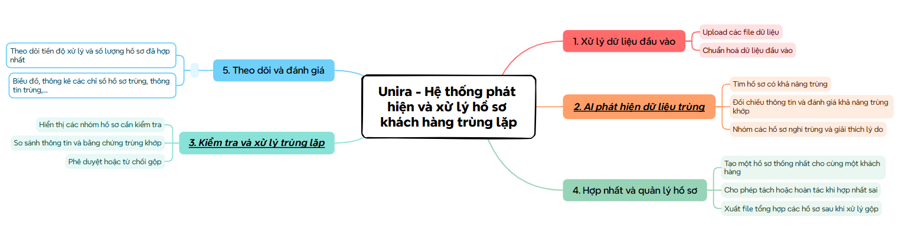
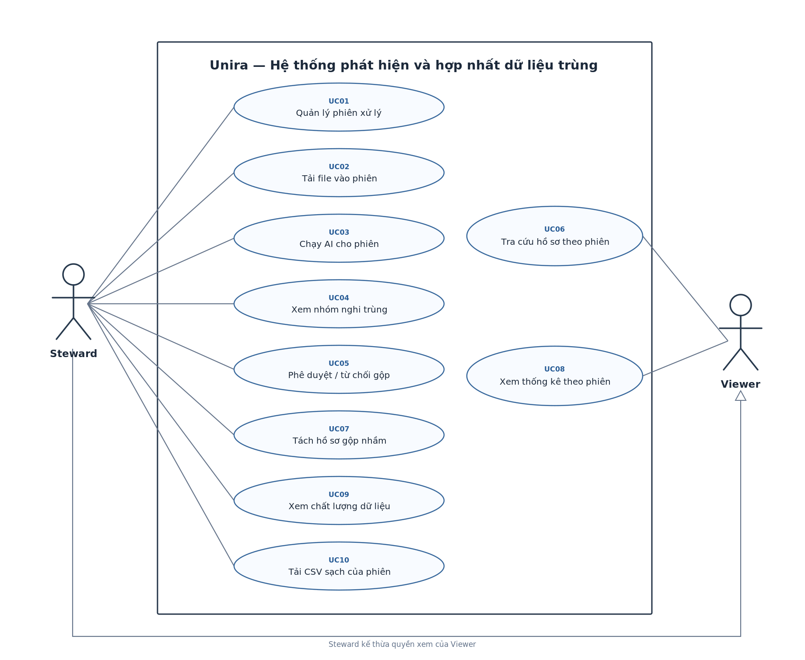

# 1. Product requirements — INVEST, use cases, and acceptance criteria

[Vietnamese version](./README.md)

## 1.1. Product mind map

## 1.2. Users and permissions

| Role | Allowed | Not allowed |
| --- | --- | --- |
| **Data Steward** | Create and view processing sessions; upload CSV files to each session; run matching; approve or reject proposals; manage and split records; download clean CSV. | Edit or delete original files from the merge screen. |
| **Viewer** | View authorized sessions, aggregate results, and Golden Records within each session. | Upload files, run jobs, review, merge, or split records. |

The use-case diagram has two roles: Steward and Viewer. The Steward uploads files. If a file was exported from a CRM or ERP, that system's name is only an origin label for traceability; Unira does not connect to it. Workers, Splink, and LangGraph are internal components.

Here, a **data source** is where the Steward obtained a file, such as a CRM. A **processing session** contains one or more input files, a main matching run, review decisions, and a resulting CSV. Sessions are independent. A **job** is background work within a session, not a separate session.

## 1.3. INVEST user stories

Each story should be relatively independent, negotiable in implementation, valuable, estimable, small, and testable. These are the six INVEST criteria.

| ID | Role | User story |
| --- | --- | --- |
| US01 | Steward | I want to create, name, and manage each processing session. |
| US02 | Steward | I want to add multiple CSV files to one session and see errors for each file. |
| US03 | Steward | I want to preview the data and then run duplicate detection for the selected session. |
| US04 | Steward | I want to track each session's status and progress. |
| US05 | Steward | I want to see likely duplicate groups and AI evidence in the correct session. |
| US06 | Steward | I want to approve or reject each proposed merge. |
| US07 | Steward | I want to choose values for the Golden Record before approving. |
| US08 | Steward | I want the system to create the Golden Record automatically after my approval. |
| US09 | Steward | I want to undo a mistaken merge while retaining the original data. |
| US10 | Steward, Viewer | I want to search processed records by session. |
| US11 | Steward, Viewer | I want to see overall statistics and results for each session. |
| US12 | Steward | I want to know each session's valid and invalid record counts and processing outcome. |
| US13 | Steward | I want to know which groups were approved or rejected and who decided. |
| US14 | Steward, Viewer | I want to sign in and use only the features permitted for my role. |
| US15 | Steward | I want to download the clean CSV from a completed session without receiving another session's file. |

US02 covers file upload and validation; US03 starts matching. Likewise, US06 captures the Steward's decision, while US08 is the system's action after approval. This separation makes each outcome testable even though the steps form one workflow.

## 1.4. Business rules

| ID | Rule |
| --- | --- |
| BR01 | A Steward may create multiple sessions. Each has its own `session_id`, name, optional description, creator, status, and timestamps. |
| BR02 | A session accepts one or more CSV files uploaded by the Steward. Other formats are rejected. A source label only identifies where a file came from. |
| BR03 | Each file belongs to exactly one session. The system does not fetch data from a CRM/ERP or mix records between sessions. |
| BR04 | Files may be added or removed only while a session is `DRAFT` or `READY`. Starting a run freezes the input file list as a snapshot. A different file set requires a new session. |
| BR05 | Each input row is identified by `(import_batch_id, row_number)`. The system retains raw data, normalized data, and error details. A customer ID in an input file is not a globally unique ID. |
| BR06 | Blocking reduces the number of pairs to compare. Each run records its candidate-pair count and performance metrics. |
| BR07 | Splink/ML scores duplicate likelihood and shows supporting and conflicting evidence with confidence. Records are not merged solely because names match or because an unverified chain of links connects them. |
| BR08 | Steward approval is required before merging. Viewers may not upload files, run AI, review, split records, or download clean CSV. The backend enforces authorization for every action. |
| BR09 | Only a `PENDING` group in the correct session may be approved. For concurrent requests, the backend locks the group and rechecks its state to prevent duplicate merges. |
| BR10 | Golden Records are session-scoped. Original source records remain available to trace the input file and undo mistaken merges. |
| BR11 | Within its session, each source record has at most one active master link. The Steward must review groups with conflicting evidence. |
| BR12 | The system exports a clean CSV only after all likely duplicate groups are resolved, merges are verified, and every valid nonduplicate record has its own master. |
| BR13 | A CSV contains only data from its own session, with one row per verified customer. Invalid records are excluded; no final CSV is exported while groups await review. |
| BR14 | Each session has one current clean CSV, with row count and export time. Downloading it again does not rerun matching or create another session. |
| BR15 | If records are split after export, the old CSV is no longer downloadable. The system revalidates and generates a new current CSV before the session returns to `COMPLETED`. |
| BR16 | Group queries, record queries, and CSV downloads check both permissions and `session_id`; changing an ID in an API URL must not expose another session's data. |
| BR17 | Sessions may run independently in the background. Workers limit concurrent jobs and record progress so large datasets do not exhaust resources. |
| BR18 | Every approval or rejection is stored in `review_decisions`. The system does not automatically retrain the model after each decision. |

## 1.5. Acceptance criteria

| AC | Observable condition |
| --- | --- |
| AC01 | A Steward can create two differently named sessions, each with its own ID, status, and detail page. |
| AC02 | A session accepts at least two CSV files and shows each file's name, valid-row count, and error-row count. A Viewer cannot upload. |
| AC03 | Non-CSV files are rejected with a clear message. Processing starts only with a valid CSV. Data errors identify the row and column; the file list is locked when the job starts. |
| AC04 | The session list shows status, progress, input files, and time. Changing a filter does not change the data. |
| AC05 | Likely duplicate groups from session A do not appear in session B. Each AI proposal has a score and traceable evidence. |
| AC06 | Only a Steward may approve or reject. If data has changed or a group already has a decision, the API returns `409`. |
| AC07 | Approval creates a master and links records within the same session. Rejection creates no merge link. |
| AC08 | A master can be traced to original records and the source of each value. A Viewer sees only authorized data. |
| AC09 | Splitting a mistaken merge changes links but retains original records. The Steward provides a reason; the system regenerates clean data. |
| AC10 | A session becomes `COMPLETED` only after all groups are resolved, merges are valid, and its CSV is `READY`. Any unresolved issue is shown clearly. |
| AC11 | Session A's CSV contains no records that exist only in B. Every valid customer in A has exactly one row, including nonduplicates. |
| AC12 | UTF-8 CSV preserves Vietnamese text, commas, quotes, and newlines. The system checks row count and checksum. |
| AC13 | Downloading again returns the same current export without creating another file or matching job. A Viewer cannot download it. |
| AC14 | After a split in a completed session, the old CSV cannot be downloaded. A new CSV becomes available only after revalidation. |
| AC15 | The dashboard shows running, awaiting-review, completed, and failed session counts. Selecting a session updates its metrics and charts. |
| AC16 | The statistics page shows valid/error row counts, likely duplicate groups, merged groups, and customers after processing. |
| AC17 | Benchmarks use 10k, 100k, and 1m records and report candidate-pair counts, time, RAM, and CPU. Unverified capacity claims are not published. |

## 1.6. Use cases

### 1.6.1. Actors

| Actor | Responsibility |
| --- | --- |
| **Steward** | Create sessions, upload files, run matching, review results, manage records, and download clean CSV. |
| **Viewer** | View authorized sessions, search records, and view statistics. |

A Steward uploads files exported from a CRM or ERP; those systems do not directly interact with Unira.

### 1.6.2. Use-case overview diagram

The [English PlantUML source](../uml/usecase-overview.en.puml) has translated use-case labels.

### 1.6.3. Use-case list

| ID | Use case | Primary actor | Related stories |
| --- | --- | --- | --- |
| UC01 | Manage processing sessions | Steward | US01, US04 |
| UC02 | Upload files to a session | Steward | US02, US12 |
| UC03 | Run matching for a session | Steward | US03, US04 |
| UC04 | View likely duplicate groups | Steward | US05 |
| UC05 | Approve or reject a merge | Steward | US06, US07, US08, US13 |
| UC06 | Search Golden Records | Steward, Viewer | US10 |
| UC07 | Undo a mistaken merge | Steward | US09 |
| UC08 | View session statistics | Steward, Viewer | US11 |
| UC09 | View data quality | Steward | US12 |
| UC10 | Download a session's clean CSV | Steward | US15 |

US14, sign-in and authorization, is a shared precondition for these use cases. The backend checks permissions for every action, even when the UI has hidden its button.

### 1.6.4. Key use-case specifications

**UC01 — Manage processing sessions**

- **Actor:** Steward.
- **Precondition:** The Steward is signed in and may create sessions.
- **Main flow:** (1) Open the session list and choose **Create session** → (2) Enter a name and optional description → (3) The system validates the input, creates a `session_id`, and sets status `DRAFT` → (4) Open the new session's upload screen.
- **Alternative:** Reopen an existing session to view its status, files, and results without changing its data.
- **Exception:** An empty name must be corrected; insufficient permission returns `403` and creates no session.
- **Postcondition:** The session has its own ID, creator, and status; it has no matching job or CSV yet.

**UC02 — Upload files to a session**

- **Actor:** Steward.
- **Precondition:** The Steward may access the session; it is `DRAFT` or `READY` and its input list has not been frozen.
- **Main flow:** (1) Select one or more CSV files → (2) Add optional origin labels → (3) The system stores each file under the correct `session_id` and validates CSV format, columns, and rows → (4) Show valid/error row counts and error details for each file.
- **Alternative:** Before matching, add or remove files and validate again.
- **Exception:** Report a non-CSV file or a limit violation for that file. After the session starts, reject further files and keep the frozen list unchanged.
- **Postcondition:** Accepted files belong to one session. Original records and validation results are retained; no records have been merged.

**UC05 — Approve or reject a merge**

- **Actor:** Steward.
- **Precondition:** The session is `WAITING_REVIEW`; the group belongs to it and is `PENDING`.
- **Main flow:** (1) Open the group and examine records and matching evidence → (2) Select Golden Record values and confirm approval → (3) The backend checks authorization, locks the group, and rechecks its state → (4) Save the decision and enqueue the merge → (5) The worker creates or updates a master, links source records in the same session, and updates progress.
- **Alternative:** Reject the proposal; the system saves the decision without creating a merge link.
- **Exception:** If the group was resolved or source data changed, return `409` and require another review. A failed merge is recorded so it can be retried safely.
- **Postcondition:** Each group has one effective decision. Only approved groups are merged; the final CSV is exported only when the whole session qualifies.

**UC10 — Download a session's clean CSV**

- **Actor:** Steward.
- **Precondition:** The session is `COMPLETED` and its current CSV is `READY`.
- **Main flow:** (1) Open session details and choose **Download clean CSV** → (2) The backend checks authorization, `session_id`, and file state → (3) Issue a time-limited download URL → (4) Download the CSV for that session.
- **Alternative:** Download the same current export again without creating a file or job.
- **Exception:** Reject the download if no CSV is `READY`, the session is regenerating after a split, or the user lacks permission. A Viewer receives `403`.
- **Postcondition:** The Steward receives the current file; session data, status, and matching history remain unchanged.
