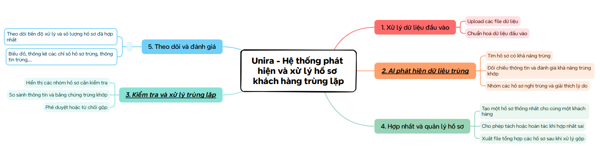
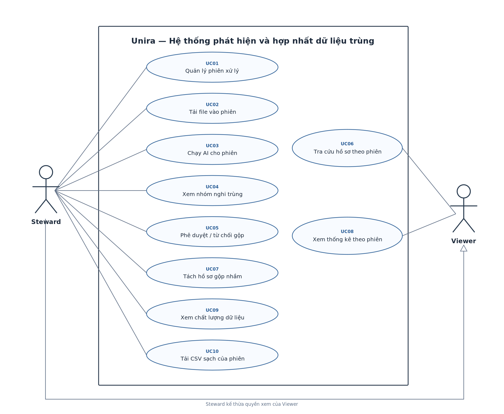

# 1. Yêu cầu sản phẩm – INVEST, use case và tiêu chí chấp nhận

[English version](./README.en.md)

## 1.1. Sơ đồ tư duy sản phẩm

## 1.2. Người dùng và phân quyền

| Vai trò | Được làm | Không được làm |
| --- | --- | --- |
| **Data Steward** (người quản lý dữ liệu) | Tạo và xem các phiên xử lý; tải CSV vào từng phiên; chạy đối chiếu; duyệt hoặc từ chối đề xuất; quản lý, tách hồ sơ và tải CSV sạch. | Không sửa hoặc xóa file gốc trên màn hình hợp nhất. |
| **Viewer** (người xem) | Xem các phiên được cấp quyền, kết quả tổng hợp và Golden Record của từng phiên. | Không tải file lên, chạy job, duyệt, hợp nhất hoặc tách hồ sơ. |

Sơ đồ Use Case có hai vai trò: Steward và Viewer. Steward là người tải file lên. Nếu file được xuất từ CRM hoặc ERP, tên hệ thống đó chỉ là nhãn xuất xứ để truy vết; Unira không kết nối trực tiếp với chúng. Worker, Splink và LangGraph là thành phần nội bộ.

Trong tài liệu này, “nguồn dữ liệu” là nơi Steward lấy file, chẳng hạn CRM. Một **phiên xử lý** gồm một hoặc nhiều file, lần đối chiếu chính, các quyết định duyệt và CSV kết quả. Mỗi phiên độc lập. **Job** là công việc chạy nền trong phiên, không phải một phiên khác.

## 1.3. User story theo INVEST

Mỗi user story cần tương đối độc lập, có thể điều chỉnh cách làm, đem lại giá trị, ước lượng được, đủ nhỏ và có thể kiểm thử. Đây là sáu tiêu chí INVEST.

| ID | Vai trò | User story |
| --- | --- | --- |
| US01 | Steward | Tôi muốn tạo, đặt tên và quản lý từng phiên xử lý. |
| US02 | Steward | Tôi muốn đưa nhiều file CSV vào một phiên và xem lỗi của từng file. |
| US03 | Steward | Tôi muốn xem trước dữ liệu rồi chạy kiểm tra trùng cho phiên đã chọn. |
| US04 | Steward | Tôi muốn theo dõi trạng thái và tiến độ của từng phiên. |
| US05 | Steward | Tôi muốn xem các nhóm nghi trùng cùng bằng chứng AI trong đúng phiên. |
| US06 | Steward | Tôi muốn duyệt hoặc từ chối đề xuất gộp của từng nhóm. |
| US07 | Steward | Tôi muốn chọn thông tin cho hồ sơ thống nhất trước khi duyệt. |
| US08 | Steward | Tôi muốn hệ thống tự tạo hồ sơ thống nhất sau khi tôi duyệt. |
| US09 | Steward | Tôi muốn tách hồ sơ gộp sai mà vẫn giữ được dữ liệu gốc. |
| US10 | Steward, Viewer | Tôi muốn tra cứu hồ sơ đã xử lý theo từng phiên. |
| US11 | Steward, Viewer | Tôi muốn xem thống kê chung và kết quả của từng phiên. |
| US12 | Steward | Tôi muốn biết mỗi phiên có bao nhiêu bản ghi hợp lệ, bản ghi lỗi và kết quả xử lý ra sao. |
| US13 | Steward | Tôi muốn biết nhóm nào đã được duyệt hoặc từ chối, và ai đã quyết định. |
| US14 | Steward, Viewer | Tôi muốn đăng nhập và chỉ dùng được các chức năng phù hợp với vai trò của mình. |
| US15 | Steward | Tôi muốn tải CSV sạch của phiên đã hoàn tất mà không lấy nhầm file của phiên khác. |

US02 tập trung vào tải và kiểm tra file, còn US03 bắt đầu bước đối chiếu. Tương tự, US06 ghi nhận quyết định của Steward; US08 là việc hệ thống làm sau khi được duyệt. Cách tách này giúp kiểm thử từng kết quả dù các bước nối tiếp nhau.

## 1.4. Quy tắc nghiệp vụ

| ID | Quy tắc |
| --- | --- |
| BR01 | Steward có thể tạo nhiều phiên. Mỗi phiên có `session_id`, tên, mô tả (nếu có), người tạo, trạng thái và mốc thời gian riêng. |
| BR02 | Một phiên nhận từ một đến nhiều file CSV. Steward tải file lên; hệ thống từ chối định dạng khác. Nhãn nguồn chỉ cho biết file đến từ đâu. |
| BR03 | Mỗi file chỉ thuộc một phiên. Hệ thống không tự lấy dữ liệu từ CRM/ERP và không trộn bản ghi giữa các phiên. |
| BR04 | Chỉ được thêm hoặc xóa file khi phiên còn `DRAFT` hoặc `READY`. Khi bắt đầu chạy, hệ thống chốt danh sách file đầu vào thành snapshot. Muốn dùng tập file khác, Steward phải tạo phiên mới. |
| BR05 | Mỗi dòng nhập được nhận diện bằng `(import_batch_id, row_number)`. Hệ thống giữ dữ liệu gốc, dữ liệu đã chuẩn hóa và thông tin lỗi. Mã khách hàng trong file không phải mã duy nhất toàn hệ thống. |
| BR06 | Bước blocking thu hẹp số cặp cần so sánh. Mỗi lần chạy phải ghi số cặp ứng viên và các chỉ số hiệu năng. |
| BR07 | Splink/ML chấm điểm khả năng trùng và cho thấy bằng chứng ủng hộ, phản đối cùng độ tin cậy. Không gộp hồ sơ chỉ vì trùng tên hoặc vì chuỗi liên hệ bắc cầu chưa được kiểm chứng. |
| BR08 | Steward phải duyệt trước khi hệ thống hợp nhất. Viewer không được tải file lên, chạy AI, duyệt, tách hồ sơ hay tải CSV sạch. Backend kiểm tra quyền cho từng thao tác. |
| BR09 | Chỉ được duyệt nhóm `PENDING` trong đúng phiên. Khi có hai yêu cầu cùng lúc, backend khóa nhóm và kiểm tra lại trạng thái để tránh gộp lặp. |
| BR10 | Golden Record được tạo theo từng phiên. Bản ghi nguồn được giữ nguyên để truy ra file gốc và tách hồ sơ nếu gộp nhầm. |
| BR11 | Trong phiên của mình, mỗi bản ghi nguồn có tối đa một liên kết master đang hoạt động. Steward phải xem lại các nhóm có mâu thuẫn. |
| BR12 | Hệ thống tự xuất CSV sạch khi mọi nhóm nghi trùng đã được xử lý, các lần hợp nhất đã được kiểm chứng và mỗi hồ sơ hợp lệ không trùng đã có master riêng. |
| BR13 | CSV chỉ lấy dữ liệu từ file của chính phiên đó, mỗi khách hàng đã xác minh một dòng. Bỏ qua bản ghi lỗi; chưa xuất CSV cuối nếu còn nhóm chờ duyệt. |
| BR14 | Mỗi phiên có một CSV sạch hiện hành, kèm số dòng và thời điểm xuất. Tải lại file không chạy đối chiếu hay tạo phiên mới. |
| BR15 | Nếu tách hồ sơ sau khi xuất CSV, file cũ không còn tải được. Hệ thống kiểm tra lại và tạo CSV hiện hành mới trước khi phiên trở lại `COMPLETED`. |
| BR16 | Mọi truy vấn nhóm, hồ sơ và tải CSV phải kiểm tra quyền và `session_id`; không được truy cập dữ liệu phiên khác chỉ bằng cách thay ID trên API. |
| BR17 | Các phiên có thể chạy nền độc lập. Worker giới hạn số job đồng thời và ghi tiến độ để xử lý dữ liệu lớn mà không làm cạn tài nguyên. |
| BR18 | Mọi quyết định duyệt hoặc từ chối được lưu trong `review_decisions`. Hệ thống không tự huấn luyện lại mô hình sau mỗi quyết định. |

## 1.5. Tiêu chí chấp nhận

| AC | Điều kiện kiểm thử |
| --- | --- |
| AC01 | Steward tạo được hai phiên khác tên; mỗi phiên có ID, trạng thái và trang chi tiết riêng. |
| AC02 | Một phiên nhận được ít nhất hai file CSV và hiện tên, số dòng hợp lệ, số dòng lỗi của từng file. Viewer không tải file lên được. |
| AC03 | File không phải CSV bị từ chối với thông báo rõ ràng. Chỉ bắt đầu xử lý khi có file CSV hợp lệ; lỗi dữ liệu chỉ rõ dòng và cột, danh sách file bị khóa khi job bắt đầu. |
| AC04 | Danh sách phiên hiện trạng thái, tiến độ, file đầu vào và thời gian. Thay đổi bộ lọc không sửa dữ liệu. |
| AC05 | Nhóm nghi trùng của phiên A không xuất hiện ở phiên B. Mỗi đề xuất AI có điểm và bằng chứng để truy vết. |
| AC06 | Chỉ Steward được duyệt hoặc từ chối. Nếu dữ liệu đã thay đổi hoặc nhóm đã có quyết định, API trả `409`. |
| AC07 | Duyệt thành công tạo master và liên kết các bản ghi trong cùng phiên. Từ chối không tạo liên kết gộp. |
| AC08 | Từ master có thể tra về bản ghi gốc và nguồn của từng thông tin. Viewer chỉ xem được dữ liệu trong phạm vi được cấp quyền. |
| AC09 | Khi tách hồ sơ gộp nhầm, liên kết được sửa nhưng bản ghi gốc vẫn còn. Steward nhập lý do; hệ thống tạo lại dữ liệu sạch. |
| AC10 | Phiên chỉ chuyển sang `COMPLETED` sau khi mọi nhóm đã được duyệt/xử lý, việc hợp nhất hợp lệ và CSV đạt `READY`. Nếu còn nghi vấn, hệ thống báo rõ. |
| AC11 | CSV phiên A không chứa dữ liệu chỉ có ở phiên B. Mỗi khách hàng hợp lệ của A có đúng một dòng, kể cả hồ sơ không trùng. |
| AC12 | CSV UTF-8 giữ đúng tiếng Việt, dấu phẩy, dấu ngoặc kép và xuống dòng. Hệ thống kiểm tra số dòng cùng checksum. |
| AC13 | Tải lại CSV trả đúng bản xuất cũ, không sinh file hay job đối chiếu mới. Viewer không tải được. |
| AC14 | Sau khi tách hồ sơ ở phiên đã hoàn tất, CSV cũ không tải được nữa. CSV mới chỉ sẵn sàng sau khi kiểm tra lại. |
| AC15 | Dashboard hiện số phiên đang chạy, chờ duyệt, hoàn tất và thất bại. Khi chọn một phiên, chỉ số và biểu đồ đổi theo phiên đó. |
| AC16 | Trang thống kê hiện số dòng hợp lệ/lỗi, nhóm nghi trùng, nhóm đã gộp và số khách hàng sau xử lý. |
| AC17 | Benchmark lần lượt 10k, 100k và 1m bản ghi; công bố số cặp ứng viên, thời gian, RAM và CPU đo được. Không công bố năng lực chưa kiểm chứng. |

## 1.6. Các ca sử dụng (Use case)

### 1.6.1. Tác nhân

| Tác nhân | Vai trò trong hệ thống |
| --- | --- |
| **Steward** | Tạo phiên, tải file, chạy so khớp, duyệt kết quả, quản lý hồ sơ và tải CSV sạch. |
| **Viewer** | Xem các phiên được cấp quyền, tra cứu hồ sơ và xem thống kê. |

File được xuất từ CRM hoặc ERP vẫn do Steward tải lên; các hệ thống đó không tương tác trực tiếp với Unira.

### 1.6.2. Sơ đồ Use Case tổng quan

### 1.6.3. Danh sách Use Case

| Mã | Ca sử dụng | Tác nhân chính | User story liên quan |
| --- | --- | --- | --- |
| UC01 | Quản lý phiên xử lý | Steward | US01, US04 |
| UC02 | Tải file vào phiên | Steward | US02, US12 |
| UC03 | Chạy so khớp cho phiên | Steward | US03, US04 |
| UC04 | Xem nhóm nghi trùng | Steward | US05 |
| UC05 | Duyệt hoặc từ chối gộp | Steward | US06, US07, US08, US13 |
| UC06 | Tra cứu hồ sơ thống nhất | Steward, Viewer | US10 |
| UC07 | Tách hồ sơ gộp nhầm | Steward | US09 |
| UC08 | Xem thống kê theo phiên | Steward, Viewer | US11 |
| UC09 | Xem chất lượng dữ liệu | Steward | US12 |
| UC10 | Tải CSV sạch của phiên | Steward | US15 |

US14 về đăng nhập và phân quyền là điều kiện chung của các ca sử dụng. Backend kiểm tra quyền ở từng thao tác, kể cả khi giao diện đã ẩn nút.

### 1.6.4. Đặc tả các Use Case trọng tâm

**UC01 – Quản lý phiên xử lý**

- **Tác nhân:** Steward.
- **Tiền điều kiện:** Steward đã đăng nhập và có quyền tạo phiên.
- **Luồng chính:** (1) Steward mở danh sách phiên và chọn **Tạo phiên mới** → (2) Nhập tên, có thể thêm mô tả → (3) Hệ thống kiểm tra dữ liệu và tạo `session_id`, trạng thái `DRAFT` → (4) Mở màn hình thêm file cho phiên vừa tạo.
- **Luồng thay thế:** Steward mở lại một phiên có sẵn để xem trạng thái, file đầu vào và kết quả; dữ liệu phiên không thay đổi.
- **Ngoại lệ:** Tên trống thì yêu cầu nhập lại; không đủ quyền thì trả `403` và không tạo phiên.
- **Hậu điều kiện:** Phiên mới được lưu với mã, người tạo và trạng thái riêng; chưa có job so khớp hoặc CSV.

**UC02 – Tải file vào phiên**

- **Tác nhân:** Steward.
- **Tiền điều kiện:** Steward có quyền với phiên; phiên còn `DRAFT` hoặc `READY` và chưa chốt file đầu vào.
- **Luồng chính:** (1) Steward mở phiên và chọn một hoặc nhiều file CSV → (2) Thêm nhãn xuất xứ nếu cần → (3) Hệ thống lưu từng file dưới đúng `session_id`, kiểm tra định dạng CSV, cột và dòng → (4) Hiển thị số dòng hợp lệ, số dòng lỗi và chi tiết lỗi theo từng file.
- **Luồng thay thế:** Trước khi chạy so khớp, Steward có thể thêm file hoặc loại file đã chọn rồi kiểm tra lại.
- **Ngoại lệ:** File không phải CSV hoặc vượt hạn mức thì báo lỗi cho file đó; phiên đã bắt đầu chạy thì không nhận thêm file và không thay đổi danh sách đã chốt.
- **Hậu điều kiện:** Các file được nhận thuộc đúng một phiên. Bản ghi gốc và kết quả kiểm tra được giữ để xử lý tiếp; hệ thống chưa gộp hồ sơ.

**UC05 – Duyệt hoặc từ chối gộp**

- **Tác nhân:** Steward.
- **Tiền điều kiện:** Phiên ở `WAITING_REVIEW`; nhóm thuộc phiên và còn `PENDING`.
- **Luồng chính:** (1) Steward mở nhóm và xem hồ sơ cùng bằng chứng so khớp → (2) Chọn giá trị cho Golden Record rồi xác nhận duyệt → (3) Backend kiểm tra quyền, khóa nhóm và kiểm tra lại trạng thái → (4) Lưu quyết định và giao việc hợp nhất → (5) Worker tạo hoặc cập nhật master, liên kết bản ghi nguồn trong cùng phiên và cập nhật tiến độ.
- **Luồng thay thế:** Steward từ chối đề xuất; hệ thống lưu quyết định nhưng không tạo liên kết gộp.
- **Ngoại lệ:** Nhóm đã được xử lý hoặc dữ liệu nguồn thay đổi thì trả `409` và yêu cầu xem lại. Nếu việc hợp nhất lỗi, hệ thống ghi trạng thái lỗi để có thể chạy lại an toàn.
- **Hậu điều kiện:** Mỗi nhóm có một quyết định đang có hiệu lực. Chỉ nhóm được duyệt mới được hợp nhất; CSV cuối chỉ được xuất khi toàn bộ phiên đủ điều kiện.

**UC10 – Tải CSV sạch của phiên**

- **Tác nhân:** Steward.
- **Tiền điều kiện:** Phiên đã `COMPLETED` và CSV hiện hành ở trạng thái `READY`.
- **Luồng chính:** (1) Steward mở chi tiết phiên và chọn **Tải CSV sạch** → (2) Backend kiểm tra quyền, `session_id` và trạng thái file → (3) Cấp đường dẫn tải có thời hạn → (4) Steward tải CSV của đúng phiên.
- **Luồng thay thế:** Tải lại cùng bản xuất hiện hành; hệ thống không tạo file hoặc job mới.
- **Ngoại lệ:** Chưa có CSV `READY`, phiên đang tạo lại file sau khi tách hồ sơ hoặc người dùng không đủ quyền thì từ chối tải. Viewer nhận `403`.
- **Hậu điều kiện:** Steward nhận file hiện hành; dữ liệu, trạng thái phiên và lịch sử so khớp không thay đổi.

