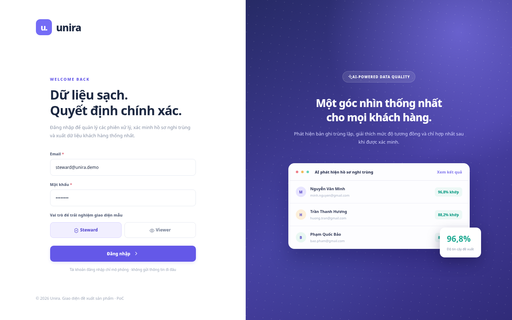
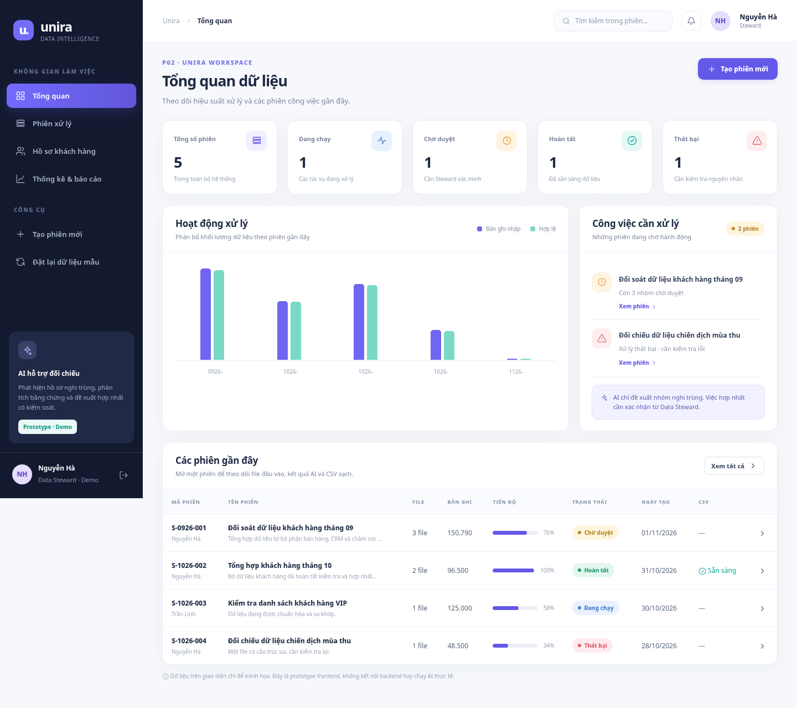
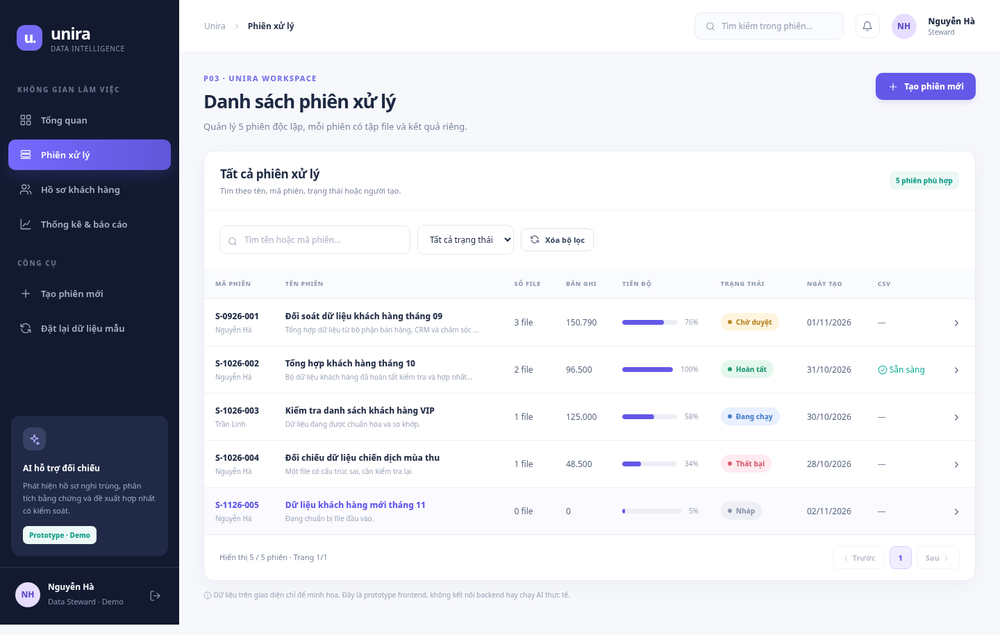
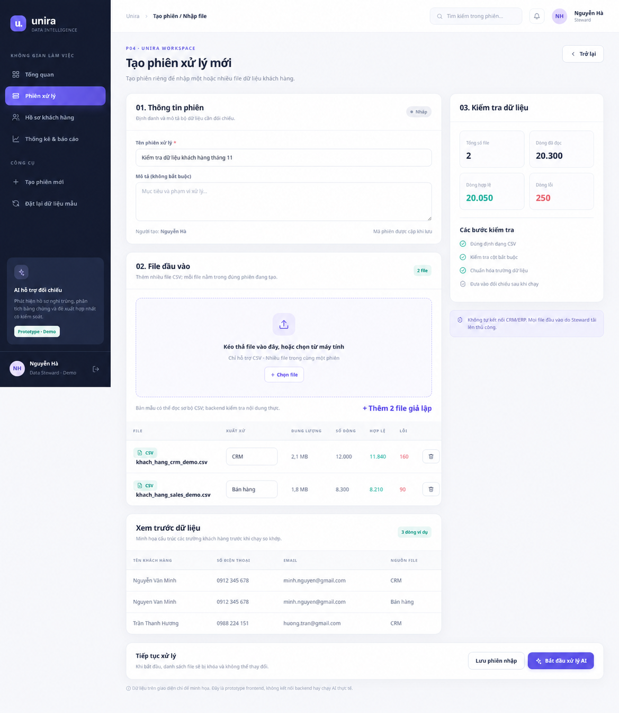
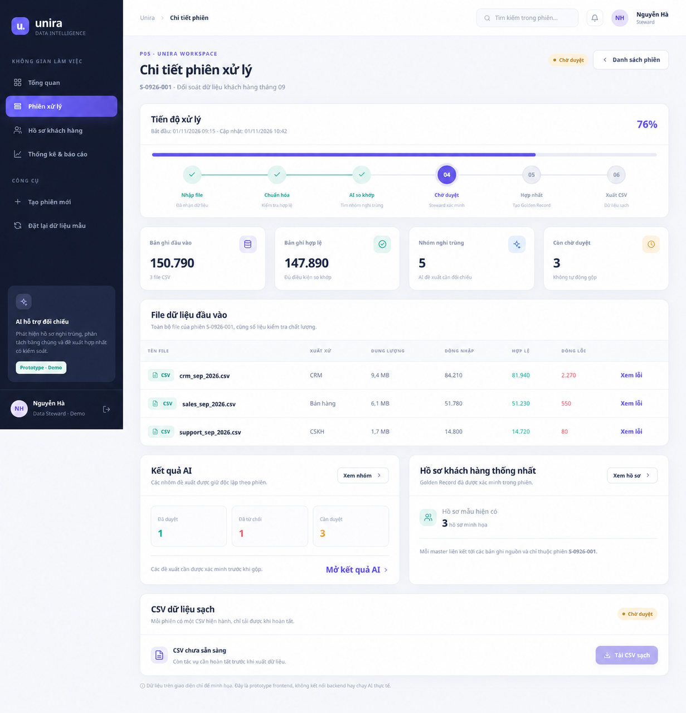
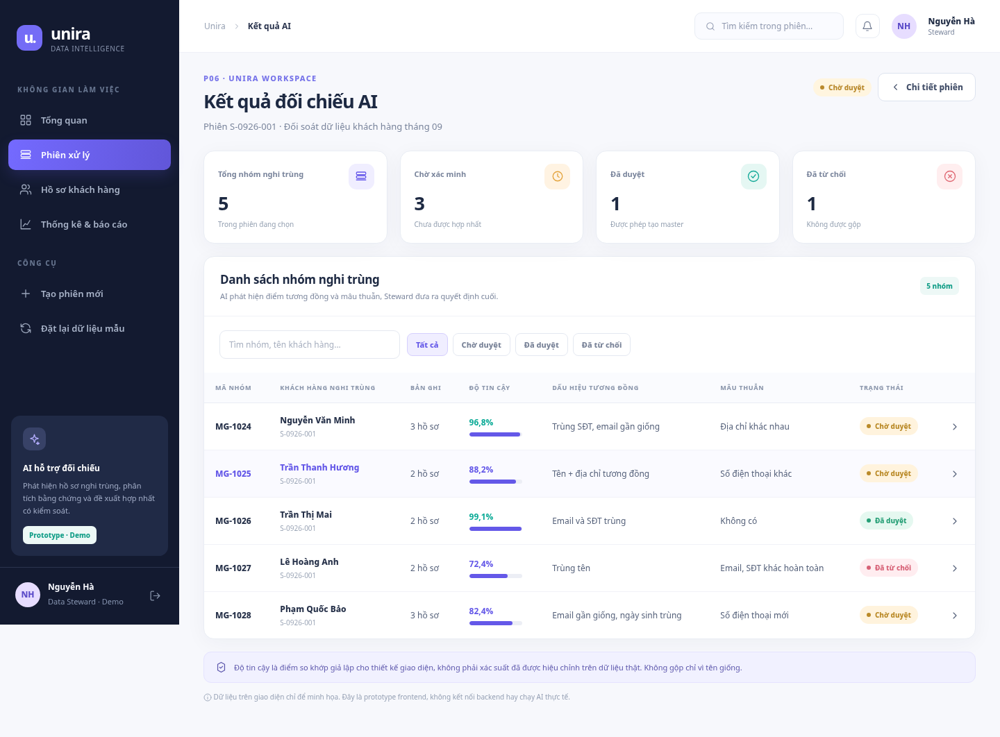
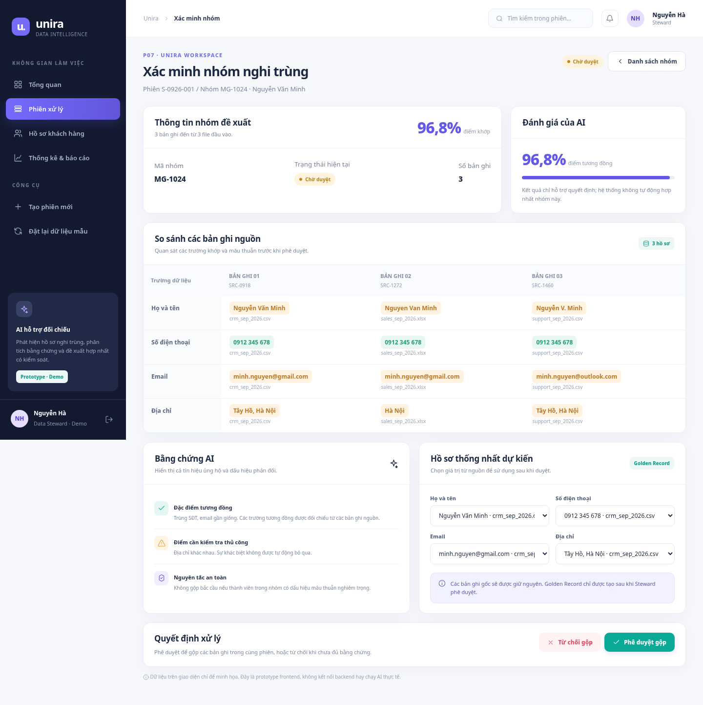
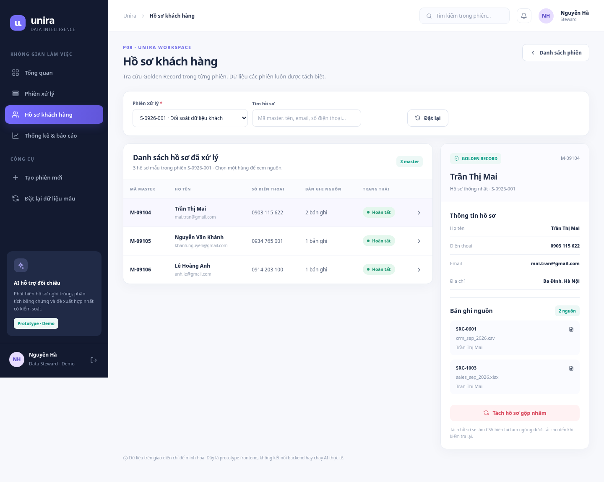
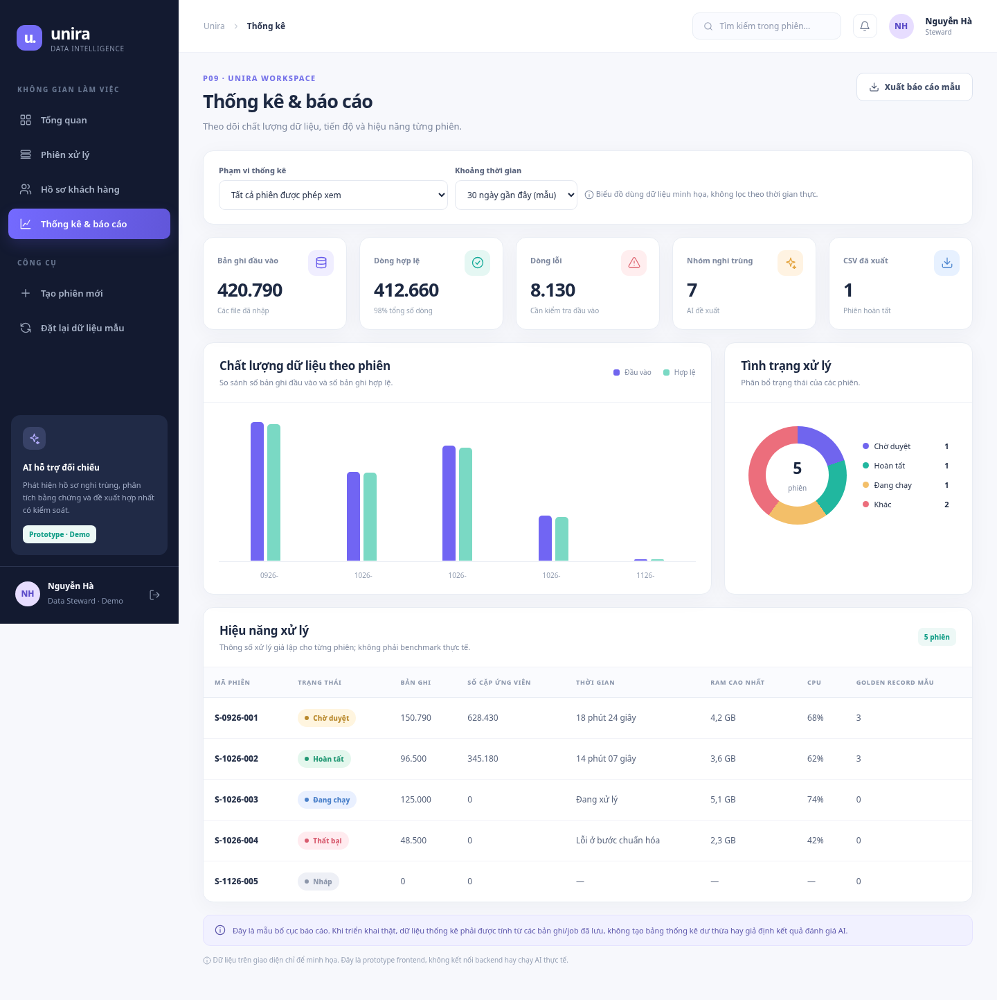

# UI/UX design — Unira

[Vietnamese version](./README.md)

The P01–P09 screen images were rendered from a prototype. They contain demonstration data and are not connected to a backend or AI. The images retain Vietnamese interface text; the English screen descriptions are in the [English project README](../../README.en.md#2-information-architecture-and-screen-hierarchy).

### P01 — Login

### P02 — Overview

### P03 — Session list

### P04 — Create session / Import CSV

### P05 — Session details

### P06 — AI results

### P07 — Verify candidate group

### P08 — Customer records

### P09 — Statistics

