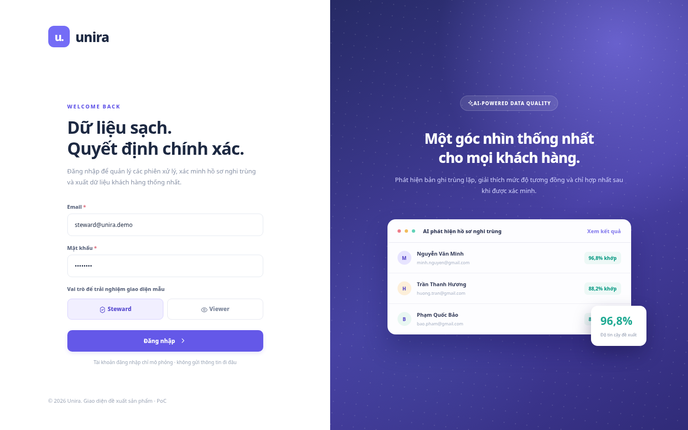
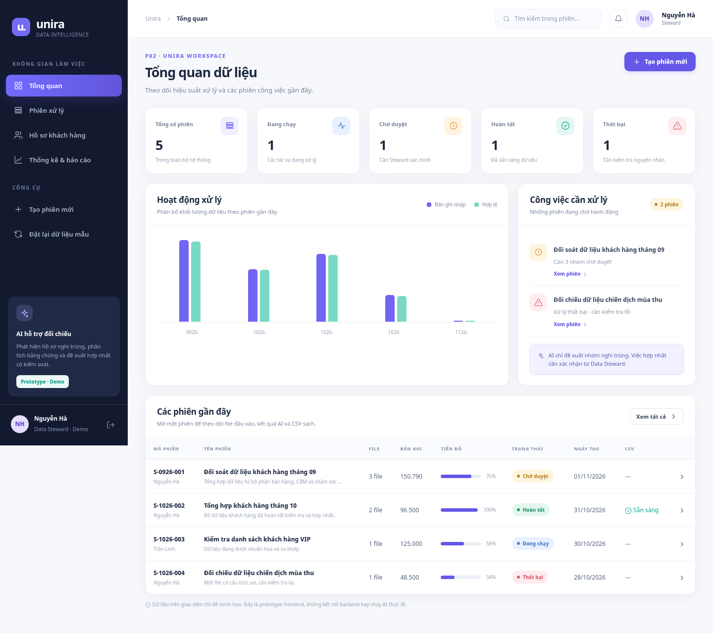
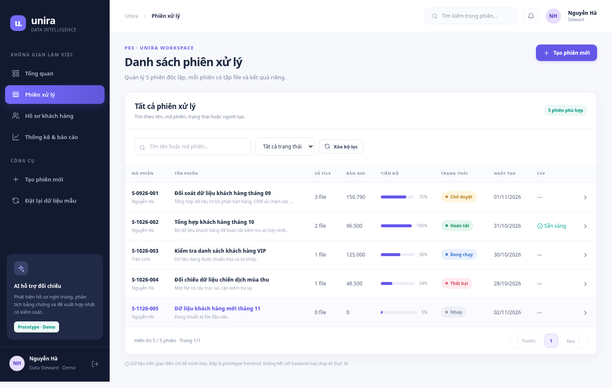
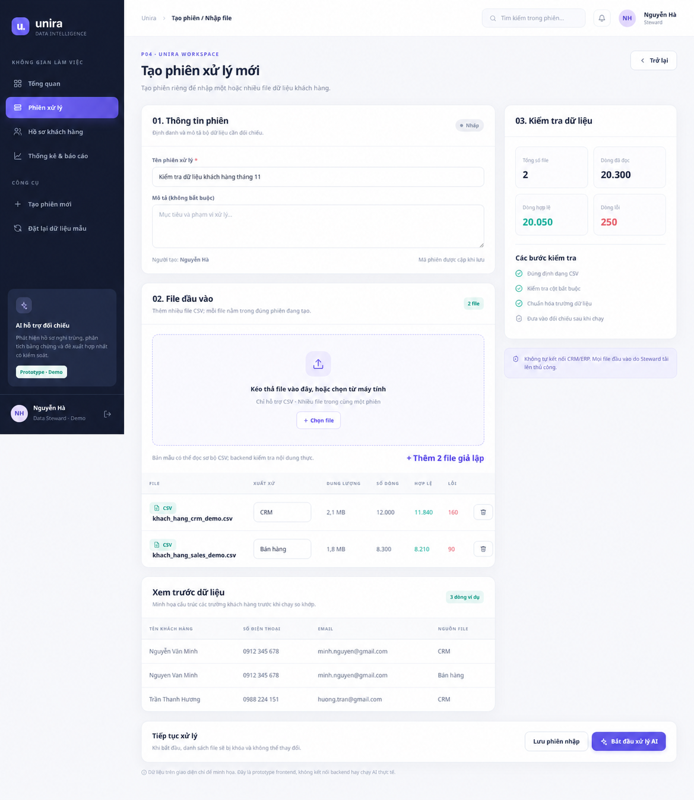
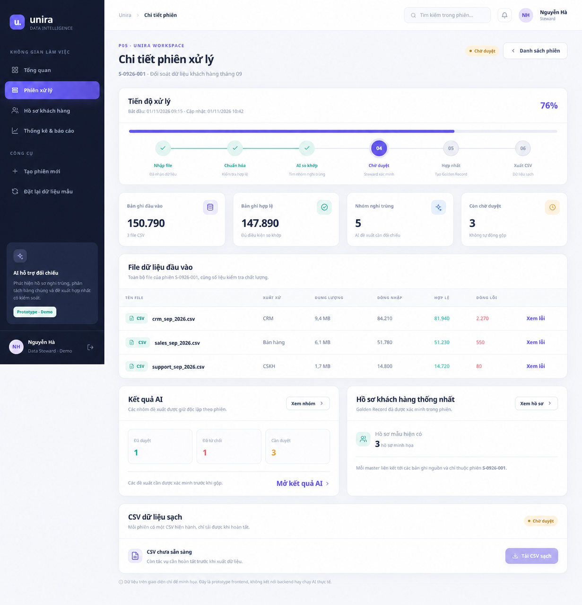
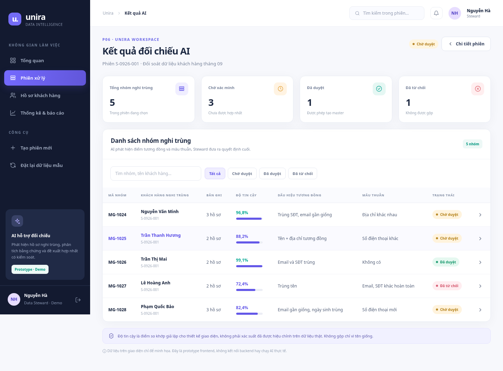
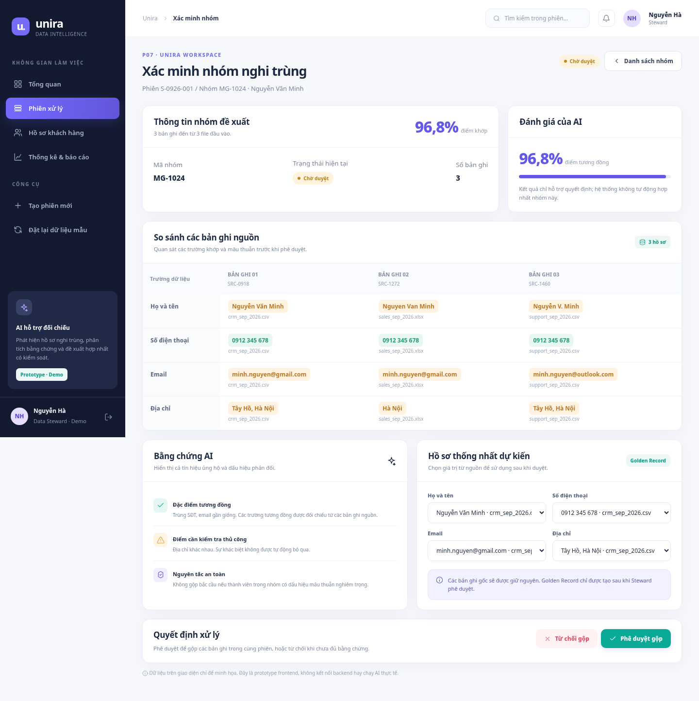
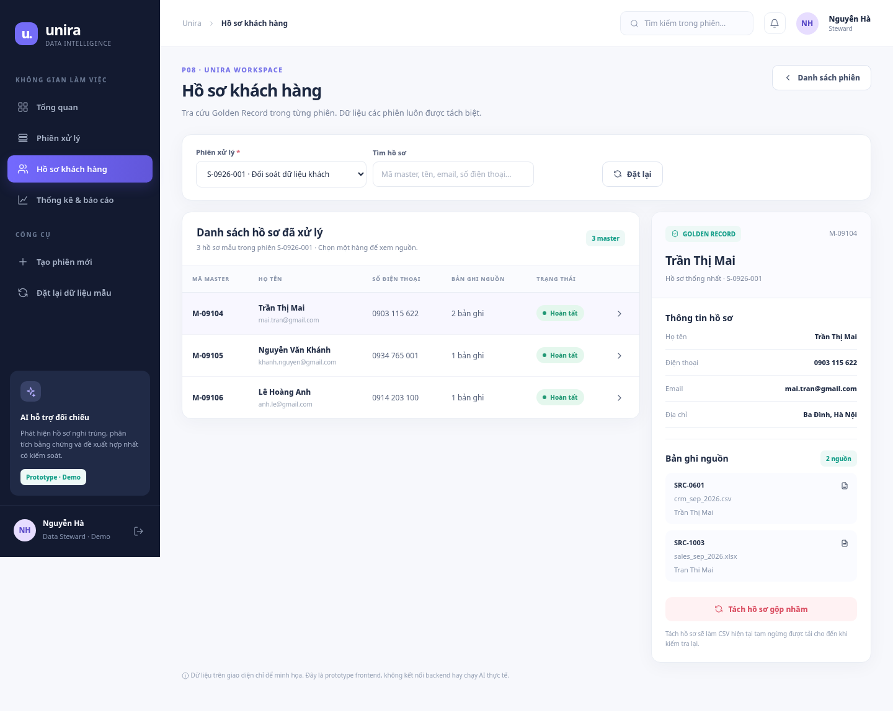
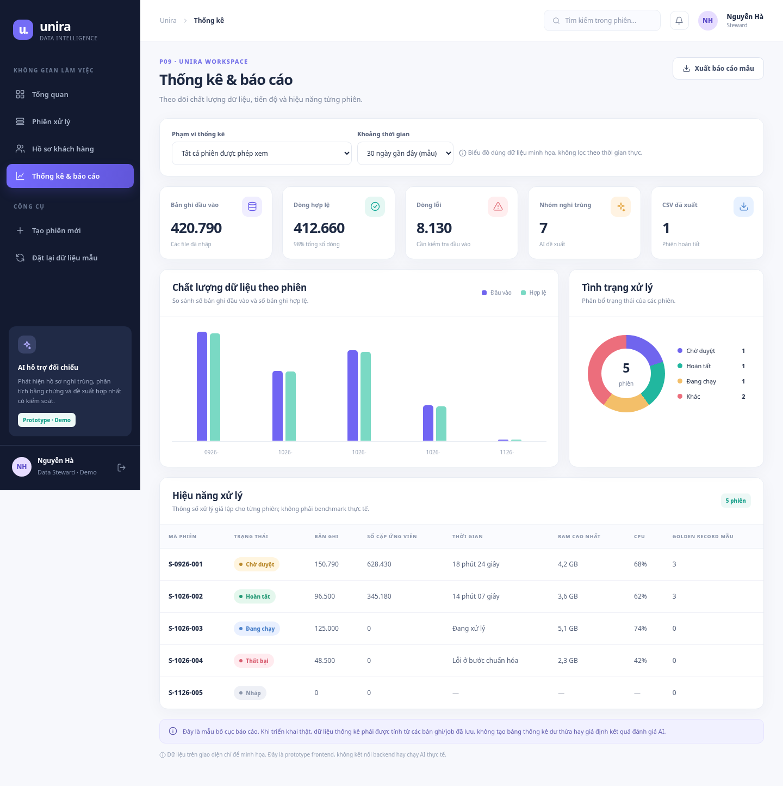

# Thiết kế UI/UX — Unira

[English version](./README.en.md)

Ảnh các màn hình P01–P09 được kết xuất từ prototype, là dữ liệu demo, chưa kết nối backend hay AI.

### P01 – Đăng nhập

### P02 – Tổng quan

### P03 – Danh sách phiên

### P04 – Tạo phiên / Nhập file

### P05 – Chi tiết phiên

### P06 – Kết quả AI

### P07 – Xác minh nhóm

### P08 – Hồ sơ khách hàng

### P09 – Thống kê

